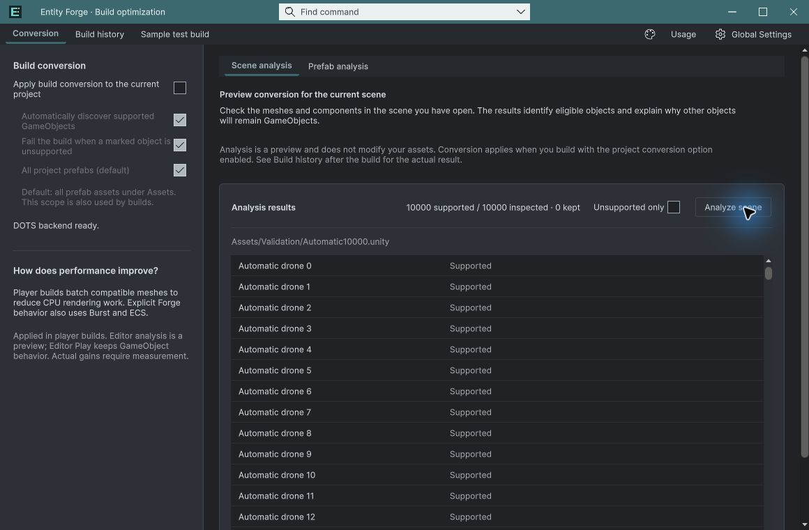
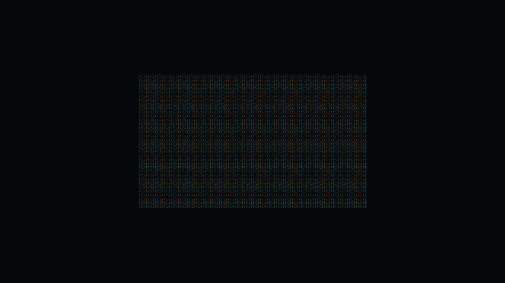

## 작업 결과

실제 변환·생명주기 검증 통과, 빌드 기록 교체 오류 수정. 성능 개선 검증은 미통과.

## 변경 내용

### 적용 내용

빌드 기록 파일의 일시적 교체 실패에 최대 250ms 재시도를 추가했습니다. 0.3.0-preview 패키지를 재생성하고 새 프로젝트에 재설치했습니다.

## 검증

Unity 6000.0.83f1 / Entities 1.3.15. 일반 GameObject 10,000개를 10,000개 엔티티로 자동 변환했습니다. 10회 드로 제출, 정지 Transform 쓰기 0회, 불필요한 시뮬레이션 0개를 확인했습니다. 동일 fingerprint·1280×720·600프레임의 실제 플레이어에서 OFF 16.7871ms / ON 17.0593ms로 약 1.62% 느렸습니다. 개선으로 판정하지 않습니다. 네이티브 이동·수명·활성/비활성·등록/해제·폴백 QA 통과. 수정 후 ON 빌드 errors=0. 샘플 제외 본체 UI 로드, 씬/빌드 설정 해시 보존 확인. 실제 마우스로 1만 목록 필터 축소/복원·선택/Inspector 이동·모서리 리사이즈 확인. [상세 검증](../assets/native-validation-20261103/verification.json)

## 남은 사항

성능 개선 원인/병목 프로파일링과 재측정, CPU/GPU·메모리 비교, 모든 언어·테마·최소화/재로드 네이티브 회귀 및 문서 화면 갱신은 남았습니다. 60FPS 부근 수렴 원인은 미확인입니다. 일반 MonoBehaviour 자동 번역, Resources/Addressables 로더 통합도 후속 범위입니다. 판매 완료로 처리하지 않습니다. 교훈 검토: 실제 개선율을 측정값 그대로 기록한다는 기존 전역 지침으로 충분하여 전역 변경 없음.

## 작업 시간

- 제안 시간: 20~40분 · 시작 2026-11-03 13:22:35 KST
- 실제로 완료된 시간: 검증 기록 작성 36분 · 2026-11-03 13:58:35 KST. 공개 배포는 이후 별도 확인.
- XERJ: 실패 — XERJ node is not running. rg와 현재 소스·실제 Unity 로그로 대조.
