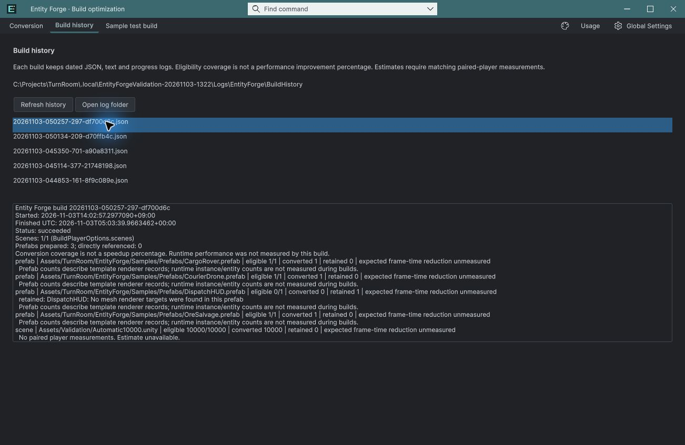
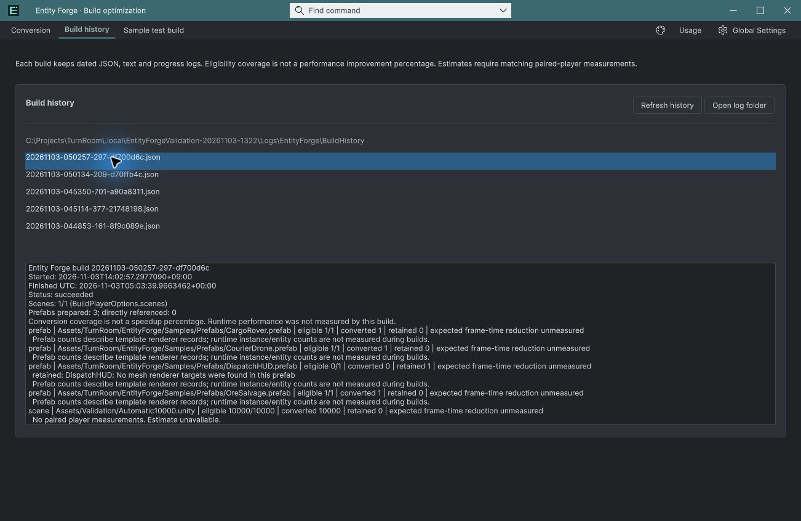

## 작업 결과

레이아웃 적용 및 실제 Unity 선택·테마 전환 확인

## 변경 내용

### 적용 내용

편집 가능한 UXML에 history-results-card를 추가하고 첫 탭과 배경·테두리·모서리·여백 스타일을 공유합니다. 설명은 박스 위에 유지하고 버튼은 박스 상단으로 옮겼습니다.

## 검증

새 프로젝트의 실제 Unity 6000.0.83f1에서 새 소스 로드, 밝은/어두운 테마 전환, 기록 선택 후 상세 로그 표시를 확인했습니다. UXML 구조 검사에서 목록과 상세 필드의 부모가 history-results-card임을 확인했습니다. 패키지 원본 바이트 대조 통과. 현재 캡처는 영어이며 다른 언어 배치의 신규 시각 검증은 하지 않았습니다.

변경 전: 목록과 로그가 분리되어 있었습니다.

변경 후: 제목·버튼·경로·목록·로그가 하나의 카드로 묶입니다.

## 남은 사항

이번 박스 배치 요청은 적용했습니다. 기존 성능 및 전체 출시 검증의 미완료 범위는 기존 메뉴얼에 보존합니다. 기존 문서 스크린샷 전체의 최신화는 완료로 표시하지 않습니다. 교훈 검토: 관련 조작과 결과를 같은 영역에 배치한다는 기존 UI 요구를 적용했으며 전역 지침 변경 없음.

## 작업 시간

- 제안 시간: 3~5분 · 시작 2026-11-03 14:10:29 KST
- 실제로 완료된 시간: UI 적용·실제 확인 약 3분 · 2026-11-03 14:13:20 KST. 공개 배포는 이후 확인.
- XERJ: 실패 — XERJ node is not running. rg와 실제 UXML·USS·현재 Unity로 확인.
