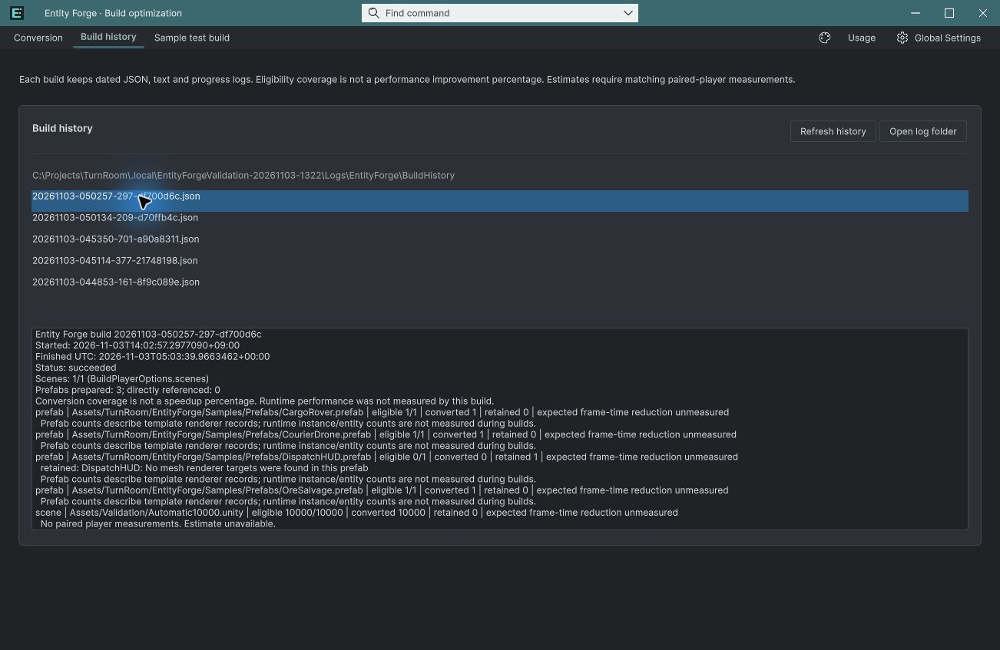
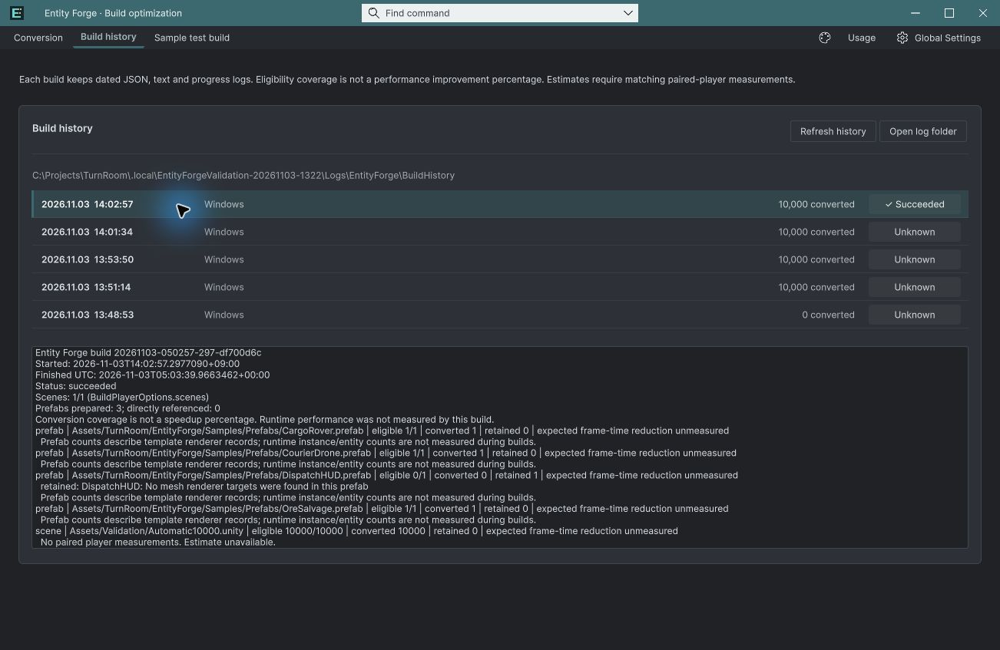

## 작업 결과

요약 행 적용 및 실제 선택/키보드/새로고침/테마 검증 통과

## 변경 내용

### 적용 내용

편집 가능한 ForgeHistoryRow.uxml과 고정 36px 행을 추가했습니다. 기록 JSON을 한 번 읽어 요약하고 원본 경로는 툴팁에 유지합니다. 선택 강조와 호버, 새로고침 선택 복원을 적용했습니다. 상태와 개수는 9개 언어 자원을 사용합니다.

## 검증

실제 Unity 6000.0.83f1에서 날짜와 JSON startedUtc 대조, 10,000개 변환 및 succeeded/unknown 상태 대조, 마우스 선택·키보드 Down·새로고침 선택 유지·밝은/어두운 테마 확인. 7개 새 문구의 9개 언어 및 {0} 인자 검사 통과. 캡처는 영어입니다. 기존 로그 파일을 수정하거나 빌드하지 않았습니다.

## 남은 사항

이번 목록 정리 요청은 적용했습니다. 기존 과거 기록의 unknown은 원래 기록값 그대로 표시합니다. 다른 언어 배치 전체의 시각 검증과 기존 전체 출시 검증은 완료로 표시하지 않습니다. 교훈 검토: 내부 파일명 대신 사용자가 판단할 정보를 표시하는 기존 UX 요구를 적용했습니다. 전역 변경 없음.

## 작업 시간

- 제안 시간: 3~5분 · 시작 2026-11-03 14:17:46 KST
- 실제로 완료된 시간: 구현·실제 확인 약 3분 12초 · 2026-11-03 14:20:58 KST. 공개 배포는 이후 확인.
- XERJ: 실패 — XERJ node is not running. rg와 실제 UXML·USS·현재 Unity로 확인.
