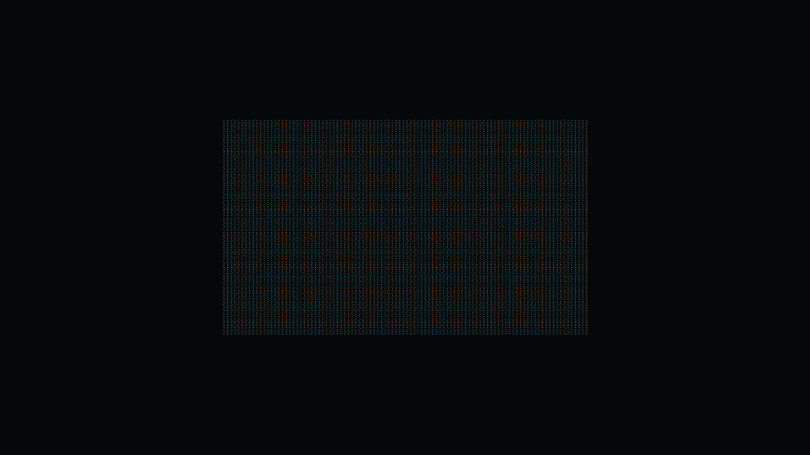
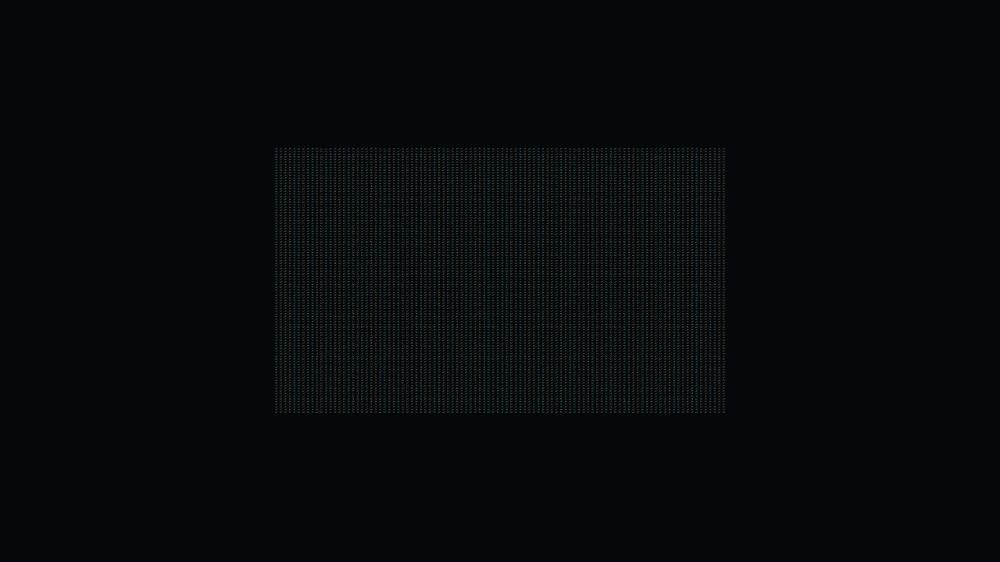

## 작업 결과

자동 대상의 매 프레임 DOTS 프록시 동기화를 네이티브 Renderer 인스턴싱과 공유 재질 동기화로 교체했습니다. 명시적 Forge 이동·수명·스폰은 DOTS/Burst를 유지합니다. 성능 수정·실제 반복 측정·프리팹 수명 회귀·최종 패키지 설치/샘플 제거 컴파일을 통과했습니다. 제품 전체의 출시 QA와 판매 초안 저장은 별도입니다.

## 변경 내용

### 적용 내용

**확인한 병목**: 기존 자동 모드는 원래 Renderer를 남기면서도 10,000개 속성을 다시 조회했고, 구 프록시 진단에서 동기화가 평균 8.1414ms였습니다. 새 경로는 개체별 조회·프록시 엔티티를 만들지 않고 엔진의 컬링·변환·렌더러 변경 처리를 사용합니다. 같은 재질의 속성만 한 번씩 확인하며 새 드론 경로의 동기화는 평균 0.0026ms였습니다.

원본 에셋을 수정하지 않고 빌드/런타임 재질 복사본을 사용합니다. 재질 변경 전파, 사용자 교체 유지, 비활성·재활성·해제·원래 재질 복원을 검증했습니다. 프리팹도 같은 네이티브 경로를 공유합니다. 일반 MonoBehaviour 자동 번역 기능을 추가한 것은 아닙니다.

실제 측정 JSON에 드로우 콜·삼각형·메모리를 추가하고 엔티티/네이티브 렌더러 혼합 개체 수를 검증합니다. 다른 부하를 섞은 측정 및 누락된 네이티브 개체 수는 거부합니다. 9개 가이드를 현재 자동 경로와 GPU 부하 한계에 맞춰 수정했습니다.

## 검증

**실제 프레임 시간 — 3회 평균, 낮을수록 좋음**

| 부하 | OFF | ON | 프레임 시간 감소 |
| --- | --- | --- | --- |
| 원본 드론 10,000개 | 14.9838ms | 14.5818ms | **2.68%** |
| 별도 경량 광석 10,000개 | 9.3457ms | 2.5174ms | **73.06%** |

Windows x64 / Unity 6000.0.83f1 / Entities 1.3.15 / Built-in / i5-12400F / GTX970 / 1280×720. 각 OFF/ON을 교차 순서로 3쌍, 매 실행 180 워밍업 후 포그라운드 600프레임을 수집했습니다. 최종 비교는 인접한 12회 실행만 사용하며, 장시간 도구 대기 전후의 초기 진단 실행은 평균에서 제외했습니다. 두 플레이어의 실제 Runtime DLL 해시도 동일합니다. 이 퍼센트는 FPS 증가율이 아닌 프레임 시간 감소율입니다.

드론 드로우 콜 **10,002→24**, 광석 **101→24**. 각 쌍의 삼각형 수는 **23,480,004 / 1,000,004**로 각각 동일합니다. 개체를 줄이거나 LOD·형상 단순화를 넣지 않았습니다. 광석은 별도의 부하 ID를 사용하며 그 결과를 드론 씬의 예측값으로 적용할 수 없습니다. 드론의 GPU 시간은 여전히 약 14.5ms이며, 별도 NVIDIA 진단 실행의 안정 구간 GPU 사용률은 98~99%였습니다. 이 진단용 추가 실행은 성능 평균에 포함하지 않았습니다.

**실제 Unity 플레이어 화면 — 전후 RGB 픽셀 차이 0개**

원본 PNG는 각각 50~59KB이며 편집·대체 이미지를 만들지 않았습니다. 네 장을 실제 크기로 확인하고 1280×720 RGB 픽셀을 읽기 전용으로 비교했습니다. 이 화면은 검증용 플레이어이며 에디터 UI 검증 화면이 아닙니다.

**회귀·설치**: 12개 실제 플레이어 실행에서 프리팹 50개 생성, 25개 비활성/재활성, 50개 해제를 통과하고 워밍업 전에 대상 수를 복원했습니다. 네이티브 재질/수명 및 기존 DOTS 이동·수명·폴백 회귀를 실제 Unity에서 3회 반복했습니다. 단독 에디터 QA의 전역 EntityStore 정리 누락은 프로젝트 QA 초기화로 수정했고 종료 할당 경고가 사라졌습니다. 외부 패키지 소스는 읽기만 했습니다.

7개 현재 어셈블리 컴파일, 9언어 515항목 인자 검사, 9개 가이드/126개 링크, 408개 패키지 원본 대조 통과. 고정된 최종 패키지를 실제 ImportPackage로 설치하고 407개 비설정 자산 읽기 대조 후, 새 Unity 프로세스에서 Samples/Development가 없는 Runtime·Editor·DOTS 컴파일과 측정 가져오기를 통과했습니다. 공유 테마 설정은 임포트 가드가 보존했습니다.

[검증 요약·12회 원시 데이터 해시](../assets/native-performance-20261104/verification.json) · [컴파일 근거](../assets/native-performance-20261104/compiled-source-hashes.json) · [GPU 진단 원시 자료](../assets/native-performance-20261104/gpu-telemetry.json) · [네이티브 설치 대조](../assets/native-performance-20261104/package-native-readback.txt) · [샘플 없는 본체 검사](../assets/native-performance-20261104/core-without-samples.txt) · [측정 인구/부하 검증](../assets/native-performance-20261104/measurement-import.txt) · [실패와 복구 기록](../assets/native-performance-20261104/attempts.txt).

카운터 의미는 [Unity 6000.0 공식 Profiler 카운터 문서](https://docs.unity3d.com/kr/6000.0/Manual/profiler-counters-reference.html)를 따릅니다.

## 남은 사항

측정한 두 부하·이 하드웨어 범위에서 개선을 확인했습니다. GPU 비용이 큰 씬에 73%를 일반화하지 않습니다. 에디터의 실제 9언어/밝고 어두운 테마·마우스/키보드 선택·레이아웃 회귀, 최신 문서 에디터 캡처와 공식 Asset Store Validator, 실제 판매 초안 저장/재열기는 출시 전 남은 작업입니다. Computer Use의 앱 접근 승인은 시간 초과되어 이번에는 실제 플레이어 캡처와 네이티브 검사로 성능을 검증했으며, 물리 입력 UI 검증을 통과한 것으로 표시하지 않았습니다. Submit은 하지 않았습니다.

교훈 검토: Entities 1.3.15 단독 QA 부트스트랩과 비동기 ImportPackage 완료 대기는 프로젝트 Architecture에 기록했습니다. 기존 전역 근거·산출물·권한 규칙과 중복되므로 전역 AGENTS 변경 없음.

## 작업 시간

- 제안 시간: 40~70분 · 시작 2026-11-04 05:29:04 KST
- 실제로 완료된 시간: 7시간 2분 0초 · 2026-11-04 12:31:04 KST. 승인/도구 대기 포함; 처음 예상 40~70분을 초과했습니다. 공개 배포 확인은 이후 별도 기록합니다.
- XERJ: 실패 — Xerj.ps1 Status: XERJ node is not running. rg와 현재 소스/실행 로그로 대조했습니다.
