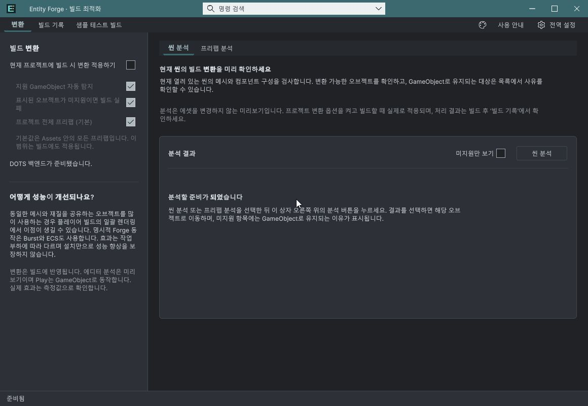
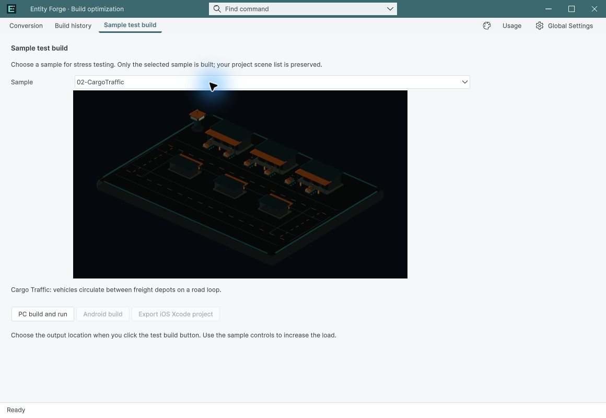
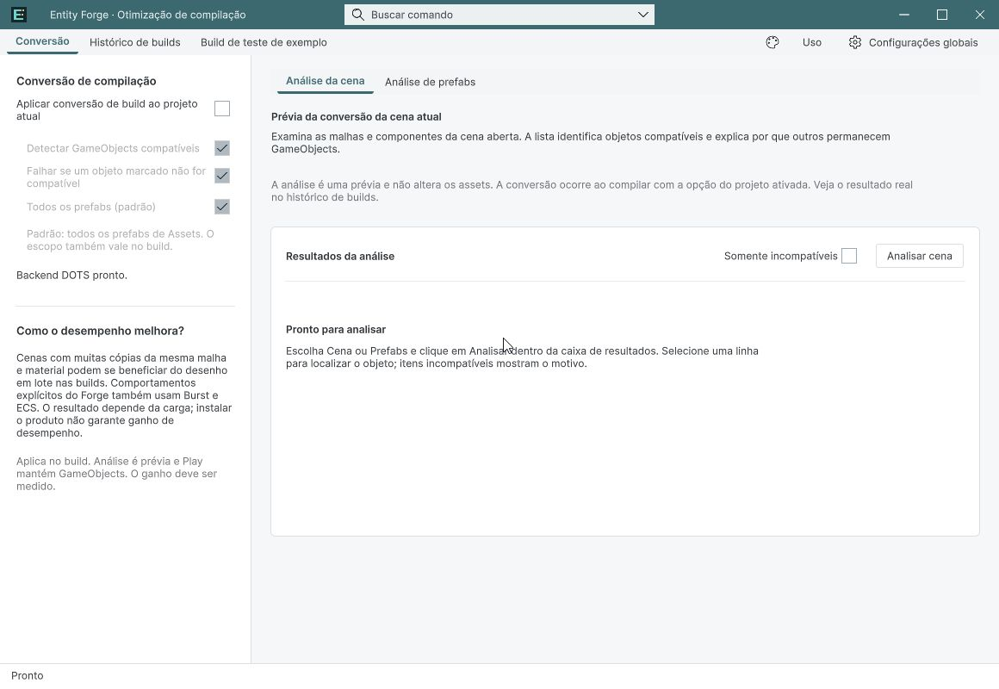

## 작업 결과

UI QA·공식 Validator·판매 설명/번역 저장과 로컬 패키지 검증은 끝났습니다. 공식 업로드 Success 후 포털이 0 files로 표시하고 원격 다운로드 확인이 시간 초과되어, 제출 가능 상태의 최종 원격 확인은 미완료입니다. Submit은 누르지 않았습니다.

## 변경 내용

### 적용 내용

공유 팝업이 키보드 NavigationSubmitEvent를 통해 Unity 기본 메뉴를 여는 경로를 차단했습니다. 빌드 완료 기록은 즉시 처리와 에디터 종료 훅으로 확정해 CI -quit에서 진행 중으로 남는 문제를 수정했습니다. 문서 9언어에 현재 창 캡처 18장을 갱신했습니다.

## 검증

Unity 6000.0.83f1, 실제 설치본에서 장면/프리팹 분석, 미지원 필터·선택 유지, 창 크기 조절, 기본 OFF와 하위 옵션, 밝고 어두운 선택/키보드 반환·취소를 확인했습니다. 9언어 전환·2테마는 공유 언어 API로 설정한 실제 창을 촬영해 검사했습니다. 모든 Inspector의 모든 조합을 검사한 의미는 아닙니다. 새 프로세스 재열기와 스크립트 재로드 후 커스텀 창 유지 확인. 공식 Asset Store Tools 11.3.1: 28 pass, 1 warning(문서 JPG), 0 fail. 실제 이전 BuildReport를 사용한 즉시 완료 및 batch -quit 종료 기록 검사 통과; 새 플레이어 빌드는 실행하지 않았습니다. 영어·한국어·일본어·중국어 설명/기술정보/AI와 출시 기록 저장 후 전체 새로고침 대조.

변경 전 기본 메뉴 노출은 실제 관찰했으나 해당 순간 파일 캡처는 보존하지 못했습니다. 전후 비교 검증 완료로 표시하지 않습니다. 기존 성능 근거는 이전 실측 보고서를 따르며 개선율을 모든 프로젝트에 일반화하지 않습니다.

최종 고정 SHA-256: 83f4db12aa0087fdccae802fd345d1231b6a767704c6ce1eb4c2940cee8e29f1, 26,312,954 bytes, 428 assets. Unity 네이티브 가져오기 완료 이벤트 및 427개 비설정 자산 바이트 일치, 이후 새 프로세스 공식 검사 28/1/0 통과. 초안 가격 Free 유지. [공식 검사](../assets/release-qa-20261104/official-validator.json) · [패키지 대조](../assets/release-qa-20261104/final-package-audit.json)

## 남은 사항

최종 원격 확인 미완료: 공식 업로드 Success인데 포털은 2026-11-04 05:58 UTC / 0 files / 25.1 MB로 표시했습니다. 로컬 패키지는 428개이며 네이티브 가져오기까지 통과했습니다. 원격 Download 확인은 도구 시간 초과 후 브라우저 연결이 해제되었습니다. 원인 미확인으로 서버 지연 또는 패키지 결함이라 단정하지 않습니다. 포털 재연결 후 원격 패키지 내용 확인이 필요합니다. Submit 미실행.

검증 환경은 Windows x64/Built-in/Entities 1.3.15입니다. 다른 플랫폼과 파이프라인은 미검증입니다. 교훈 검토: 별도 NavigationSubmit 경로와 CI 종료 전 기록 확정은 프로젝트 근거로 보존하며 기존 전역 검증 지침과 중복되어 AGENTS 변경 없음.

## 작업 시간

- 제안 시간: 30~60분 · 최초 시작 2026-11-04 12:41:55 KST; 재개 예상 15~25분 + 추가 10~15분
- 실제로 완료된 시간: 현재 작업 검증 기록 시각 2026-11-04 15:07 KST. 최초 시작 12:41:55부터 약 2시간 25분 경과, 재개 14:12:46부터 약 54분 경과. 전체 작업은 원격 확인이 남아 미완료이며 완료 시각으로 기록하지 않습니다. 최초 30~60분 예상을 초과했습니다.
- XERJ: 실패 — XERJ node is not running. 현재 소스는 rg로 확인했습니다.
