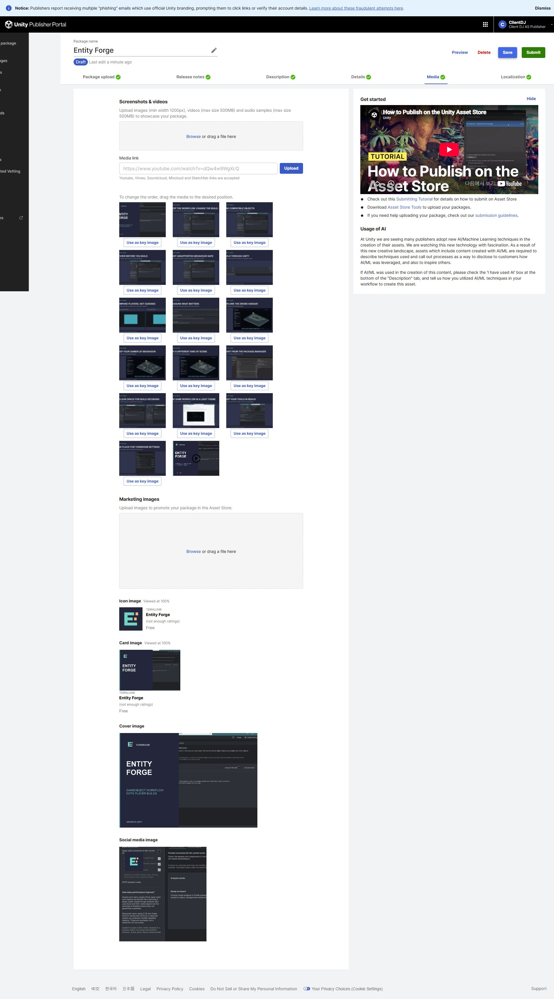

## 작업 결과

네 지원 로케일에 동일한 미디어가 저장됐으며 최종 제출은 하지 않았습니다.

## 변경 내용

### 적용 내용

후: 저장 후 재열어 확인한 실제 포털.

## 검증

갤러리16개 서버 원본을 다시 내려받아 준비된 PNG16개의 SHA256 집합과 완전 일치했습니다. 기존 미디어를 제거하여 최종16장·영상1개만 보존했습니다. 새 영상은 실제 서버 플레이어 readyState4에서 약70초 끝까지 재생됐습니다.

영어·한국어·일본어·중국어 저장값 재조회: 이미지16장·영상1개, 아이콘 주소 일치. Draft 및 기존 가격 유지. [서버 저장값](../assets/store-media-final-20261105/1541570-after.json) · [갤러리 검증](../assets/store-media-final-20261105/content-verification.json) · [아이콘 픽셀 대조](../assets/store-media-final-20261105/icon-pixel-verification.json).

아이콘512px 원본을 포털 기본 자르기에 넣으면 중앙160px만 잘려 초기 저장에서 확대됐습니다. 이를 실제 화면에서 발견하고 실제 Affinity에서160px 전체 로고로 다시 렌더링·업로드했습니다. 서버가 투명 바깥 영역을 흰색으로 합성하여 원본 PNG 바이트·알파 동일성은 통과가 아닙니다. 최종 화면에서 전체 심볼과 여백을 직접 확인했습니다.

## 남은 사항

기한5분을 초과했습니다. 파일 선택 연결 시간 초과, 구미디어 삭제 완료 대기와 아이콘 잘림 수정이 실제 지연 요인입니다. 영상 전체 음성의 실제 청취 QA는 이번 회차에 완료하지 않아 품질 최종 통과로 처리하지 않았습니다. 이번 회차 변경 전 화면을 별도로 확보하지 못했으며 전후 화면 비교 완료로 표시하지 않습니다. 교훈 검토: 기존 지침의 실제 서버 저장값·아이콘 자르기 검증 규칙을 적용했으며 중복 전역 규칙은 추가하지 않았습니다.

## 작업 시간

- 제안 시간: 5분
- 실제로 완료된 시간: 2026-11-05 13:57:38 KST 시작. 최종 업로드 저장값 확인14:16:20 KST,18분42초. 내용 해시·영상 재생·보고서 공개 확인은 이후 계속 수행.
- XERJ: 미사용 — 미디어 업로드와 저장값 대조로 코드 검색 불필요.
