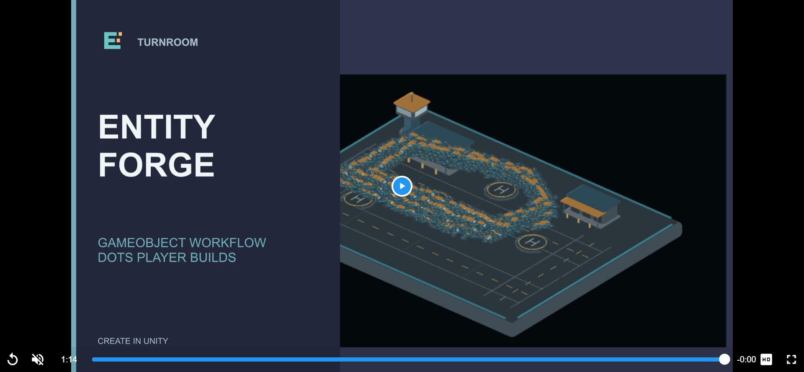

## 작업 결과

새 영상 1개가 네 지원 로케일 모두 첫 번째에 저장됐습니다. 실제 Unity 플레이어에서 종료까지 재생됐습니다.

## 변경 내용

### 적용 내용

기존 중간 실제 촬영 6구간은 보존하고, 실제 Affinity에서 만든 새 도입·종료 화면으로 바꿨습니다. 새 게임플레이 촬영 작업은 아닙니다.

[새 MP4](../assets/video-refresh-20261105/EntityForge-Promo-20261105-r1.mp4) · [파일 해시·구간 근거](../assets/video-refresh-20261105/Manifest.json)

## 검증

새 영상 길이는 약 75초입니다. 전체 디코딩·오디오 신호 검사를 통과했습니다. 실제 포털 플레이어의 readyState=4, ended=true를 확인했습니다. [재생 결과](../assets/video-refresh-20261105/playback.json)

이전 영상은 제거했고 영상1개·이미지16개를 유지했습니다. 영어·한국어·일본어·중국어 저장값에서 새 영상 우선 순서와 Cipher / Kevin MacLeod / CC BY 3.0 / 원본 링크 / 편집 고지를 확인했습니다. [포털 저장값](../assets/video-refresh-20261105/1541570-after.json) · [음악 권리](../assets/video-refresh-20261105/MUSIC-CREDITS.txt)

## 남은 사항

실제 전체 오디오 청취는 미검증이며 음질 QA 통과로 표시하지 않습니다. 심사 제출은 아직 하지 않았습니다. Pixora 새 패키지는 업로드 성공 후 Unity 서버 처리 중입니다.

교훈 검토: 이미지뿐 아니라 영상 자체의 첫·끝 화면과 저장된 플레이어를 대조합니다. 기존 전역 실제 결과 검증 규칙에 포함되므로 중복 규칙을 추가하지 않았습니다. Affinity 작업 사본3개는 저장·재열기 검증 후 닫았고 사용자 기존6문서는 보존했습니다.

## 작업 시간

- 제안 시간: 5~10분 (동일 미디어 수정 작업 최초 예상)
- 실제로 완료된 시간: 4466초 경과, 2026-11-05 16:12:54 KST 기준. 영상 교체·시각 재생 검증 완료, 청취·제출 미완료.
- XERJ: 미사용 — 미디어 편집·포털 저장값 검증으로 코드 검색 불필요.
