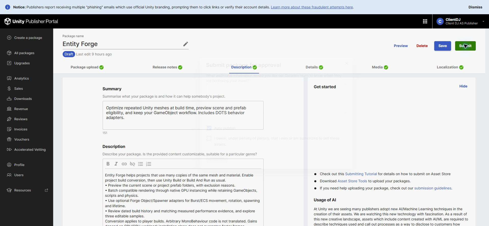
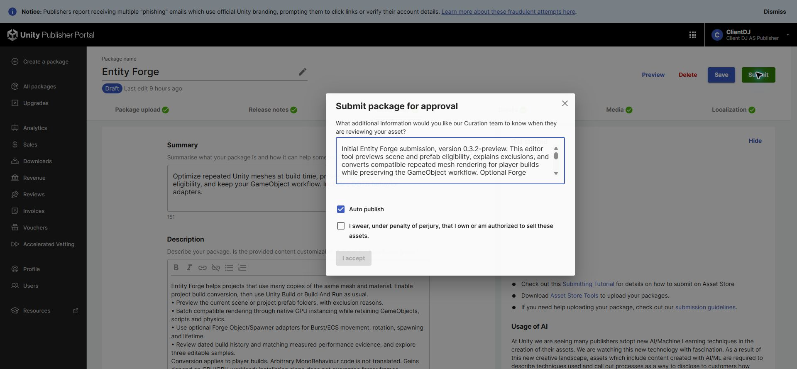

## 작업 결과

심사팀 전달 사유를 입력한 제출 창을 브라우저 탭에 유지했습니다. 최종 제출과 법적 소유권 선서는 실행하지 않았습니다.

## 변경 내용

### 적용 내용

Initial Entity Forge submission, version 0.3.2-preview. This editor tool previews scene and prefab eligibility, explains exclusions, and converts compatible repeated mesh rendering for player builds while preserving the GameObject workflow. Optional Forge Object/Spawner adapters handle supported movement, rotation, spawning and lifetime through Burst/ECS; arbitrary MonoBehaviour code is not translated. Verified scope: Windows x64, Unity 6000.0.83f1, Built-in Render Pipeline and Entities 1.3.15. Required Unity packages are installed by the user through Package Manager. Other platforms and render pipelines have not been validated. Includes nine interface languages, offline documentation, three optional editable samples and dated build/measurement records. Performance depends on workload; no blanket frame-rate improvement is promised. Runtime Resources, Addressables and AssetBundle loading require dedicated integration. AI assistance is disclosed in the listing.

## 검증

현재 제품명·버전·Draft 상태와 저장된 설명/변경 이력을 직접 확인했습니다. 입력 후 DOM에서 전체 사유 문구, 미선택 소유권 선서, 비활성 I accept를 확인했습니다.  

## 남은 사항

심사 사유는 열린 제출 창에 입력된 상태입니다. 제출 전 서버 저장 여부는 미확인으로, 창을 닫거나 새로고침하면 사라질 수 있습니다. 바이너리 재업로드·재검증은 이번 요청 범위에 포함하지 않았습니다. 교훈 검토: 초안 저장과 제출 창 입력 상태를 구분하는 기존 지침 적용, 전역 변경 없음.

## 작업 시간

- 제안 시간: 3~5분
- 실제로 완료된 시간: 시작 2026-11-06 01:27:56 KST, 사유 입력 완료 01:29:36 KST, 약1분40초. 중앙 보고서 공개 확인 별도.
- XERJ: 미사용 — 코드 검색 불필요 — 실제 판매 페이지의 설명과 변경 이력 대조.
