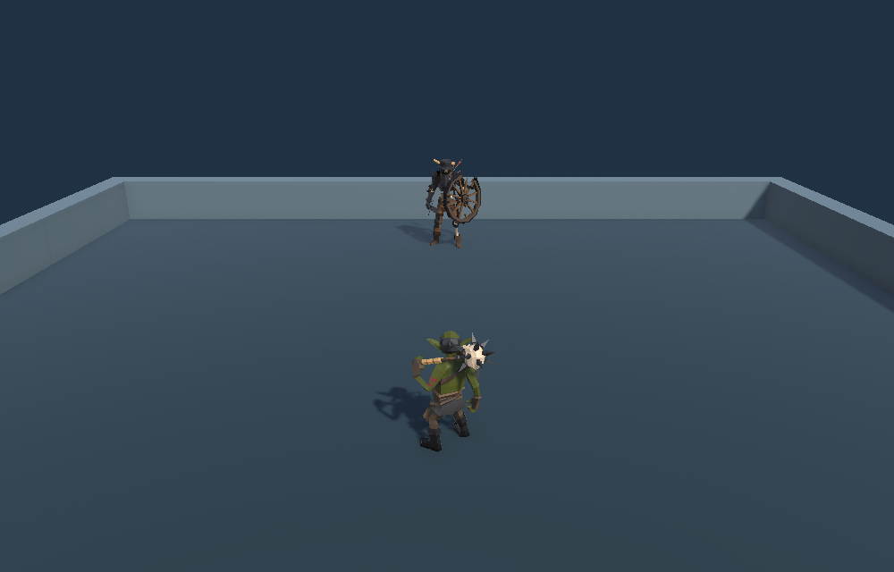
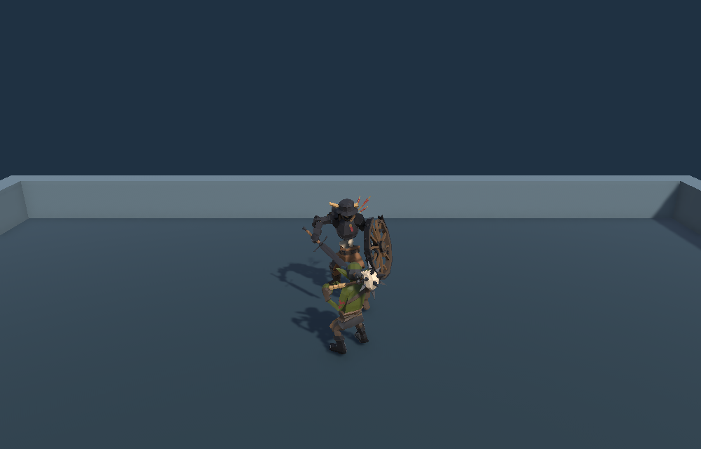
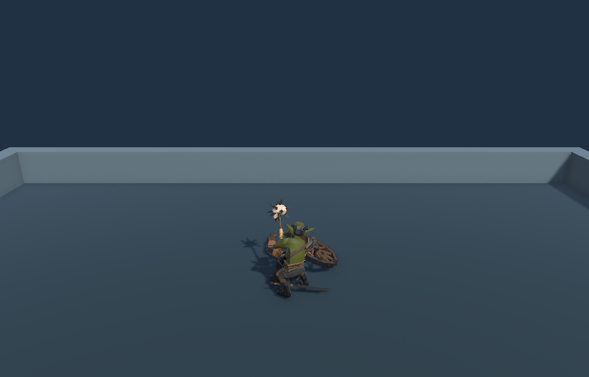

## 목표와 완료 기준

신규 구매 없이 고블린 플레이어와 스켈레톤 적을 배치하고 모체 구조를 검토합니다.

완료 기준: Unity에서 이동·추격·공격·피격·사망·재시작을 확인하고 씬과 문서를 보존합니다.

후속 2회차 · 순차 진행 · 전체 3개 · 이번 실행 T01, T02, T03

## 순차 작업 메뉴얼

| 순서 | 작업 | 실행 절차 | 완료 기준 | QA 절차 | 상태 |
| --- | --- | --- | --- | --- | --- |
| T01 | 대화·모체·기존 에셋 검토 | 공유 대화와 로컬 모체 코드, 크리처 프리팹을 읽습니다. | 기존 플레이어와 상대 모델을 선정하고 가져올 구조를 정합니다. | 프리팹 참조와 모체 컨트롤러·Pawn 의존성을 대조합니다. | 완료 |
| T02 | 전투 씬 구성 및 실행 | 두 Pawn, 입력·AI, 카메라, 운동장을 씬에 연결합니다. | Playground에서 근접 전투와 재시작이 작동합니다. | 저장·재열기한 씬에서 가상 키보드 상태를 게임 프레임에 적용하고, 사거리 도달 이후 양쪽 피해와 스켈레톤 사망·재시작을 검증합니다. | 완료 |
| T03 | 문서 및 기록 검증 | README와 Dosc를 갱신하고 공개 아카이브용 결과를 등록합니다. | 플레이 조작, 구조, 검증과 보고서 본문이 열립니다. | 문서 링크·그림·내비게이션과 공개 결과 HTML을 확인합니다. | 완료 |

### T02 · 전투 씬 구성 및 실행 · 화면 대조

## QA 반복 기록

### Q01 · step · 2026-11-09T15:32:23+09:00

공유 대화와 프로젝트 구조 검토

- T01 r1 · pass: 기존 에셋과 모체 역할 분리를 확인했습니다. · 근거: CTL_Humanoids 컨트롤러, 고블린·스켈레톤 프리팹 참조, SampleProjectForUnity PawnController·Pawn·AIController 소스
### Q02 · step · 2026-11-09T15:43:04+09:00

재검증 전까지 관찰한 프로젝트 잠금과 배치 입력·미세 이동 실패 정리

- T02 r1 · fail: 첫 실행은 프로젝트 잠금으로 차단됐고, 격리 배치 실행에서 가상 입력과 미세 이동 문제로 이동·추격 검사가 실패했습니다. · 근거: UnityLockfile 공유 위반, Keyboard movement failed, Monster chase failed 및 씬 m_MinMoveDistance 0.001
### Q03 · regression · 2026-11-09T15:44:01+09:00

씬 설정 조정 후 저장·재열기와 전체 전투 재실행

- T02 r2 · pass: 이동·추격·헛스윙·양쪽 피해·사망·R 재시작이 통과했습니다. · 근거: Unity 6000.0.83f1 FANTASYA_QA_PASS, 저장한 씬·소스·머티리얼·스크린샷 해시 대조
### Q04 · final · 2026-11-09T15:48:42.3658659+09:00

모든 작업의 현재 버전과 결과 공개 확인

- T01 r1 · pass: 기존 에셋과 모체 역할 분리를 확인했습니다. · 근거: CTL_Humanoids 컨트롤러, 고블린·스켈레톤 프리팹 참조, SampleProjectForUnity PawnController·Pawn·AIController 소스
- T02 r2 · pass: 이동·추격·헛스윙·양쪽 피해·사망·R 재시작이 통과했습니다. · 근거: Unity 6000.0.83f1 FANTASYA_QA_PASS, 저장한 씬·소스·머티리얼·스크린샷 해시 대조
- T03 r1 · pass: 로컬 문서와 공개 결과가 확인되었습니다. · 근거: 로컬 경로·앵커 58개 및 내비게이션 검사, Tracefolio verify.mjs, 공개 보고서·카탈로그·PNG 3개 GET 및 PNG SHA-256 일치

## 남은 작업과 다음 반복

Standalone·웹 빌드 및 실물 입력 장치 테스트는 이번 Play Mode 검증 범위 밖입니다.

이전 회차: [메뉴얼 열기](../../../projects/fantasya/reports/2026-11-09-manual-20261109063447729-v1.0.0.html)

## 작업 시간

- 제안 시간: 15~25분 · 2026-11-09 15:28:35 KST 시작
- 실제로 완료된 시간: 20분 6초 · 2026-11-09 15:48:42 KST 공개 결과 확인 기준
- XERJ: 미사용 — MCP와 프로젝트 검색 실행 경로가 확인되지 않아 rg로 대체
