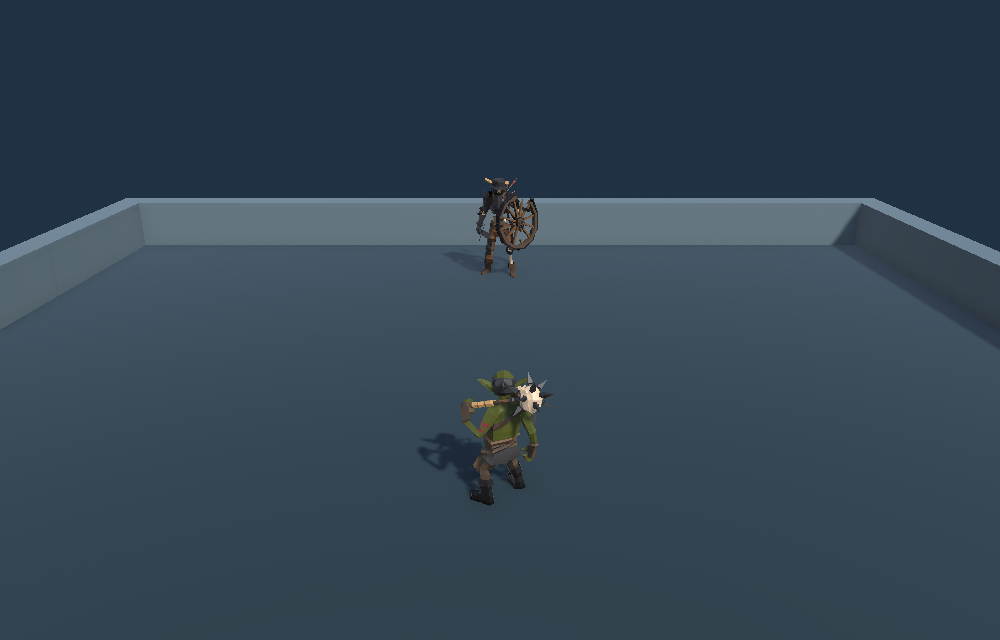
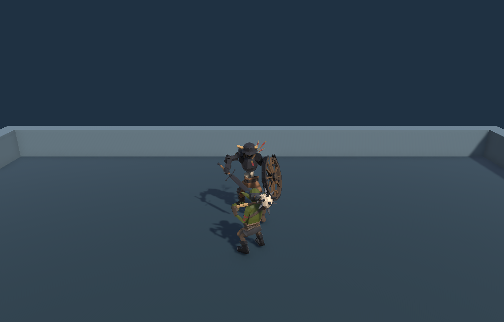
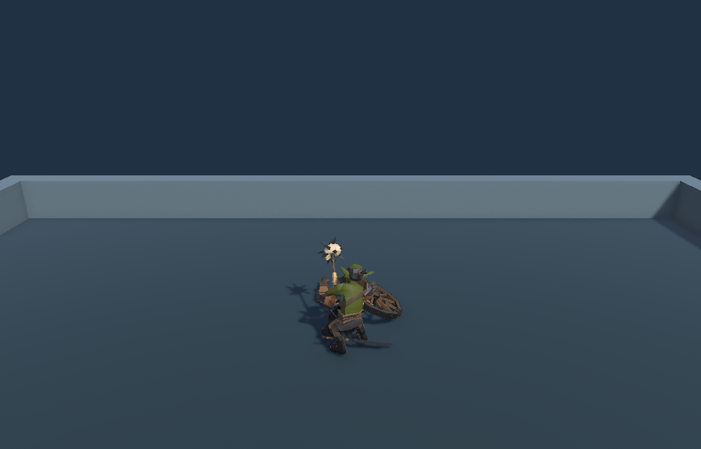

## 작업 결과

Playground에서 고블린 전사를 조작해 스켈레톤 병사와 싸울 수 있습니다. 스켈레톤은 접근을 감지해 추격하고, 양쪽 모두 공격·피격·사망 처리가 적용됩니다.

## 변경 내용

### 적용 내용

- WASD·방향키로 이동, Space·왼쪽 클릭으로 공격, R로 재시작합니다.
- 모체의 Pawn과 컨트롤러 분리를 적용했습니다. 모체 Pawn의 장비·버프와 AI의 Behavior·NavMesh는 이 장면의 요구보다 넓어 별도 의존 없이 구성했습니다.
- 기존 모델과 Animator를 자식 프리팹으로 연결했습니다. 공용 코드 반영 후보 없음. README와 로컬 HTML 문서를 갱신했습니다.

### 대화 기록

1. 사용자 · “일단 몬스터와 플레이어를 기준으로 간단하게 만들어볼래?” 기존 에셋 사용 및 SampleProjectForUnity 구조 검토를 요청했습니다.
2. Codex · 프리팹 참조를 확인해 고블린 전사를 플레이어, 스켈레톤 병사를 상대로 선정했습니다.
3. Codex · 열린 Unity 프로젝트를 보존하고 격리 복사본에서 씬을 저장·재열기하고 실행했습니다.

발언 시각은 미기록입니다. 공유 대화에서는 구매 대기 중 임시 리소스로 개발을 시작한다는 맥락을 확인했습니다.

## 검증

- Unity 6000.0.83f1에서 저장·재열기한 씬의 헛스윙, 가상 키보드 이동, AI 추격·공격, 플레이어 공격, 적 사망·충돌 해제 및 R 재시작을 확인했습니다.
- 프로젝트 적용본의 씬·메타·머티리얼·소스 해시를 격리 검증본과 대조했습니다. README·HTML 파일 링크와 앵커, 목차 전환 및 역방향 전환을 검사했습니다.
- 전 화면은 초기화 직후 Playground 씬이 없어 동일 조건으로 촬영할 대상이 없었습니다. 아래 이미지는 Unity Play Mode의 실제 카메라 출력입니다.
- 교훈 검토 결과 기존 격리 검증·외부 원본 보존 규칙을 적용했습니다. 전역 지침 변경 없음.

시작 위치에서 두 캐릭터를 확인했습니다.

플레이어와 몬스터가 근접한 상태입니다.

스켈레톤 처치 후 상태입니다.

## 남은 사항

Standalone·웹 빌드 및 실물 마우스·키보드 수동 플레이는 미실행입니다. 공개 보고서에는 실행 화면과 설명을 포함하며 Fantasya 프로젝트 소스는 로컬 적용했습니다.

## 작업 시간

- 제안 시간: 15~25분
- 실제로 완료된 시간: 15분 48초 · 2026-11-09 15:44:24 KST 로컬 적용·검증 기준
- XERJ: 미사용 — XERJ MCP·실행 경로 미확인, rg 및 프리팹·C# 소스 직접 확인
