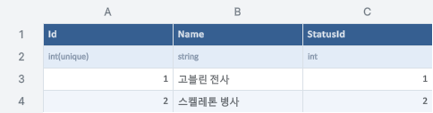
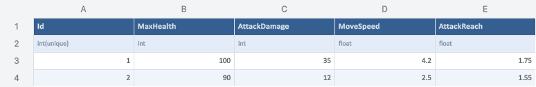
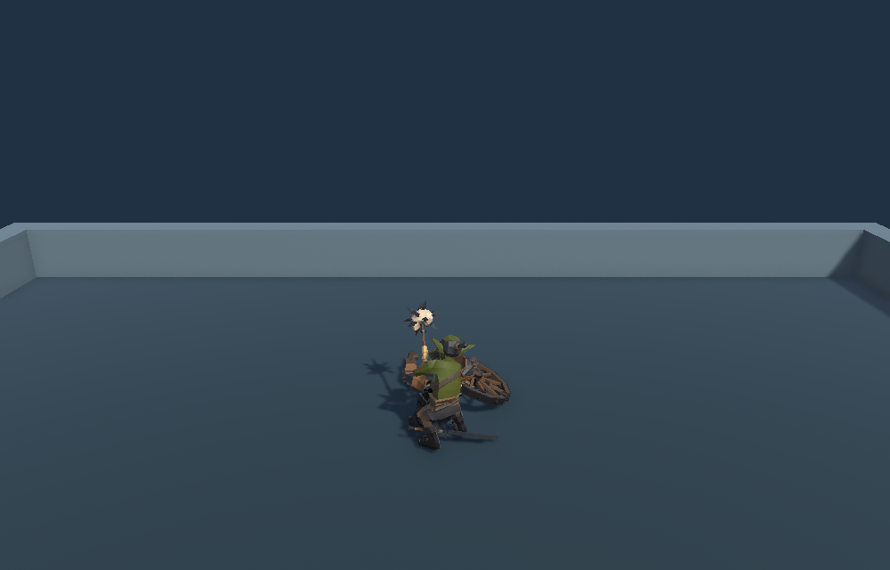

## 작업 결과

FantasyaCharacter의 StatusId로 FantasyaStatus를 연결합니다. 고블린과 스켈레톤의 공통 이동과 전투는 Monster가 처리하고, 각 전용 스크립트에서 종별 동작을 확장할 수 있습니다.

## 변경 내용

### 적용 내용

- FantasyaCharacter는 Id·이름·StatusId를 관리합니다. FantasyaStatus는 최대 체력·공격력·이동 속도·사거리를 관리합니다. 기존 밸런스는 보존했습니다.
- Playground의 고블린과 스켈레톤에 GoblinWarrior와 SkeletonSoldier를 각각 연결했습니다.
- 샘플의 한국어 3줄 XML summary·네이밍·조건문 중괄호 규칙을 적용하고 README, 다큐먼트와 프로젝트 지침에 반영했습니다.

### 대화 기록

1. 사용자 · DDT로 스테이터스와 캐릭터 테이블을 관리해 달라고 요청했습니다.
2. 사용자 · DDT를 설치했다고 알리고 “몬스터로 바꿔주고 상속할 수 있는 구조”와 몬스터별 스크립트를 요청했습니다. 주석에는 샘플 프로젝트를 참고하라고 정정했습니다.
3. Codex · DDT 2.0.2의 생성·등록 API와 모체 가이드를 확인했습니다. 기존 전투 값은 두 XLSX에 넣고 씬에서 전용 클래스를 사용했습니다.

발언 시각은 미기록입니다.

## 검증

- DDT 원본·바이너리 일치 검사와 Unity 6000.0.83f1 씬 저장·재열기가 통과했습니다.
- DDT 편집 API의 미리보기와 저장으로 스켈레톤 체력을 90에서 91로 바꿨습니다. 실제 플레이와 R 재시작에서 체력 91을 확인했고, 원본과 바이너리를 90으로 복원했습니다.
- 가상 키보드 이동, 헛스윙, AI 추격, 양쪽 피해, 스켈레톤 사망 애니메이션과 충돌 해제를 확인했습니다.
- 검증 파일의 해시를 적용본과 대조했습니다. DDT의 기존 등록 24개를 보존했습니다.
- 교훈 검토에서 모체 주석 기준을 Fantasya 지침에 명시했습니다. 전역 지침의 모체 문서 확인 규칙에 이미 포함돼 있어 전역은 변경하지 않았습니다. Monster는 Fantasya 스키마와 전투에 의존하므로 샘플 환류 후보가 없습니다.

DDT의 실제 범위 렌더에서 두 캐릭터 이름과 StatusId를 확인했습니다. 이번에 신설한 표여서 이전 화면이 없습니다.

기본 수치로 복원할 스켈레톤의 체력 90을 포함한 표입니다.

적용 전 Playground의 스켈레톤 처치 장면입니다.

새 Monster 상속과 DDT 데이터를 사용하는 실제 Play Mode에서 스켈레톤 처치를 재현했습니다.

## 남은 사항

Standalone 빌드와 실물 키보드·마우스 조작은 미실행입니다.

## 작업 시간

- 제안 시간: 15~25분
- 실제로 완료된 시간: 12분 54초 · 2026-11-09 17:12:06 KST 로컬 적용·검증 기준
- XERJ: 미사용 — 연결 경로를 확인하지 못해 rg와 DDT·샘플 프로젝트 소스로 대조했습니다.
