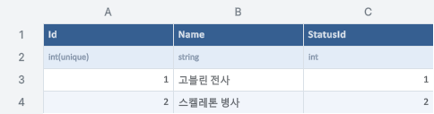
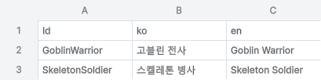

## 작업 결과

고블린 전사와 스켈레톤 병사의 이름을 FantasyaLocalization.xlsx에서 편집합니다. Monster.CharacterName은 현재 언어로 이름을 조회합니다.

## 변경 내용

### 적용 내용

- FantasyaCharacter의 Name을 NameKey로 교체했습니다. 키는 GoblinWarrior와 SkeletonSoldier입니다.
- 새 Names 시트의 ko·en 번역과 영어 기본값을 DDT에서 등록했습니다. README와 Dosc에 편집 절차를 반영했습니다.

### 대화 기록

1. 사용자 · “DDT 로컬라이징 파일 만들어서 쓰자”라고 요청했습니다.
2. Codex · 캐릭터 표에는 키를 두고 DDT 로컬라이징에서 한국어와 영어를 관리했습니다.

발언 시각은 미기록입니다.

## 검증

- DDT의 변경 전후 실제 범위 렌더와 캐릭터 원본·바이너리 일치를 확인했습니다.
- Unity 6000.0.83f1 Playground Play Mode에서 같은 몬스터가 한국어→영어 전환 후 새 이름을 반환했습니다. 프랑스어 요청은 영어로 돌아갔고 초기 체력 100·90을 확인했습니다.
- 검증본과 적용본의 해시 및 문서 링크를 대조했습니다. DDT 전용 연동으로 샘플 환류 후보가 없으며 전역 지침 변경 사항도 없습니다.

Name 열에 한국어 이름이 들어 있던 상태입니다.

NameKey 열에 DDT 번역 키를 연결했습니다.

이번에 등록한 Names 시트의 실제 DDT 렌더입니다.

## 남은 사항

게임 화면에 이름 라벨은 배치되어 있지 않아 플레이 검증은 몬스터의 이름 조회값으로 수행했습니다.

## 작업 시간

- 제안 시간: 10~20분
- 실제로 완료된 시간: 8분 13초 · 2026-11-09 18:20:56 KST 로컬 적용·검증 기준
- XERJ: 미사용 — 연결 경로 미확인으로 rg 및 패키지 원본 대조
