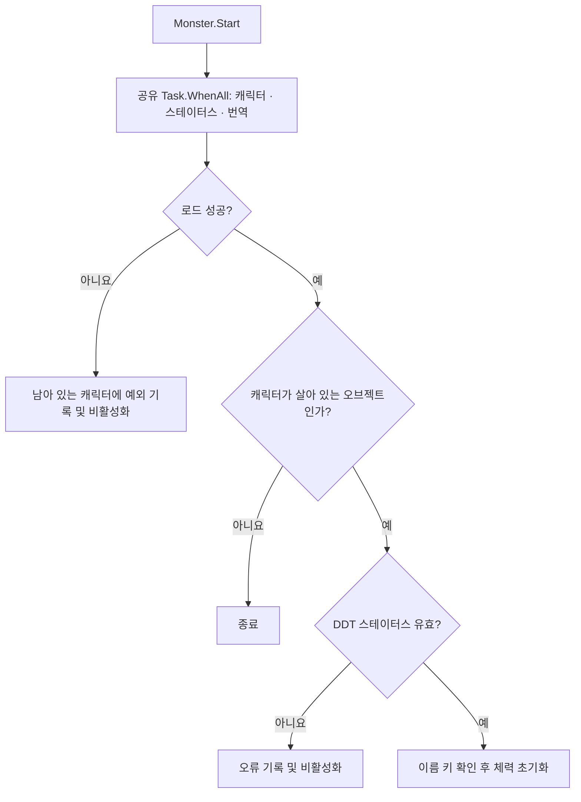

## 작업 결과

Playground의 기존 플레이어·스켈레톤·오크를 프리팹으로 분리했습니다. 이어 보유 Creatures 48종을 몬스터로 구성했고, 플레이어를 포함해 주소는 49개입니다.

## 변경 내용

### 적용 내용

- Addressables 2.9.1을 사용합니다. `Characters` 그룹에는 플레이어와 몬스터, `Design Data Tables`에는 DDT 바이너리와 번역 참조 에셋을 등록했습니다.
- 캐릭터와 스테이터스는 DDT 생성 테이블의 비동기 API로 읽습니다. 이름은 DDT 번역 원본을 참조하는 프로젝트 에셋을 Addressables로 읽습니다. 새 DDT 테이블 바이너리 등록은 DDT 가져오기 흐름을 사용합니다.
- 보유 팩의 말·사슴도 시험용 몬스터 범위에 포함했습니다. 기존 Playground에는 처음 배치한 두 몬스터가 남아 있습니다. Data 에셋은 파일 종류별로 `Tables`, `Behavior`, `Localization`으로 정리하고 기존 GUID를 보존했습니다.

### 캐릭터 초기화

모든 캐릭터가 공유 로드 작업을 기다립니다. 로드 실패나 잘못된 스테이터스는 해당 캐릭터를 비활성화하며, 이름 키 오류는 경고를 남깁니다.



**Assets/Scripts/InGame/Object/Monster/Monster.cs**

```csharp
private async void Start()
{
    try
    {
        await (_tableLoad ??= Task.WhenAll(
            FantasyaCharacterTable.instance.LoadAsync(),
            FantasyaStatusTable.instance.LoadAsync(),
            CharacterLocalization.LoadAsync()));
    }
    catch (Exception exception)
    {
        if (this != null)
        {
            Debug.LogException(exception, this);
            enabled = false;
        }
        return;
    }

    if (this == null)
    {
        return;
    }

    var character = FantasyaCharacterTable.instance.GetData(_characterId);
    _status = character == null ? null : FantasyaStatusTable.instance.GetData(character.StatusId);
    if (_status == null || _status.MaxHealth < 1 || _status.AttackDamage < 1 ||
        !IsPositiveFinite(_status.MoveSpeed) || !IsPositiveFinite(_status.AttackReach))
    {
        Debug.LogError($"캐릭터 {_characterId}의 DDT 스테이터스를 확인해 주세요.", this);
        enabled = false;
        return;
    }

    if (Enum.TryParse(character.NameKey, out FantasyaLocalizationId nameId) &&
        Enum.GetName(typeof(FantasyaLocalizationId), nameId) == character.NameKey)
    {
        _nameId = nameId;
    }
    else
    {
        Debug.LogWarning($"캐릭터 {_characterId}의 DDT 이름 키를 확인해 주세요.", this);
    }
    Health = _status.MaxHealth;
}
```

### 대화 기록

1. 사용자 · 미기록 · “아 프리팹화 하라고 하려고 했던거임”.
2. 사용자 · 미기록 · “어드레서블 설치하고 정리해둬”. DDT의 Addressables 로드도 요청했습니다.
3. 사용자 · 미기록 · “현재 있는 모든 몬스터들 비슷하게 구현해서 프리팹화 하고 어드레서블에 등록해줘.”
4. Codex · 11월 9일 21:00 KST · 몬스터 48종과 DDT, Addressables 연결을 보고하고 Play Mode는 미확인으로 구분했습니다.
5. 사용자 · 미기록 · “파일 종류 단위로 폴더 구분하라고”. Codex는 파일마다 만들었던 폴더를 세 종류로 다시 묶었습니다.

### 보고서 보완 요청

- 사용자 · 미기록 · “코드 조각은 앞으로 최소 함수 단위 ~ 클래스 단위로 작성”하고, 누락한 Mermaid 도표를 추가해 달라고 요청했습니다.

## 검증

현재 작업 트리에서 캐릭터 프리팹 49개와 플레이어 빌드의 Addressables 설정을 대조했습니다. 당시 프리팹 ID, 주소, DDT 바이너리 연결은 정적으로 대조했습니다. v1.0.1에서 코드 예시를 현재 소스의 전체 함수와 대조하고 동작 흐름을 Mermaid로 추가했습니다.

## 남은 사항

Unity 임포트, 최신 콘텐츠 빌드 및 Play Mode는 미확인입니다. 동일 상태의 전후 화면은 당시 확보하지 못했습니다.

## 작업 시간

- 제안 시간: 원 작업별로 채팅에 안내했습니다. 누락분 정리 초안은 5~10분으로 제안했습니다.
- 실제로 완료된 시간: 원 작업별 소요 시간은 개별 작업 응답에 기록했으며 합산하지 않았습니다.
- XERJ: 미사용 — 코드 검색 근거가 제공되지 않았습니다.
