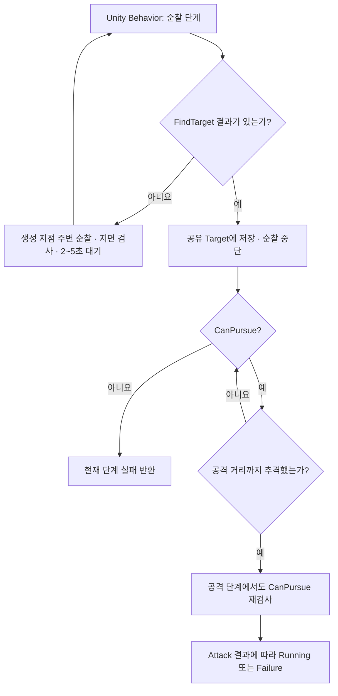

## 작업 결과

플레이어가 탐지되지 않으면 몬스터는 생성 지점 주변을 순찰합니다. 목적지에 도착하거나 이동이 중단되면 몬스터마다 2~5초 사이의 대기 시간을 새로 뽑습니다.

## 변경 내용

### 적용 내용

- `MonsterBehavior.asset`은 Unity Behavior 1.0.16을 사용합니다. `MonsterBehaviorAction`이 순찰·추격·공격 단계를 연결하고 `MonsterAI`가 행동을 실행합니다.
- 기본 순찰 4m, 감지 7m, 생성 지점 기준 추격 한계 12m입니다. 순찰 이동 시도는 최대 6초입니다. 대기는 0.6초에서 3초로 늘린 후 무작위 간격으로 조정했습니다.
- 샘플의 전역 `eTeam`을 가져왔습니다. 활성 캐릭터 중 다른 전투 진영을 고르며 같은 팀과 `None`은 제외합니다. 기본 배치는 플레이어 `MyTeam`, 몬스터 `Enemy`입니다.

### 몬스터 행동 전환

순찰 중 대상이 감지되면 그래프가 공유 Target을 다음 단계에 넘깁니다. 추격과 공격은 대상을 재검사합니다. 순찰 목적지에 도착하거나 이동 시도가 끝나면 2~5초 쉬고 다음 목적지를 고릅니다.



**Assets/Scripts/InGame/Object/AI/MonsterBehaviorAction.cs**

```csharp
protected override Status OnStart() => Execute();

protected override Status OnUpdate() => Execute();

/// <summary>
/// 단계의 결과를 그래프에 반환해 다음 행동을 선택하게 한다.
/// </summary>
private Status Execute()
{
    if (_controller == null || !_controller.isActiveAndEnabled || !_controller.IsAlive)
    {
        return Status.Failure;
    }

    if (Step.Value == eStep.Patrol)
    {
        Monster found = _controller.FindTarget();
        Target.Value = found != null ? found.gameObject : null;
        if (found == null)
        {
            _controller.Patrol();
            return Status.Running;
        }

        _controller.InterruptPatrol();
        return Status.Success;
    }

    Monster target = Target.Value != null ? Target.Value.GetComponent<Monster>() : null;
    if (!_controller.CanPursue(target))
    {
        return Status.Failure;
    }

    if (Step.Value == eStep.Approach)
    {
        return _controller.Approach(target) ? Status.Success : Status.Running;
    }

    return _controller.Attack(target) ? Status.Running : Status.Failure;
}
```

**Assets/Scripts/InGame/Object/AI/MonsterAI.cs**

```csharp
internal void Patrol()
{
    if (_hasPatrolPoint)
    {
        Vector3 direction = PlanarOffset(transform.position, _patrolPoint);
        if (direction.sqrMagnitude > 0.16f && Time.time < _patrolDeadline &&
            HasGround(transform.position + direction.normalized * 0.5f))
        {
            _monster.Drive(direction.normalized);
            return;
        }

        _hasPatrolPoint = false;
        _nextPatrolTime = Time.time + Random.Range(2f, 5f);
    }

    _monster.Drive(Vector3.zero);
    if (Time.time < _nextPatrolTime)
    {
        return;
    }

    Vector2 offset = Random.insideUnitCircle * _patrolRadius;
    _patrolPoint = PlanarOffset(_spawnPosition, transform.position).sqrMagnitude > _patrolRadius * _patrolRadius
        ? _spawnPosition
        : _spawnPosition + new Vector3(offset.x, 0f, offset.y);
    _hasPatrolPoint = HasGround(_patrolPoint);
    _patrolDeadline = Time.time + 6f;
    if (!_hasPatrolPoint)
    {
        _nextPatrolTime = Time.time + Random.Range(2f, 5f);
    }
}
```

### 대화 기록

1. 사용자 · 미기록 · “AI는 단순하게 하나로만 만들어봐 몬스터 공용으로”.
2. 사용자 · 미기록 · “몬스터 ai 유니티 비헤비어로 만들어야지”와 “생성 지점을 기준으로 패트롤하게 해”.
3. Codex · 11월 9일 21:33 KST · 공용 그래프와 순찰·추격 범위의 파일 연결을 보고했습니다.
4. 사용자 · 미기록 · “글로벌 이넘으로 team 가져와”라고 요청했습니다.
5. 사용자 · 미기록 · “너무 짧아 좀 더 텀을 주자” 이후 “고정 시간은 좀 그렇지 않나”.
6. Codex · 11월 10일 19:06 KST · 몬스터별 무작위 대기를 적용했습니다.

### 보고서 보완 요청

- 사용자 · 미기록 · “코드 조각은 앞으로 최소 함수 단위 ~ 클래스 단위로 작성”하고, 누락한 Mermaid 도표를 추가해 달라고 요청했습니다.

## 검증

그래프와 48개 몬스터 프리팹 연결, 현재 소스의 팀 필터 및 무작위 대기값을 대조했습니다. v1.0.1에서 코드 예시를 현재 소스의 전체 함수와 대조하고 동작 흐름을 Mermaid로 추가했습니다.

## 남은 사항

Unity Play Mode의 실제 순찰, 추격, 팀 전투와 전후 화면은 미확인입니다.

## 작업 시간

- 제안 시간: 원 작업별로 채팅에 안내했습니다. 누락분 정리 초안은 5~10분으로 제안했습니다.
- 실제로 완료된 시간: 원 작업별 소요 시간은 개별 작업 응답에 기록했으며 합산하지 않았습니다.
- XERJ: 미사용 — 코드 검색 근거가 제공되지 않았습니다.
