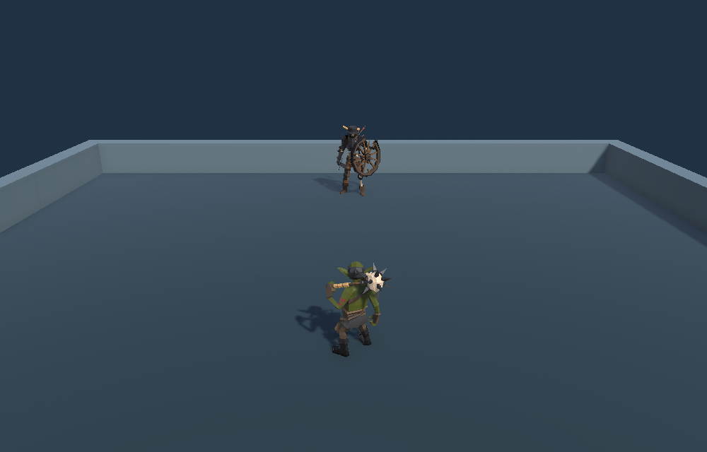
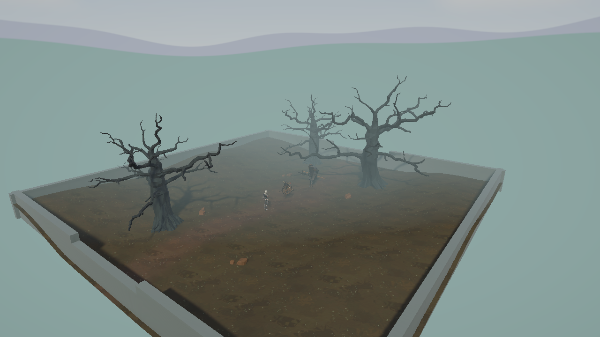

## 작업 결과

16×16m 바닥을 Unity Terrain으로 교체했습니다. 중앙 전투 공간과 흙길, 낮은 둔덕을 구성하고 기존 나무와 바위 에셋을 배치했습니다.

## 변경 내용

### 적용 내용

- `PlaygroundTerrain.asset`과 Meadow·Trail TerrainLayer를 추가했습니다. 나무 3그루는 기존 팩의 `Tree_Oak_Big_Dead_Fantasy` 프리팹을 사용했습니다.
- `MeadowSky` 스카이박스에 하늘과 두 겹의 능선을 넣고 `PlaygroundDaylight` URP Volume에서 노출·채도·대비를 조절했습니다.
- 안개는 선형 모드에서 24m부터 100m까지 적용합니다. 그 뒤 하늘·능선·초원을 파스텔 팔레트로 조정했습니다.

### 대화 기록

1. 사용자 · 미기록 · “테스트맵을 터레인 맵으로 지금 보다 2배로 대충 디자인해줄래?”
2. Codex · 11월 9일 22:12 KST · 32×32m로 확장하고 나무와 바위를 배치했다고 보고했습니다. 당시 열린 씬에는 미저장 표시가 있었습니다.
3. 사용자 · 미기록 · 나무가 원래 있던 에셋인지 확인했습니다. Codex는 기존 에셋을 새로 배치했다고 답했습니다.
4. 사용자 · 미기록 · 배경과 야숨풍 색감, 더 옅은 안개, “파스텔톤으로 못 하나?”를 차례로 요청했습니다.
5. Codex · 11월 10일 00:04 KST · 파스텔 색과 채도·대비 변경을 보고했습니다.

### Playground 배경 비교

### 촬영 보완 요청

- 사용자 · 미기록 · “스크린샷 보완해줘”. PC 사용을 계속할 수 있도록 컴퓨터 유즈 없이 Unity에서 직접 촬영하라고 요청했습니다.

## 검증

TerrainData 생성 당시 Unity 배치에서 에셋을 저장했습니다. 씬의 스카이박스·Volume 참조와 카메라 포스트 프로세싱 설정, 24~100m 안개 설정을 대조했습니다. 추가 촬영은 Unity 6000.0.83f1의 분리된 배치 실행에서 실제 플레이 씬 카메라를 1280×720으로 렌더링한 결과입니다.

## 남은 사항

이전 이미지는 기존 실제 플레이 기록입니다. 이번 전체 구도와 동일한 카메라 위치·해상도의 이전 장면은 미확보 상태입니다.

## 작업 시간

- 제안 시간: 원 작업별로 채팅에 안내했습니다. 누락분 정리 초안은 5~10분으로 제안했습니다.
- 실제로 완료된 시간: 원 작업별 소요 시간은 개별 작업 응답에 기록했으며 합산하지 않았습니다.
- XERJ: 미사용 — 코드 검색 근거가 제공되지 않았습니다.
