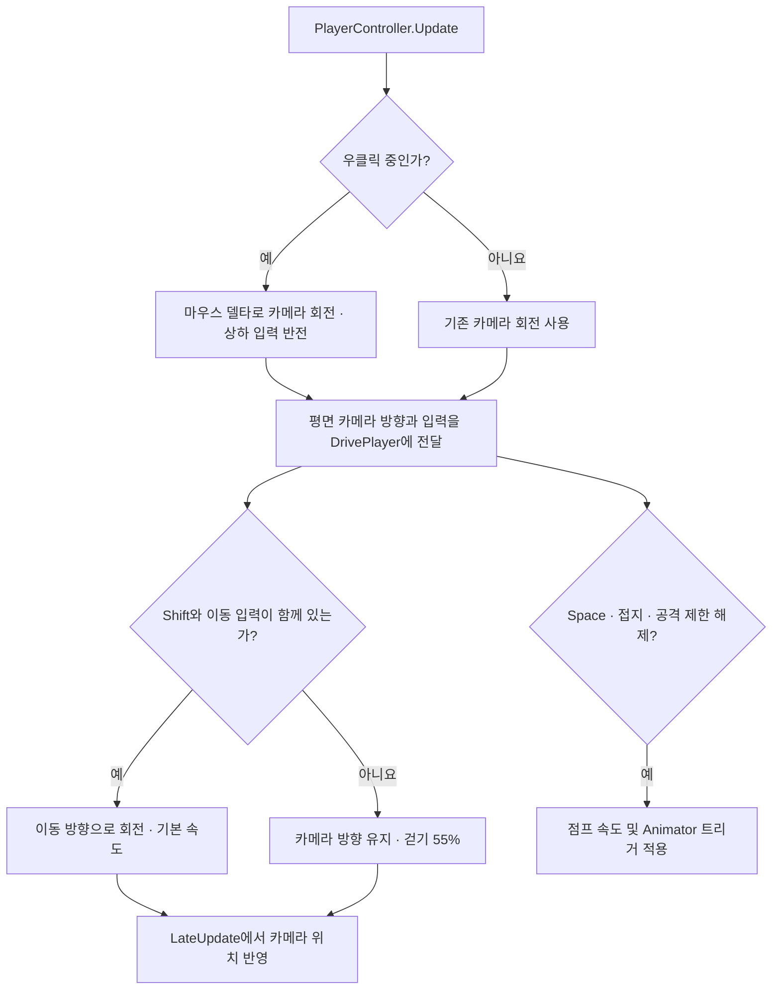

## 작업 결과

걷는 동안 카메라 방향을 바라보며 8방향으로 움직이고, 스프린트할 때 이동 방향으로 돌아섭니다. 우클릭으로 카메라를 회전하며 상하 입력은 반전했습니다.

## 변경 내용

### 적용 내용

- `Player.prefab`의 임시 외형을 Robot Kyle로 교체하고 기존 DDT ID 1을 유지했습니다. Animator에서 샘플의 8방향 걷기, 전진 달리기, 점프·착지 클립을 연결했습니다.
- `Monster.DrivePlayer`에서 방향 애니메이션 입력을 0.2초 감쇠로 보간합니다. 걷기는 DDT 이동 속도의 55%, 점프 초기 수직 속도는 5.2m/s입니다. Space는 점프, F 또는 왼쪽 클릭은 공격입니다.
- 공격 클립이 샘플 컨트롤러에만 있는 이벤트를 호출해 경고가 발생했습니다. Fantasya 전용 사본에서 시작·끝 피해 체크와 공격 종료 이벤트를 제거했습니다. Fantasya의 피해 판정은 공격 시작 0.3초 뒤 진행합니다.

### 카메라 기준 입력과 이동

우클릭 중 회전한 카메라 방향을 같은 프레임의 이동에 사용합니다. 걷기는 카메라 방향을 유지하고 스프린트는 이동 방향을 바라봅니다. 점프는 지면에 있고 공격 제한이 풀렸을 때 시작합니다.



**Assets/Scripts/InGame/Object/PlayerController.cs**

```csharp
private void Update()
{
    UpdateCameraOrbit();
    Keyboard keyboard = Keyboard.current;
    if (keyboard == null)
    {
        return;
    }

    if (keyboard.rKey.wasPressedThisFrame)
    {
        SceneManager.LoadScene(gameObject.scene.buildIndex);
        return;
    }

    float horizontal = Axis(keyboard.dKey.isPressed || keyboard.rightArrowKey.isPressed, keyboard.aKey.isPressed || keyboard.leftArrowKey.isPressed);
    float vertical = Axis(keyboard.wKey.isPressed || keyboard.upArrowKey.isPressed, keyboard.sKey.isPressed || keyboard.downArrowKey.isPressed);
    Vector3 forward = Vector3.ProjectOnPlane(_cameraRotation * Vector3.forward, Vector3.up).normalized;
    bool sprint = keyboard.leftShiftKey.isPressed || keyboard.rightShiftKey.isPressed;
    _monster.DrivePlayer(new Vector2(horizontal, vertical), forward, sprint, keyboard.spaceKey.wasPressedThisFrame);

    if (keyboard.fKey.wasPressedThisFrame || Mouse.current?.leftButton.wasPressedThisFrame == true)
    {
        _monster.Attack(SelectOpponent());
    }
}
```

```csharp
private void UpdateCameraOrbit()
{
    Mouse mouse = Mouse.current;
    if (mouse != null && mouse.rightButton.isPressed)
    {
        Vector2 delta = mouse.delta.ReadValue() * _cameraSensitivity;
        Vector3 horizontalOffset = Vector3.ProjectOnPlane(_cameraOffset, Vector3.up);
        float elevation = Mathf.Atan2(_cameraOffset.y, horizontalOffset.magnitude) * Mathf.Rad2Deg;
        float pitch = Mathf.Clamp(elevation - delta.y, 10f, 75f) - elevation;
        Quaternion rotation = Quaternion.AngleAxis(delta.x, Vector3.up)
            * Quaternion.AngleAxis(pitch, Vector3.Cross(horizontalOffset, Vector3.up));
        _cameraOffset = rotation * _cameraOffset;
        _cameraRotation = rotation * _cameraRotation;
    }
}
```

**Assets/Scripts/InGame/Object/Monster/Monster.cs**

```csharp
internal void DrivePlayer(Vector2 input, Vector3 cameraForward, bool sprint, bool jump)
{
    if (!IsAlive)
    {
        return;
    }

    Vector3 direction = Vector3.Cross(Vector3.up, cameraForward) * input.x + cameraForward * input.y;
    bool sprinting = sprint && input.sqrMagnitude > 0f;
    _visual.SetFloat(_moveXParameter, input.x, PlayerMovementBlendTime, Time.deltaTime);
    _visual.SetFloat(_moveYParameter, input.y, PlayerMovementBlendTime, Time.deltaTime);
    _visual.SetFloat(_sprintParameter, sprinting ? 1f : 0f, PlayerMovementBlendTime, Time.deltaTime);

    if (jump && _motor.isGrounded && Time.time >= _nextAttack - 0.15f)
    {
        _verticalSpeed = PlayerJumpSpeed;
        _visual.SetTrigger(_jumpParameter);
    }

    Drive(direction, sprinting ? direction : cameraForward, sprinting ? 1f : 0.55f, !sprinting);
    _visual.SetBool(_airborneParameter, !_motor.isGrounded);
}
```

### 대화 기록

1. 사용자 · 미기록 · “우클릭으로 화면 회전할 수 있게 해줘” 이후 키보드 움직임을 “카메라 축 기준으로” 요청했습니다.
2. 사용자 · 미기록 · “유니티 기본 캐릭터 있잖아 로봇 그걸로 플레이어 캐릭터 임시로” 쓸 것을 요청했습니다.
3. 사용자 · 미기록 · “달리기는 쉬프트”, 이어 “정확히는 스프린트”.
4. 사용자 · 미기록 · 좌우 이동 애니메이션 전환을 부드럽게 하고 점프를 가져오라고 요청했습니다.
5. 사용자 · 미기록 · `OnStartDamageCheck`와 `OnEndDamageCheck` 수신자가 없다는 Unity 로그를 제공했습니다. Codex는 샘플 전용 이벤트를 제거한 사본을 연결했습니다.
6. 사용자 · 미기록 · “카메라 우클릭했을 때 위아래 입력 반전 좀”. Codex는 11월 10일 19:17 KST에 파일 수정 완료를 보고했습니다.

### 보고서 보완 요청

- 사용자 · 미기록 · “코드 조각은 앞으로 최소 함수 단위 ~ 클래스 단위로 작성”하고, 누락한 Mermaid 도표를 추가해 달라고 요청했습니다.

## 검증

입력 분기, Animator 참조, 공격 클립 사본의 이벤트 제거, 상하 입력 부호를 소스 및 에셋에서 확인했습니다. v1.0.1에서 코드 예시를 현재 소스의 전체 함수와 대조하고 동작 흐름을 Mermaid로 추가했습니다.

## 남은 사항

Unity에서 최신 로봇 표시, 이동·점프·카메라 조작과 콘솔 경고 해소는 미확인입니다. 당시 전후 화면은 미확보 상태입니다.

## 작업 시간

- 제안 시간: 원 작업별로 채팅에 안내했습니다. 누락분 정리 초안은 5~10분으로 제안했습니다.
- 실제로 완료된 시간: 원 작업별 소요 시간은 개별 작업 응답에 기록했으며 합산하지 않았습니다.
- XERJ: 미사용 — 코드 검색 근거가 제공되지 않았습니다.
