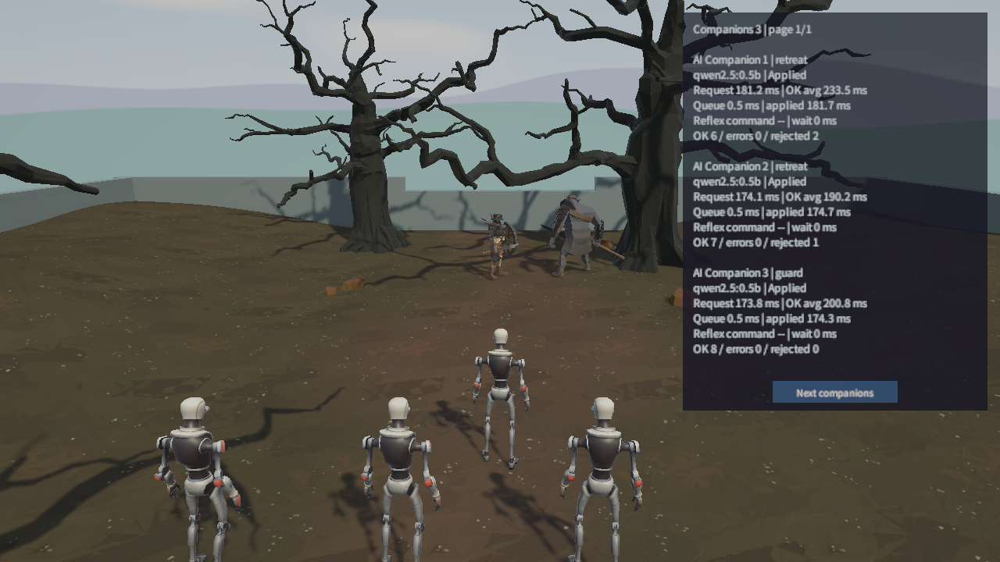
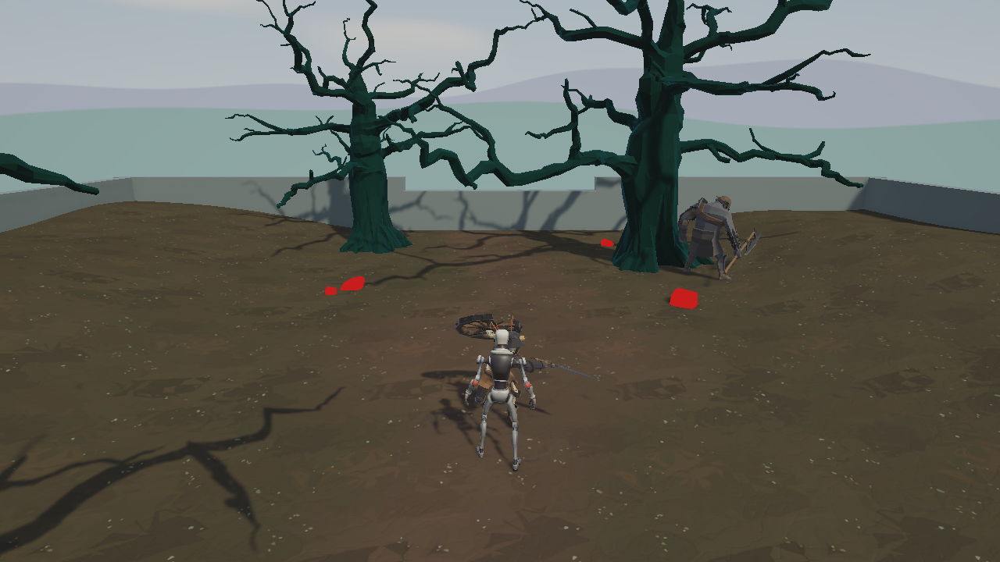

## 작업 결과

동료마다 모델 판단과 게임 프레임 실행을 분리했습니다. 최종 Unity 실행에서 21회 적용, 3회 폐기, 연결 오류 0회를 확인했습니다.

## 변경 내용

### 적용 내용

기존 플레이어와 같은 DrivePlayer·Attack을 사용합니다. 따라가기·엄호·공격·후퇴·대기 중 제공한 행동만 적용하고 저체력 후퇴가 우선합니다. AgentParty는 기본 3명, 구성 상한 32명이며 대규모 성능 보장은 아닙니다. UI 배치·폰트·버튼 연결은 씬에 저장했습니다.

### 판단과 실행

~~~mermaid
flowchart LR
A[최신 관측과 허용 선택지] --> B[모델 비동기 판단]
B --> C{시간과 대상 검증}
C -->|유효| D[행동 유효 기간 설정]
C -->|무효| E[안전한 기존 행동 유지]
D --> F[매 프레임 공통 모터 실행]
F --> A
~~~

### 허용 행동 적용 전체 메서드

AIAgentController.TryApply는 모델에 제공한 요청별 짧은 대상 번호를 현재 캐릭터 참조로 확인합니다. 죽거나 범위를 벗어난 대상은 폐기합니다.

~~~csharp
private bool TryApply(AgentDecision decision)
{
    Monster target = null;
    if (decision.action == "attack")
    {
        if (!_offeredTargets.TryGetValue(decision.targetId, out target) || !IsAllowedEnemy(target))
        {
            return false;
        }
    }
    else if (decision.targetId != 0 || !(decision.action == "hold" || decision.action == "guard" || decision.action == "retreat" ||
        (decision.action == "follow" && _leader != null && _leader.IsAlive)))
    {
        return false;
    }
    _action = decision.action;
    _target = target;
    _leaseEnds = Time.time + decision.seconds;
    return true;
}
~~~

### 호출 수명과 정리

~~~mermaid
flowchart TD
A[설정별 슬롯 대기] --> B[슬롯 확보 후 관측 생성]
B --> C[HTTP 요청]
C --> D[응답 또는 오류]
D --> E[Dispose와 슬롯 반환]
B --> F[비활성화 또는 사망]
C --> F
F --> G[코루틴 중단과 요청 Abort]
G --> E
~~~

모델 연결은 [AgentModelClient 전체](../assets/ai-companions-20261111/AgentModelClient.cs), 상태·수명 전체는 [AIAgentController 전체](../assets/ai-companions-20261111/AIAgentController.cs)에 보존했습니다. 게임별 해석은 컨트롤러에 남기고 공통 통신은 사용자 승인으로 모체에 반영했습니다.

### 대화 기록

사용자는 여러 AI 동료·반응 시간 표시·로컬 모델을 요청했습니다. 설치 질문에는 “Ollama와 소형 모델 설치·실측까지 진행”, 공용화 질문에는 “공용화해서 모체에도 반영”을 선택했습니다. 발언 시각은 미기록입니다.

## 검증

Unity 6000.0.83f1의 실제 Play Mode 카메라 출력과 [실측 JSON](../assets/ai-companions-20261111/final.json)을 보존했습니다. 사용자 Unity 세션은 보존하고 격리 사본을 사용했습니다. 최종 적용 씬·소스와 사본을 해시 대조했습니다.

- Ollama 0.40.16, qwen2.5:0.5b 약 397MB 설치. GPU 실행 확인.
- 최종 동료별 정상 요청 평균 190.2~233.5ms; 21/24회 적용. 폐기는 실패를 숨기지 않고 HUD에 별도로 표시합니다.
- 첫 로딩은 약 25.1초, 첫 직접 요청 전체 약 27.0초. 20초 제한 실패를 보존하고 60초 제한과 사전 로딩 스크립트를 추가했습니다.
- C# 컴파일, 씬 저장·재열기, 실제 동료 생성·이동·공격·모델 판단·HUD 표시를 확인했습니다.
- 테스트 스위트 작성·실행 없음. 로컬 HTML 브라우저 열기는 도구의 file URL 정책으로 차단되어 소스·링크 검사로 범위를 구분했습니다.

### 프레임 판단 전체 메서드

~~~csharp
private void Update()
{
    if (!_monster.IsAlive)
    {
        CancelThinking();
        Status = _monster.MaxHealth == 0 ? "Loading character" : "Dead";
        return;
    }
    Monster nearest = FindNearestEnemy();
    bool emergency = nearest != null && _monster.Health <= _monster.MaxHealth * _retreatHealthRatio;
    if (emergency && !_isEmergency)
    {
        _threatObservedAt = _monster.LastDamageRealtime >= 0d ? _monster.LastDamageRealtime : Time.realtimeSinceStartupAsDouble;
    }
    _isEmergency = emergency;

    if (_isEmergency)
    {
        MoveAway(nearest);
        if (_threatObservedAt > 0d)
        {
            LastReflexMilliseconds = (Time.realtimeSinceStartupAsDouble - _threatObservedAt) * 1000d;
            _threatObservedAt = 0d;
        }
    }
    else
    {
        ExecuteAction(nearest);
    }

    if (_modelSettings != null && _modelSettings.useModel)
    {
        if (_thinking == null && Time.realtimeSinceStartupAsDouble >= _nextDecision)
        {
            _queuedAt = Time.realtimeSinceStartupAsDouble;
            _thinking = StartCoroutine(Think(_generation));
        }
    }
    else
    {
        Status = "Rules only";
    }
}
~~~

### 생성과 표시

~~~mermaid
flowchart LR
P[리더와 Player 프리팹] --> S[동료별 생성과 대형 배정]
S --> C[각자 독립 컨트롤러]
C --> H[지연 HUD: 4명씩 페이지 표시]
~~~

## 남은 사항

원격 유료 API·LM Studio·최대 32명 부하·긴급 후퇴 자연 발생 실측은 미확인입니다. 이번 코업은 한 게임 인스턴스 안의 AI 동료이며 네트워크 코업은 구현하지 않았습니다. 전역 길찾기 대신 짧은 장애물 회피와 막힘 만료를 사용합니다. 작은 모델의 선택 품질에는 한계가 있습니다. Fantasya는 기존 미커밋 변경이 많아 다른 작업을 포함하는 프로젝트 커밋·푸시는 하지 않았습니다. 실행용 설치와 모델은 사용자 요청에 따라 유지합니다. Affinity doctor/status는 ECONNREFUSED라 이미지 재편집·압축 없이 실제 PNG를 보존했습니다. 대표 화면은 본문에 등록했으며 현재 아카이브 목록의 개별 썸네일 기능은 미지원입니다. 전역 지침 변경 없음; 기존 비동기·실측·원본 보존 규칙 적용.

## 작업 시간

- 제안 시간: Fantasya 35~50분 + 승인된 모체 공용화 10~15분
- 실제로 완료된 시간: 17:37:11 시작 → 2026-11-11 18:15:13 KST, 보고 원본 작성까지 실측 38.0분. 공개 배포 확인 시간은 최종 채팅에 별도 기록합니다.
- XERJ: 미사용 — 사용자 전역 지침에 따라 XERJ 미사용. rg·현재 소스·Unity 로그·실제 Ollama 응답으로 확인했습니다.
