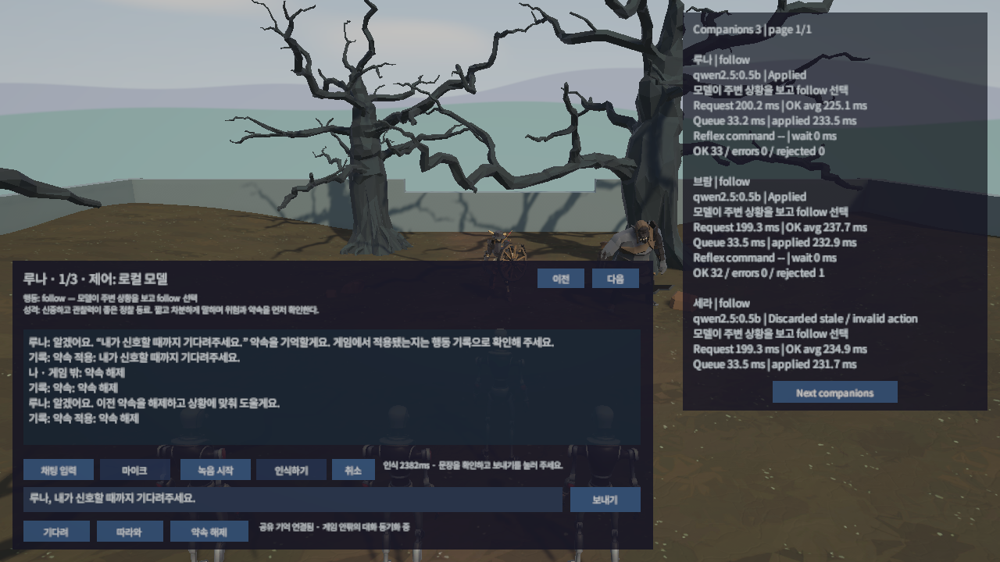
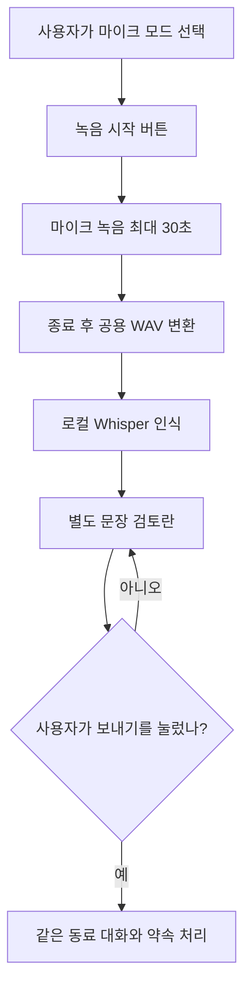
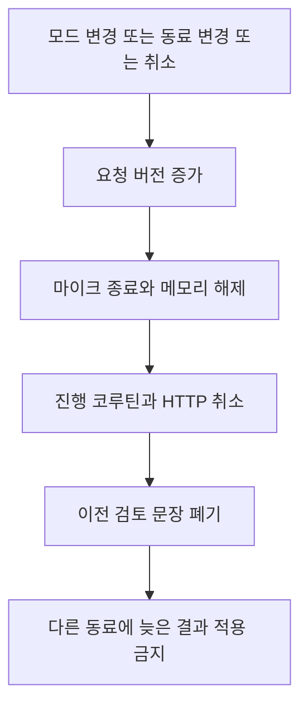
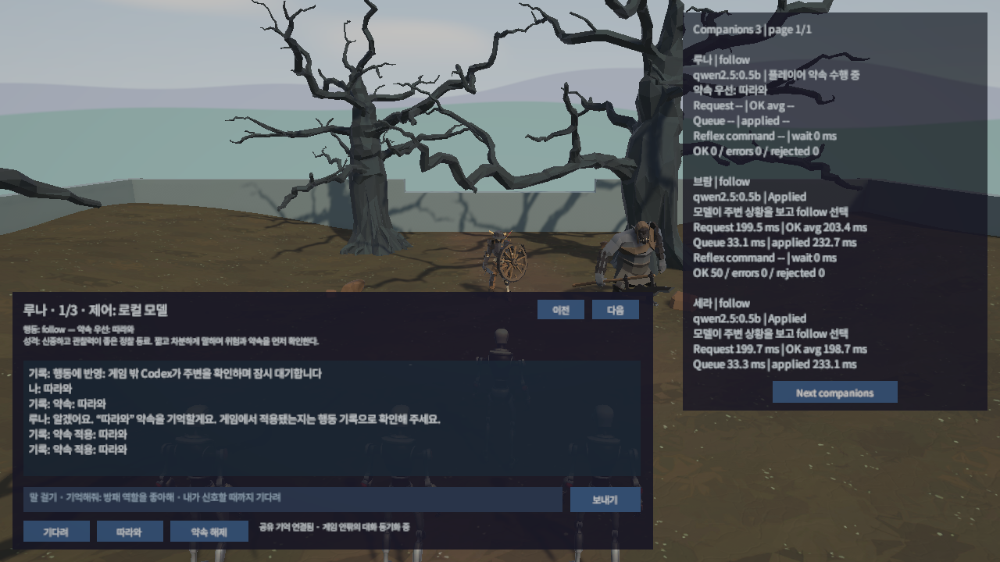
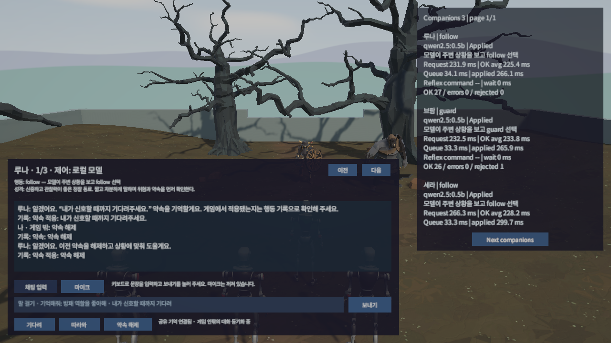

## 작업 결과

채팅 입력과 마이크 모드를 분리했습니다. 마이크는 버튼으로만 시작하고 녹음 → 로컬 인식 → 문장 검토 → 보내기 순서로 처리합니다. 실제 합성 한국어 샘플을 인식했으며, 확인 버튼 전에는 약속이 바뀌지 않았습니다.



## 변경 내용

### 적용 내용

키보드 초안과 음성 검토란을 분리했습니다. 녹음은 최대 30초, 기본 마이크·16kHz PCM16 모노를 사용합니다. 모드·동료 변경과 취소는 마이크·요청을 정리하고 늦은 결과를 폐기합니다. 음성 합성 TTS는 추가하지 않았습니다.



다음은 AgentVoiceInput.cs의 현재 결과 적용과 취소 생명주기 전체입니다. 전송은 별도 Send 메서드에서만 처리합니다.

```csharp
private IEnumerator Recognize(byte[] wave, int version)
{
    yield return null;
    yield return _link.Transcribe(wave, (success, text, milliseconds) =>
    {
        if (version != _requestVersion || !IsVoiceMode || _panel.Selected?.CompanionId != _companionId)
        {
            return;
        }
        if (success)
        {
            _review.text = text;
            _status.text = "인식 " + milliseconds.ToString("F0") + "ms · 문장을 확인하고 보내기를 눌러 주세요.";
        }
        else
        {
            _status.text = text;
        }
    });
    _recognition = null;
    _record.interactable = true;
}
```

```csharp
public void Cancel()
{
    _requestVersion++;
    if (_clip != null)
    {
        Microphone.End(null);
        Destroy(_clip);
        _clip = null;
    }
    if (_recognition != null)
    {
        StopCoroutine(_recognition);
        _recognition = null;
    }
    _link.CancelSpeech();
    _review.text = string.Empty;
    _record.interactable = true;
    _stop.interactable = false;
    _status.text = "녹음하지 않는 중 · 녹음 시작 버튼을 눌러 주세요.";
}
```



## 검증

공식 whisper.cpp b5454 Windows CPU 실행기와 다국어 base 모델을 프로젝트 전용 폴더에 설치하고 체크섬을 확인했습니다. 물리 마이크를 켜지 않고 Microsoft Heami Desktop이 만든 4.11초 합성 한국어를 사용했습니다. “루나, 내가 신호할 때까지 기다려 주세요.”가 “루나, 내가 신호할 때까지 기다려주세요.”로 인식됐습니다. 직접 1603ms, 초기 Unity 2153ms, 공용화 후 최종 Unity 약 2382ms였습니다. [실측](../assets/companion-conversation-20261111/speech-recognition.json) · [최종 검토 상태](../assets/companion-conversation-20261111/34-shared-speech-preview.json)

확인 전 auto → 확인 뒤 hold, 실제 약속 적용 기록을 확인했습니다. 모드 전환 후 인식 결과가 다시 나타나지 않았고 임시 WAV·문장 파일도 정리됐습니다. 7개 Node 테스트에는 WAV·무음 거부와 모델 JSON 교정도 포함됩니다.





공용 Game.Audio.AudioWaveEncoder는 Fantasya·모체·실제 실행 사본의 소스 SHA256이 같습니다. 아래는 실제 공용 클래스 전체입니다.

```csharp
using System;
using System.IO;
using System.Text;
using UnityEngine;

namespace Game.Audio
{
    /// <summary>
    /// 게임별 입력·통신·UI에 의존하지 않고 Unity 오디오 샘플을 표준 PCM WAV로 변환한다.
    /// </summary>
    public static class AudioWaveEncoder
    {
        /// <summary>
        /// 16kHz 클립의 유효 샘플을 모노 PCM16 WAV로 반환하며 원본 클립과 디스크를 변경하지 않는다.
        /// </summary>
        public static byte[] EncodePcm16Mono(AudioClip clip, int samples)
        {
            if (clip == null)
            {
                throw new ArgumentNullException(nameof(clip));
            }
            if (clip.frequency != 16000 || samples < 1 || samples > clip.samples)
            {
                throw new ArgumentException("16kHz 클립의 유효한 샘플 수가 필요합니다.");
            }
            var data = new float[clip.samples * clip.channels];
            if (!clip.GetData(data, 0))
            {
                throw new InvalidOperationException("읽을 수 있는 오디오 데이터가 필요합니다.");
            }
            using var stream = new MemoryStream();
            using var writer = new BinaryWriter(stream);
            writer.Write(Encoding.ASCII.GetBytes("RIFF"));
            writer.Write(36 + samples * 2);
            writer.Write(Encoding.ASCII.GetBytes("WAVEfmt "));
            writer.Write(16);
            writer.Write((short)1);
            writer.Write((short)1);
            writer.Write(16000);
            writer.Write(32000);
            writer.Write((short)2);
            writer.Write((short)16);
            writer.Write(Encoding.ASCII.GetBytes("data"));
            writer.Write(samples * 2);
            for (int index = 0; index < samples; index++)
            {
                float mono = 0f;
                for (int channel = 0; channel < clip.channels; channel++)
                {
                    mono += data[index * clip.channels + channel];
                }
                float normalized = mono / clip.channels;
                if (float.IsNaN(normalized) || float.IsInfinity(normalized))
                {
                    throw new ArgumentException("유한한 오디오 샘플이 필요합니다.");
                }
                writer.Write((short)Mathf.RoundToInt(Mathf.Clamp(normalized, -1f, 1f) * short.MaxValue));
            }
            return stream.ToArray();
        }
    }
}
```

모체 main c7b40e5 반영·푸시와 [문서 배포](https://github.com/MDJ0126/SampleProjectForUnity/actions/runs/43008565911) 성공, [공개 본문·Mermaid](https://mdj0126.github.io/SampleProjectForUnity/docs/documentation/29-wave-encoding.html) 표시를 확인했습니다. 모체 전체 게임은 미확인입니다.

## 남은 사항

물리 마이크 녹음·사용자 발화 정확도, Claude/Cursor 앱의 실제 접속, 최대 32명 부하·네트워크 코업·게임 빌드 배포는 미확인입니다. 아카이브의 목록 카드 썸네일은 현재 템플릿이 지원하지 않아 표시 검증을 완료하지 못했습니다. 대표 실제 화면을 각 본문에 등록했고 이 제한 때문에 게시물 상태를 부분 확인으로 기록합니다. 물리 마이크 녹음 성공과 합성 샘플 인식 성공을 구분합니다. 설치 명령: pwsh -File Tools/Install-LocalSpeech.ps1. 마이크 원본을 공개 자료에 포함하지 않았습니다.

## 작업 시간

- 제안 시간: 18:47 KST 시작, 최초 70~100분. 채팅·마이크 모드 추가 요청으로 20~35분 추가 예상(총 90~135분).
- 실제로 완료된 시간: 구현·실제 게임 검증·모체 반영은 2026-11-11 20:04 KST까지 완료(시작부터 약 77분). 아카이브 게시와 외부 검증은 별도 진행 중이며 실제 최종 시각을 작업 기록에 남깁니다.
- XERJ: 미사용 — 사용자 전역 지침에 따라 XERJ에 연결하지 않고 rg·현재 소스·로그·실제 Unity 결과를 확인했습니다.
