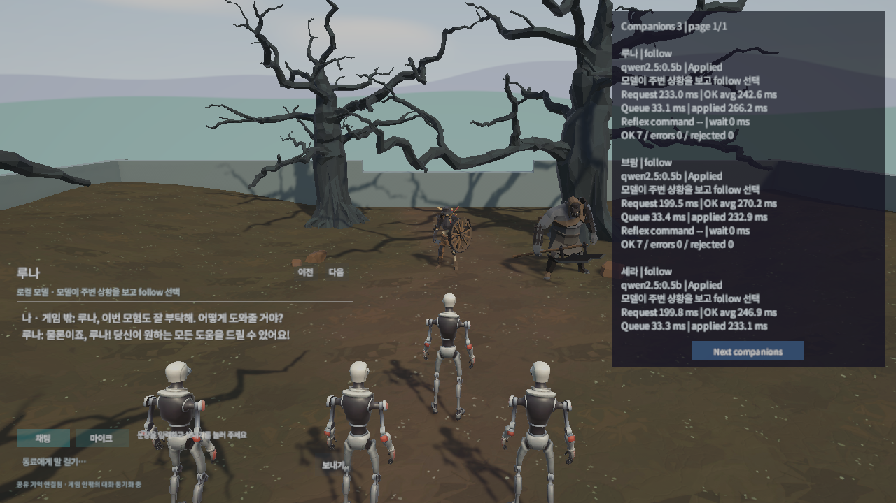
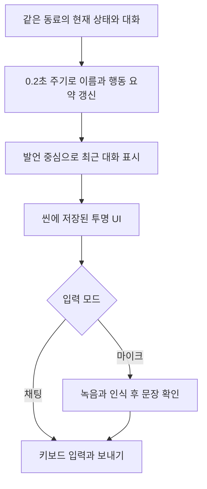
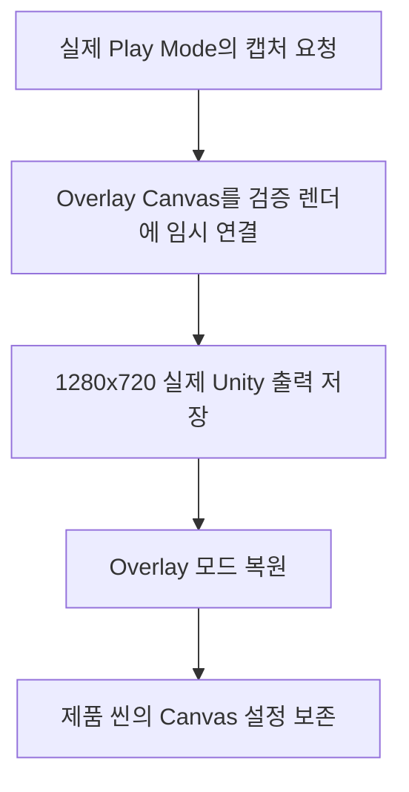
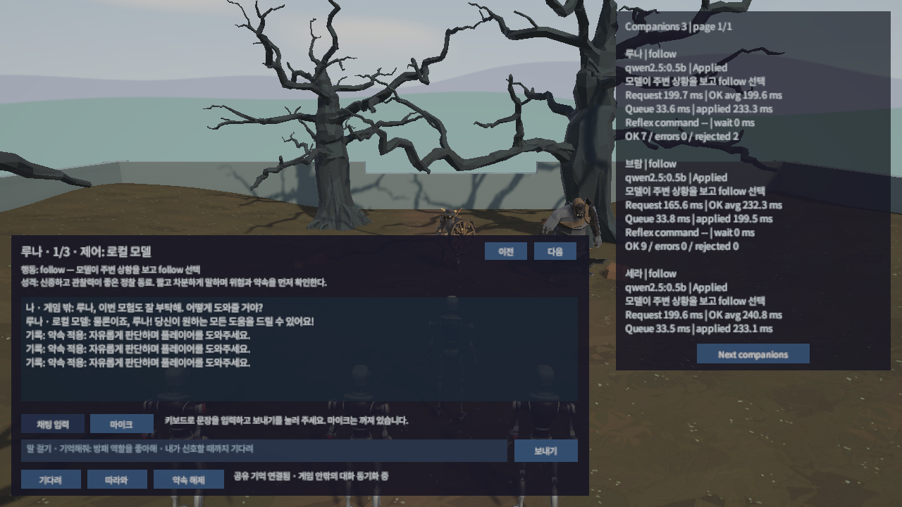
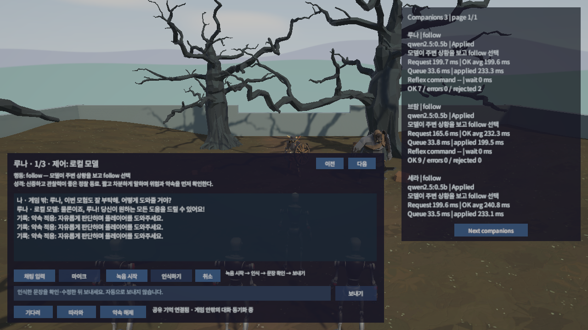
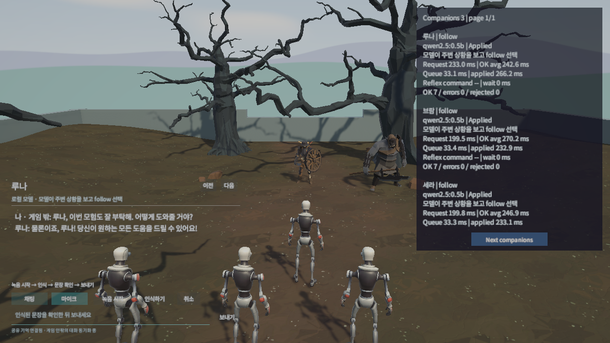

## 작업 결과

대화창을 왼쪽 아래 24px 여백, 500×320 영역으로 줄이고 큰 배경과 대화 영역을 완전히 투명하게 했습니다. 채팅·마이크 입력과 동료 전환은 유지했습니다.



## 변경 내용

### 적용 내용

대화창 폭 820 → 500px, 정적 글자 그림자·얇은 구분선·입력 밑줄을 적용했습니다. 이름과 응답 담당자·현재 행동 요약을 표시하고 긴 성격 설명과 반복 사건 행은 기본 화면에서 덜어냈습니다. 최근 기억 한 항목과 발언 위주로 표시하며 전체 성격·기억·사건은 서비스에 보존합니다. 빠른 약속 버튼은 숨겼고 약속은 채팅으로 사용할 수 있습니다. 폰트·배치·색상·이벤트는 씬에 저장하며 런타임에 UI를 재구성하지 않습니다.



다음은 AgentConversationPanel.Update의 현재 전체 구현입니다. 성격·기억·행동 시스템은 그대로 두고 표시만 간결하게 합니다.

```csharp
private void Update()
{
    if (Time.unscaledTime < _nextRefresh || _party == null)
    {
        return;
    }
    _nextRefresh = Time.unscaledTime + 0.2f;
    AIAgentController agent = Selected;
    if (agent == null)
    {
        _title.text = "생성된 동료가 없습니다";
        _send.interactable = false;
        return;
    }
    _title.text = agent.AgentName;
    _details.text = agent.ControllerName + " · " + agent.ActionReason;
    _send.interactable = _talk == null;
    _status.text = string.IsNullOrEmpty(_requestStatus) ? agent.Conversation?.awaitingExternalReply == true ? agent.ControllerName + "의 답변을 기다리고 있어요…" : _link.ConnectionStatus : _requestStatus;
    var text = new StringBuilder();
    CompanionState state = agent.Conversation;
    if (state?.memories != null && state.memories.Length > 0)
    {
        text.AppendLine("기억 · " + state.memories.Last().text);
    }
    if (state?.messages != null)
    {
        foreach (CompanionMessage message in state.messages.Where(item => item.role == "player" || item.role == "companion").TakeLast(12))
        {
            string speaker = message.role == "player" ? message.source == "game-player" ? "나" : "나 · 게임 밖" : message.role == "companion" ? agent.AgentName : "기록";
            if (message.role == "companion" && message.source != "promise" && message.source != "memory" && !message.source.StartsWith("model:"))
            {
                speaker += " · " + message.source;
            }
            text.AppendLine(speaker + ": " + VisibleMessage(message.text));
        }
    }
    string current = text.ToString();
    if (current != _lastTranscript)
    {
        _lastTranscript = current;
        _transcript.text = current;
        Canvas.ForceUpdateCanvases();
        _scroll.verticalNormalizedPosition = 0f;
    }
}
```

## 검증

Unity 6000.0.83f1의 별도 프로젝트·포트·데이터에서 실제 Play Mode와 카메라 렌더를 사용했습니다. 제품의 Overlay Canvas 설정은 보존했습니다. 최초 카메라 단독 출력은 Overlay를 놓쳐 근거로 인정하지 않았고, 검증 렌더에서만 Camera 모드로 출력한 뒤 Overlay로 복구하도록 보완했습니다. 이후 변경 전·후 채팅과 마이크 화면을 각각 다시 촬영했습니다.










최종 씬을 저장·재열기하고 원본과 실행 사본의 SHA256 일치를 확인했습니다. 대화창 밖 243개 블록은 그대로 보존했습니다. 동료 전환과 저장된 보내기 버튼 경로, 두 입력 모드 및 녹음이 자동 시작되지 않는 상태를 확인했습니다. 화면의 대화는 개인 대화가 아닌 새 검증 데이터에서 실제 Qwen으로 생성한 발언입니다. 대답의 품질 평가를 이번 디자인 검증으로 대신하지 않습니다. 테스트 스위트는 추가·실행하지 않았습니다.

[씬 보존 근거](../assets/transparent-chat-20261111/scene-merge.json) · [현재 전체 UI 소스](../assets/transparent-chat-20261111/AgentConversationPanel.cs) · [전체 캡처 도구 소스](../assets/transparent-chat-20261111/CompanionParticipationSession.cs)

### 대화 기록

사용자: “대화창은 왼쪽 구성에 간소하게 배경은 투명하게 만들어줘 디자인 좀”. Codex: 작은 왼쪽 배치와 투명 패널, 이름·행동·대화 중심 표시, 채팅·마이크 유지로 구현했습니다. 사용자 발언 시각은 별도 미기록이며 작업 시작은 21:20:47 KST입니다.

## 남은 사항

물리 마이크 녹음·다른 해상도·게임 빌드는 이번 디자인 작업에서 미확인입니다. 아카이브 목록 카드 썸네일은 기존 제한으로 미확인 상태를 남깁니다. 대표 실제 화면과 전후 쌍은 본문에 등록합니다. 프로젝트 고유 UI 변경이므로 신규 공용 코드 후보는 없고 모체 변경은 없습니다. 기존 지침으로 충족하여 전역 지침 수정도 없습니다.

## 작업 시간

- 제안 시간: 2026-11-11 21:20:47 KST 시작, 15~25분
- 실제로 완료된 시간: 2026-11-11 21:20:47 KST 시작, 구현·실제 UI 확인·문서 갱신을 21:37 KST까지 수행했습니다. 공개 기록 검증과 정리 진행 중입니다.
- XERJ: 미사용 — 사용자 지침에 따라 rg와 현재 소스·실제 Unity 로그·렌더 결과 사용
