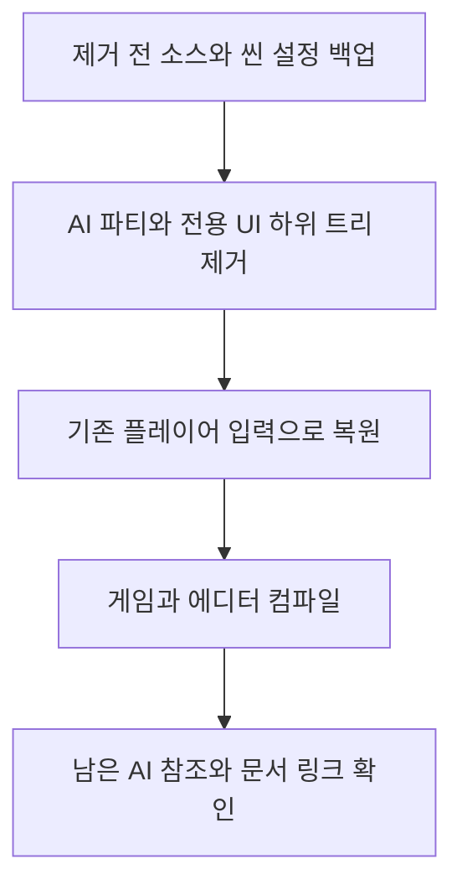
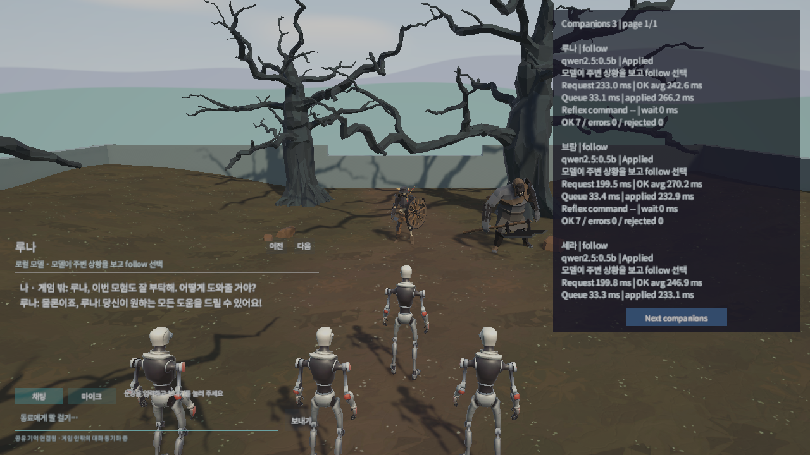

## 작업 결과

Fantasya의 AI 동료 컨트롤러·파티·대화·마이크·지연 HUD·로컬 연결 도구·에셋을 제거했습니다. 게임·에디터 C# 컴파일과 AI 참조 제거를 확인했습니다. 실제 게임 실행은 기존 Unity 세션의 중복 실행 방지로 차단돼 미확인입니다.

## 변경 내용

### 적용 내용

AI 파티와 전용 UI EventSystem의 242개 씬 블록만 제거하고 나머지 212개 블록은 보존했습니다. 플레이어 입력의 대화 포커스 검사·동료 전용 조회 프로퍼티·UI 마우스 검사와 Game.Audio·UI 어셈블리 의존성을 제거했습니다. 기존 플레이어·몬스터·배경·카메라와 다른 미커밋 변경은 보존했습니다.

프로젝트의 Codex·Claude·Cursor Fantasya 연결만 제거하고 전용 동료 서비스를 종료했습니다. 프로젝트 내 음성 모델·런타임·기억은 복구 백업으로 이동해 비활성화했습니다. 공용으로 설치된 Ollama 프로그램과 전역 모델, 모체의 기존 범용 모듈과 과거 공개 기록은 삭제하지 않았습니다.



현재 PlayerController.Update 전체입니다.

```csharp
private void Update()
{
    UpdateCameraOrbit();
    Keyboard keyboard = Keyboard.current;
    if (keyboard == null)
    {
        return;
    }

    if (keyboard.rKey.wasPressedThisFrame)
    {
        SceneManager.LoadScene(gameObject.scene.buildIndex);
        return;
    }

    float horizontal = Axis(keyboard.dKey.isPressed || keyboard.rightArrowKey.isPressed, keyboard.aKey.isPressed || keyboard.leftArrowKey.isPressed);
    float vertical = Axis(keyboard.wKey.isPressed || keyboard.upArrowKey.isPressed, keyboard.sKey.isPressed || keyboard.downArrowKey.isPressed);
    Vector3 forward = Vector3.ProjectOnPlane(_cameraRotation * Vector3.forward, Vector3.up).normalized;
    bool sprint = keyboard.leftShiftKey.isPressed || keyboard.rightShiftKey.isPressed;
    _monster.DrivePlayer(new Vector2(horizontal, vertical), forward, sprint, keyboard.spaceKey.wasPressedThisFrame);

    bool mouseAttack = Mouse.current?.leftButton.wasPressedThisFrame == true;
    if (keyboard.fKey.wasPressedThisFrame || mouseAttack)
    {
        _monster.Attack(SelectOpponent());
    }
}
```

## 검증

게임·에디터 C# 컴파일 통과, AI 컨트롤러·대화·모델·공용 오디오 참조 없음, SceneRoots 유효성·문서 링크 19개를 확인했습니다. 테스트 스위트와 게임 빌드는 실행하지 않았습니다. 실제 Play Mode 확인은 프로젝트가 이미 열려 있다는 Unity 오류로 차단됐으며 사용자 세션을 종료하거나 잠금을 해제하지 않았습니다.



이번 제거 후 새 화면은 실행 차단으로 확보하지 못했습니다. 위 이미지를 제거 완료 화면으로 제시하지 않습니다. [제거 및 보존 블록 근거](../assets/ai-removal-20261111/removal.json) · [컴파일·참조·실행 제한](../assets/ai-removal-20261111/verification.json)

### 대화 기록

사용자: “AIAgent 관련된거 다 지워줘”, “다시 이전 상태로 만들어줘”, “빠르게 부탁”. Codex: 기존 비-AI 변경은 보존하며 AI 기능만 제거했고 미커밋 소스를 복구 백업에 남겼습니다. 정확한 사용자 발언 시각은 미기록이며 작업 시작은 21:56:29 KST입니다.

## 남은 사항

열린 Unity에서 Play를 중지한 뒤 Playground 씬을 다시 열어 확인해야 합니다. 실제 실행·제거 후 화면·게임 빌드는 미확인입니다. 기존 AI 변경이 미커밋이므로 git revert만으로 복구할 수 없으며 로컬 삭제 전 백업을 제공합니다. 목록 카드 썸네일도 미확인입니다. 신규 공용 코드 후보가 없고 전역 지침 수정은 없습니다.

## 작업 시간

- 제안 시간: 2026-11-11 21:56:29 KST 시작, 빠른 제거 5~10분
- 실제로 완료된 시간: AI 제거·컴파일·연결 해제는 22:01 KST까지 확인했습니다. 22:04 추가 실행은 기존 Unity 프로젝트 중복 실행 방지로 차단됐고, 복구 안내·공개 기록 정리를 이어갑니다.
- XERJ: 미사용 — 사용자 지침에 따라 rg·현재 소스·씬 블록·컴파일·Unity 로그로 확인했습니다.
