## 작업 결과

[공개 블로그](https://moondongjun-blog.pages.dev/)에 배너, 프로필, 4열 목록, 검색과 사이트 하단을 적용했습니다. 포트폴리오 링크를 제거했습니다.

## 변경 내용

### 적용 내용

공개 글 700편에 이미지와 설명을 표시합니다. 동향 글은 공식 스토어 또는 저장소 공유 이미지와 출처 링크 두 개를 사용합니다. 검색은 제목·요약·프로젝트명 색인을 브라우저에서 한 번 가져와 최대 30편씩 표시합니다.

## 검증

Cloudflare 운영 배포 ad95fc8f와 GitHub 8c8a345. Chrome에서 PC 4열과 모바일 2열, 홈 카드 16개와 포트폴리오 링크 제거를 확인했습니다.

로컬 700편과 HTML 753개에 내부 링크 오류 0개. 공개 동향 29편의 링크 58개, 고유 외부 출처 52개의 공식 주소 또는 GitHub API 대응 리소스 성공, 이미지 25개 원본 바이트 일치.

Chrome에서 GrowingCity 결과, 한글 게임 키워드, 0건 결과, 더 보기와 색인 단일 요청을 확인했습니다. 전송량 47,825바이트, 브라우저 관측 37.5ms입니다.

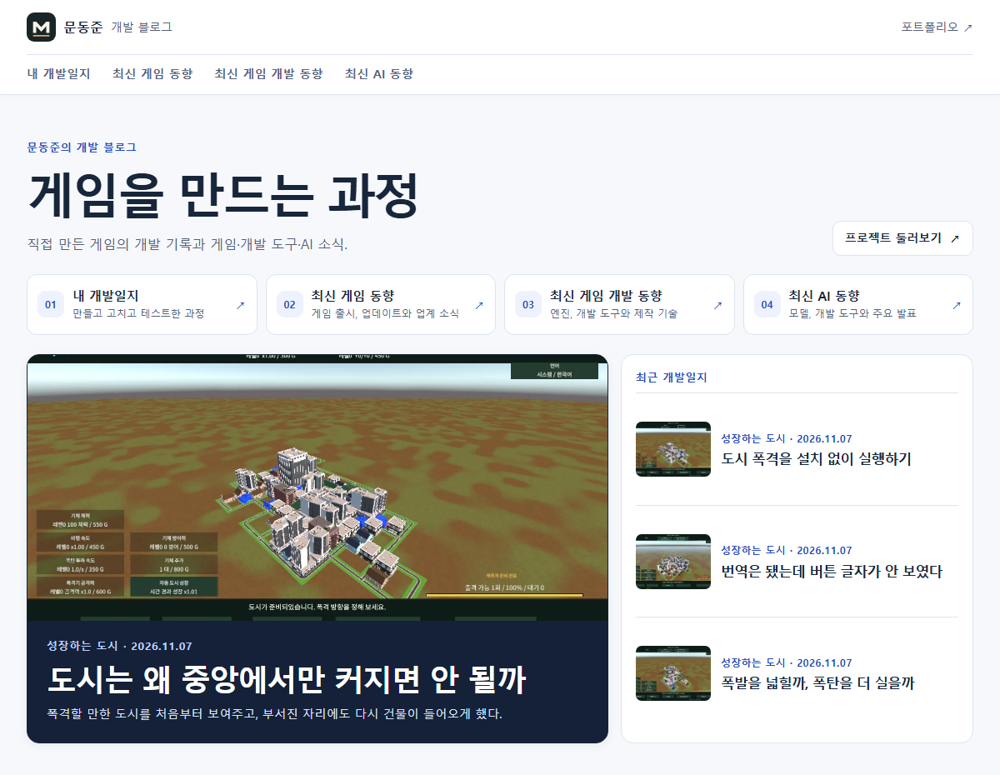

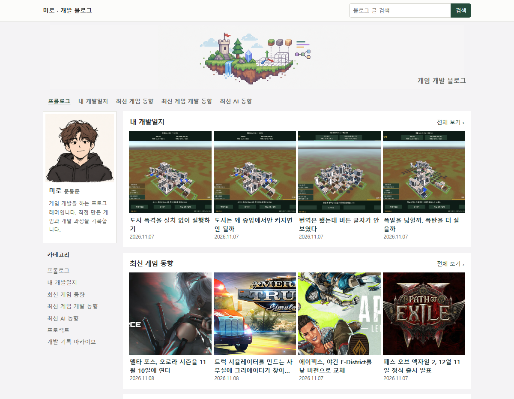

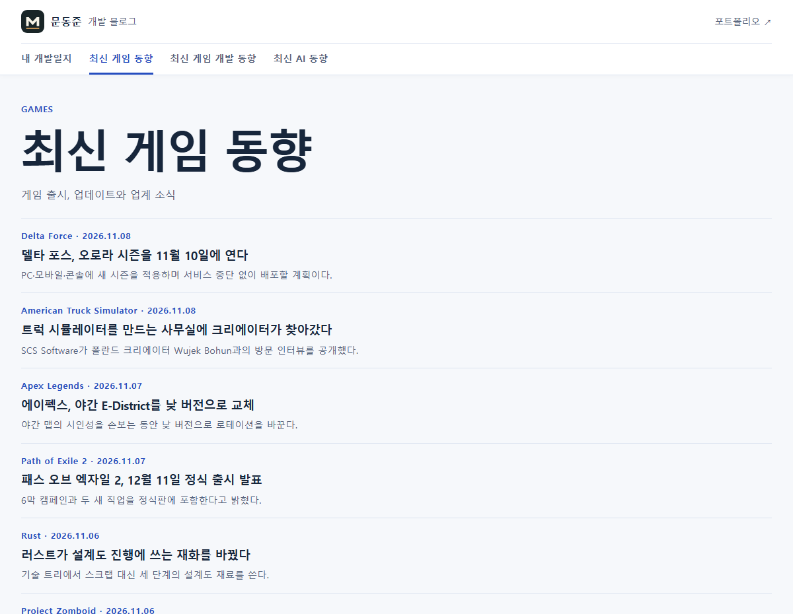

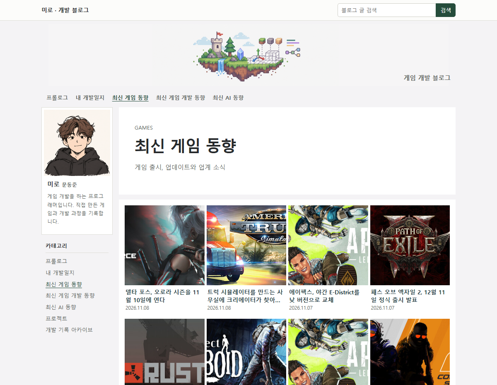

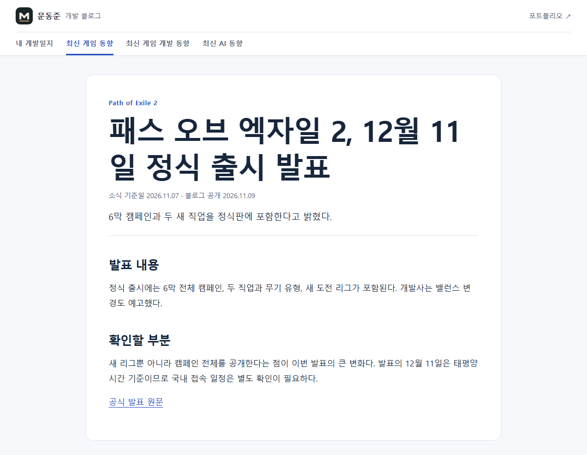

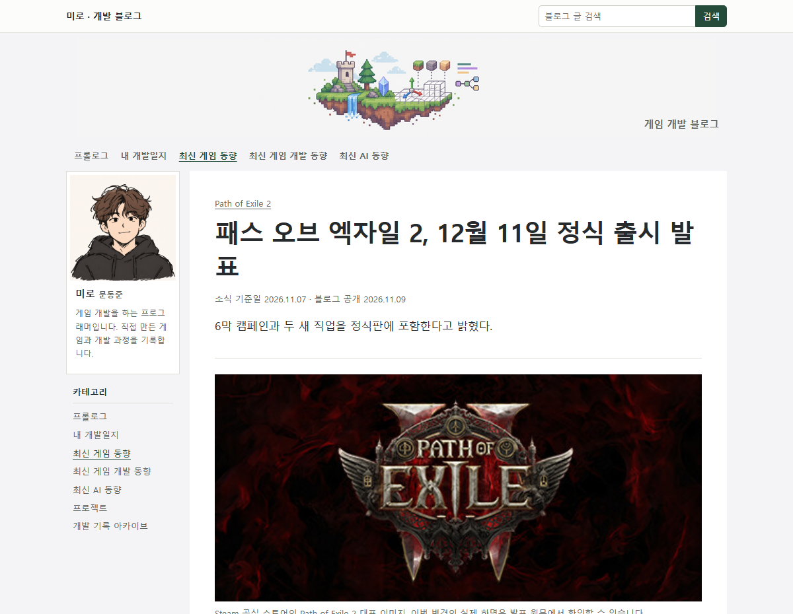

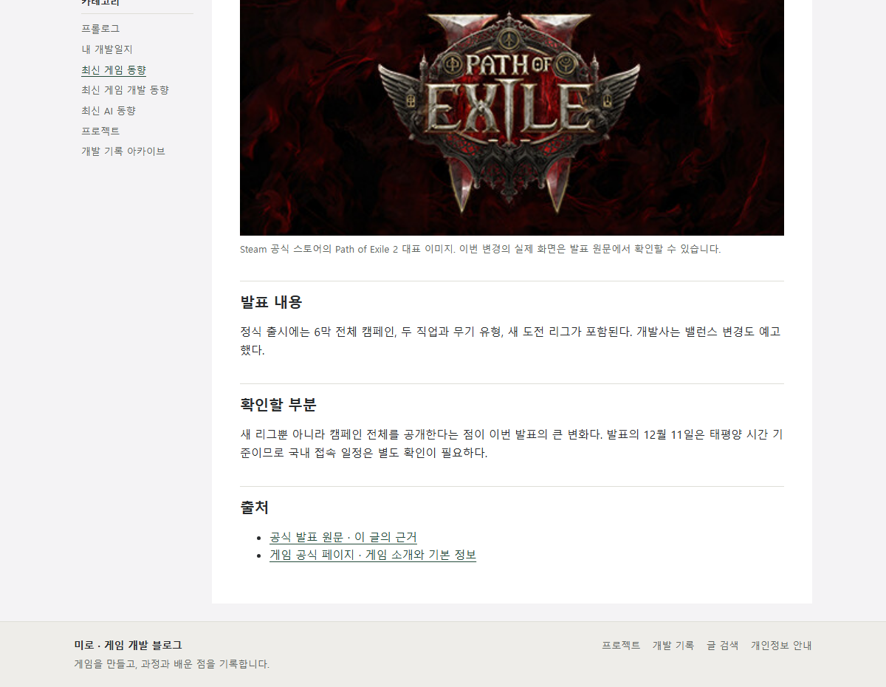

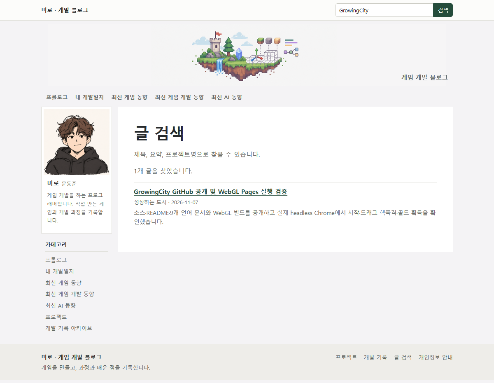

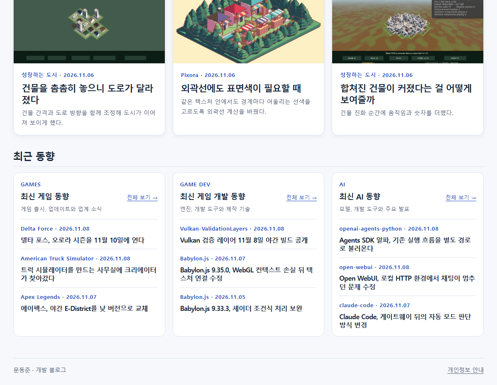

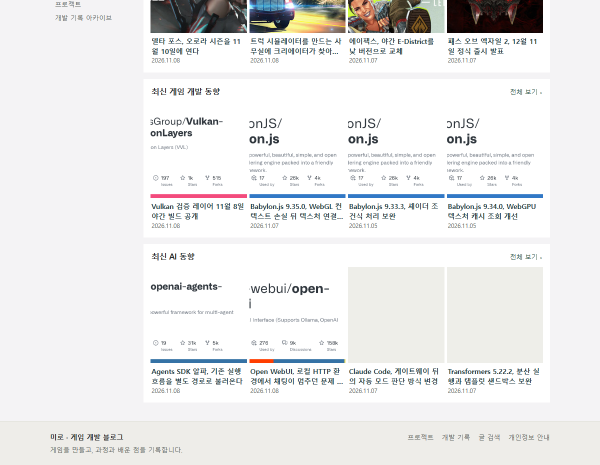

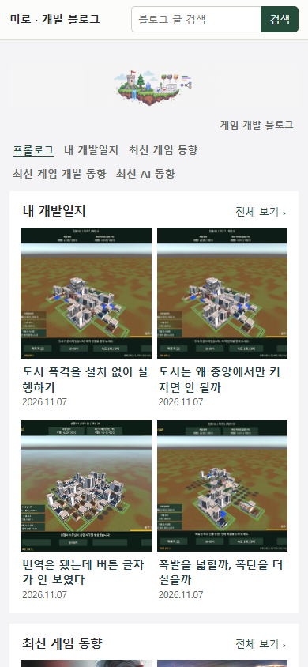

## 남은 사항

방문 통계는 별도 구현 단계입니다. 기존 포트폴리오 GA4와 로그인 전용 Cloudflare Worker를 확인했습니다. 블로그용 GA4 속성을 분리하고 관리 화면에 사이트 선택을 추가하는 방향을 제안했습니다. 전역 지침 변경은 없습니다. 썸네일은 공식 원본과 이미 보유한 이미지로 충당했습니다.

대화 요약(개별 시각 미기록). 사용자는 국내 블로그 디자인을 참고해 달라고 요청한 뒤 “이전에 작업했떤 네이버 블로그 디자인 참고해라”라고 기준을 정정했습니다. 또 동향 글에 참조 링크 최소 2개, 글별 썸네일과 설명, 탑바·푸터, 빠른 검색과 포트폴리오 링크 제거를 요청했습니다. AI는 기존 네이버 배너와 프로필 원본을 사용하고 동향 글에서 원문과 배경 링크를 구분했습니다.

## 작업 시간

- 제안 시간: 네이버 레이아웃·이미지·출처 5~10분. 상단·하단·검색 추가 4~7분 예상.
- 실제로 완료된 시간: 2026-11-09 17:03:32 KST 작업 시작 기록, 17:12:53 KST 사이트 검증 완료 기록. 9분 21초.
- XERJ: 미사용 — 연결 도구 미제공. rg, 원본 HTML과 브라우저 실행 결과를 대조했습니다.
