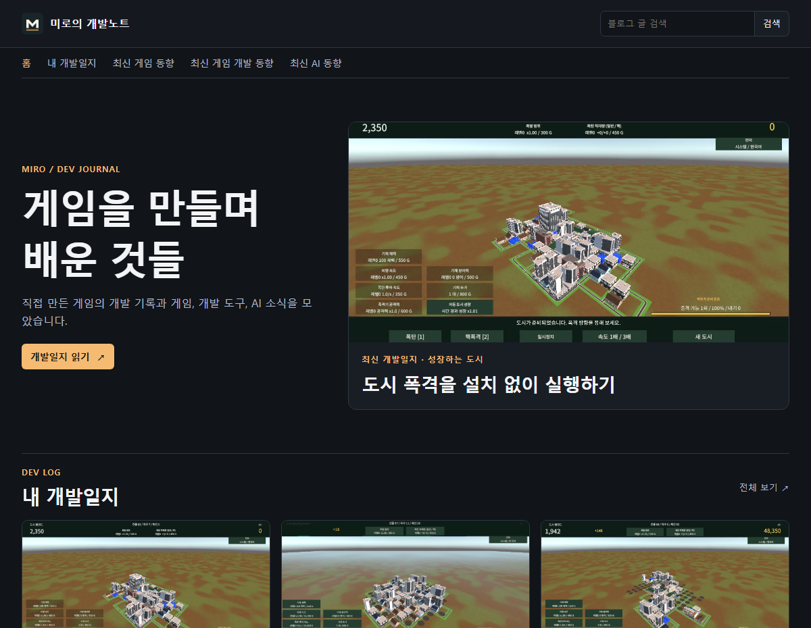
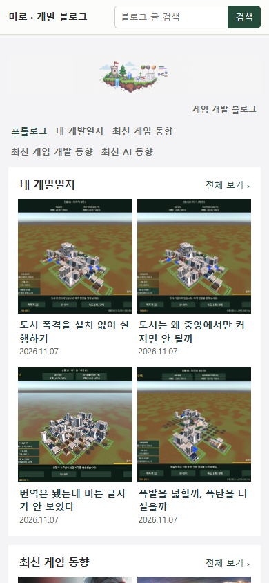
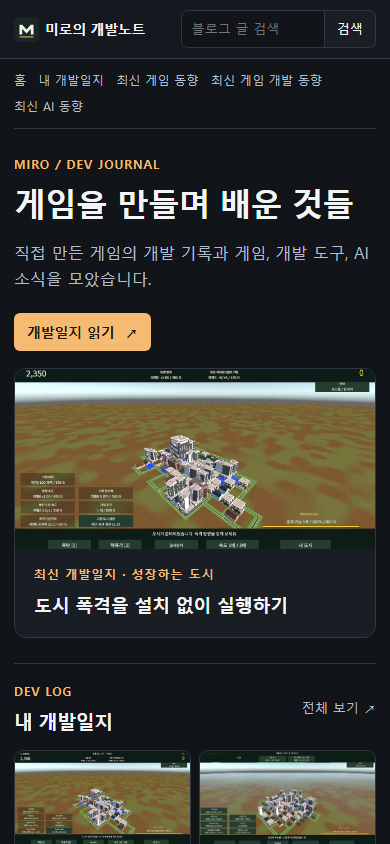
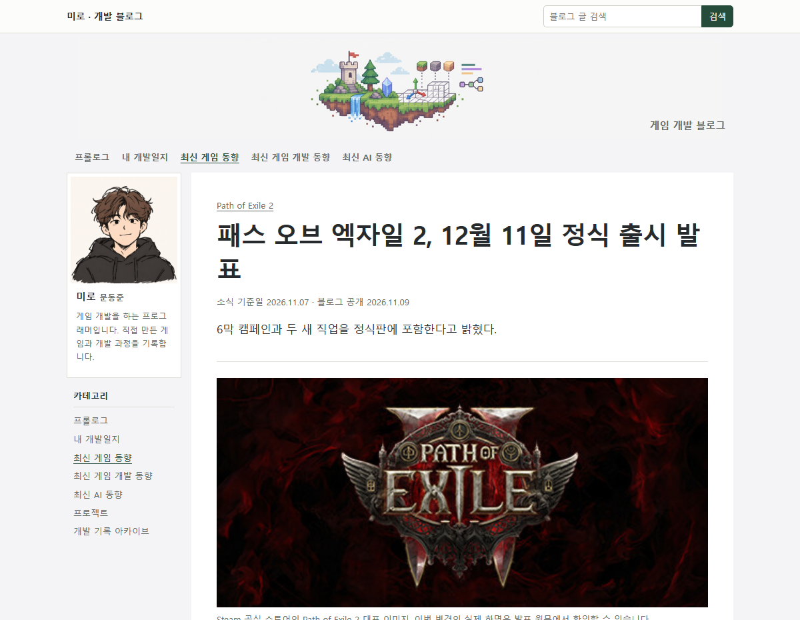
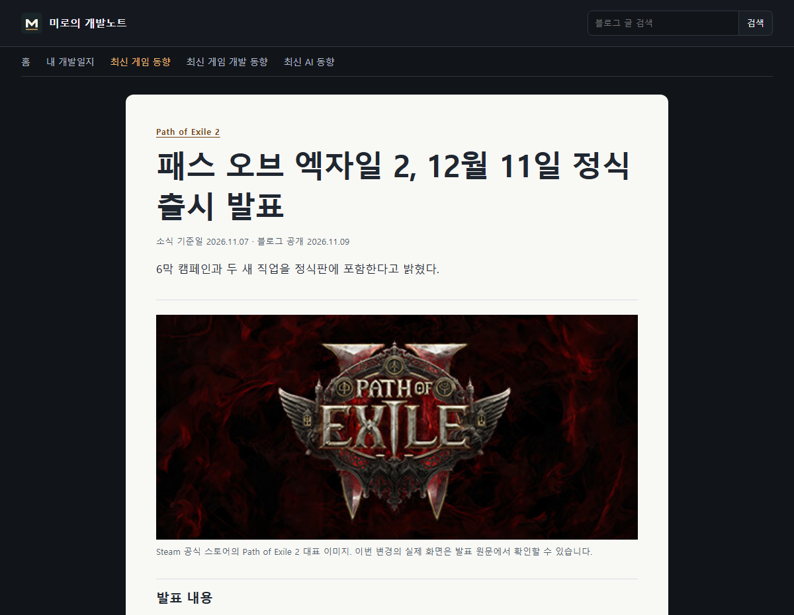
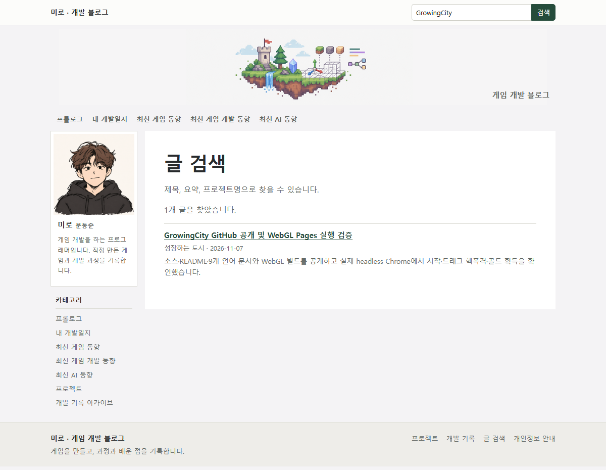
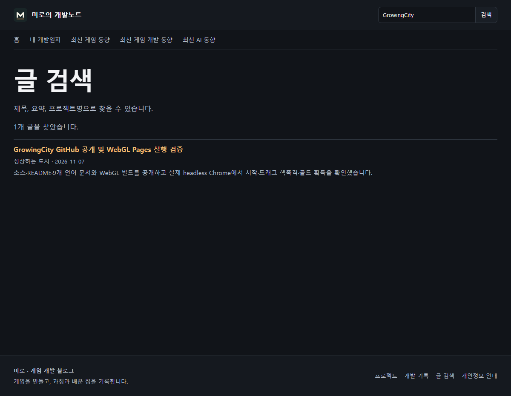

## 작업 결과

[개발 블로그](https://moondongjun-blog.pages.dev/)의 새 디자인이 운영에 반영됐습니다.

## 변경 내용

### 적용 내용

상단 검색과 카테고리, 최신 개발일지를 크게 보여 주는 홈, 16:9 목록 카드, 읽기용 본문 스타일을 적용했습니다.

## 검증

운영 Chrome에서 홈과 카테고리, 데스크톱 3열과 모바일 2열, 실제 이미지, 글 상세 출처 2개, GrowingCity 검색을 확인했습니다. 빌드 HTML 753개와 게시물 700편의 내부 링크 오류는 0건입니다. GitHub 32a3981을 푸시했습니다.

## 남은 사항

전역 지침 변경은 없습니다. 기존 개발일지의 게임 화면 원본을 사용했습니다.

대화 기록 요약. 사용자가 “네이버 블로그 디자인 구리다 바꿔줘”라고 요청했습니다. AI는 앞서 공개 개발 블로그에 적용한 네이버풍 레이아웃을 교체하는 요청으로 해석하고 최신 개발일지에 실제 게임 화면을 사용했습니다.

## 작업 시간

- 제안 시간: 디자인과 배포 검증 약 5~8분.
- 실제로 완료된 시간: 2026-11-09 18:04:40 KST 시작, 운영 검증 2026-11-09T18:08:27+09:00 완료, 227초.
- XERJ: 미사용 — 연결 도구가 없어 rg와 격리 Chrome으로 검증했습니다.
