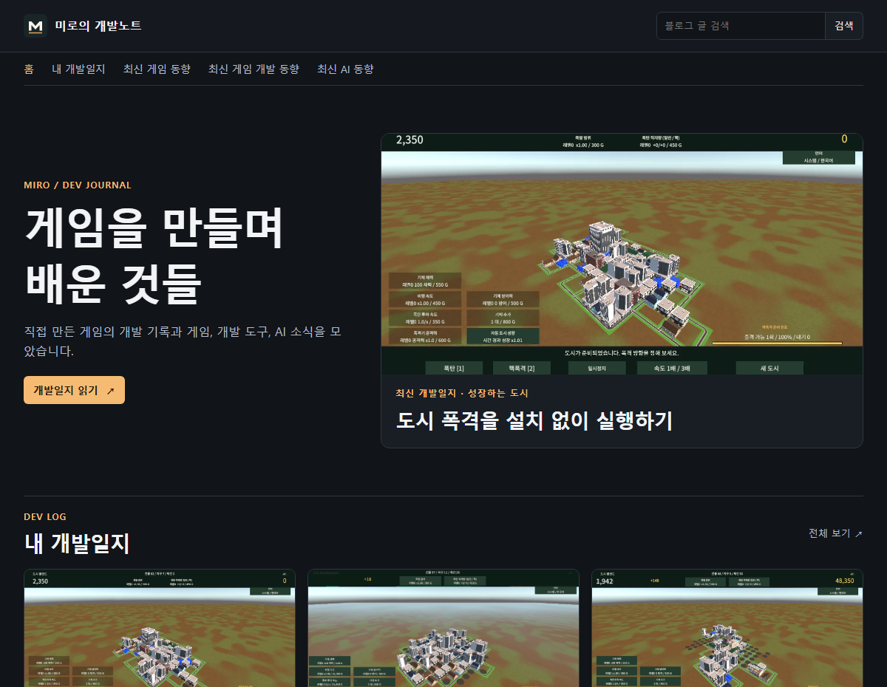
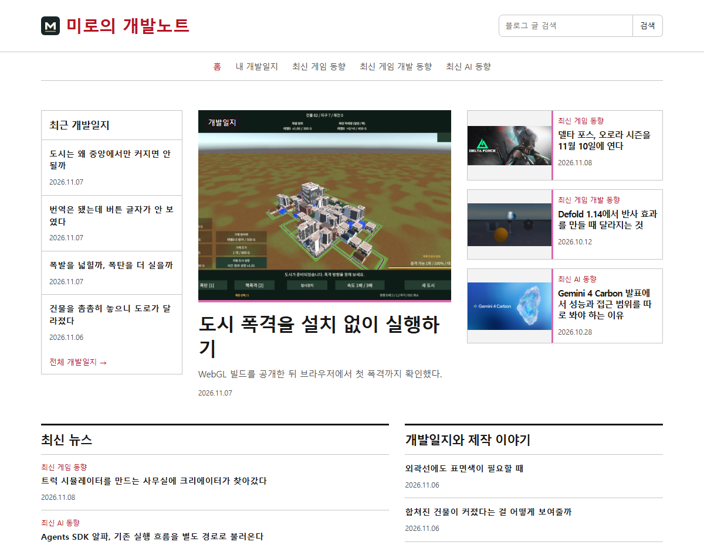
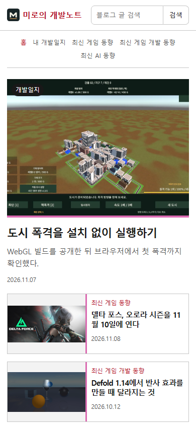
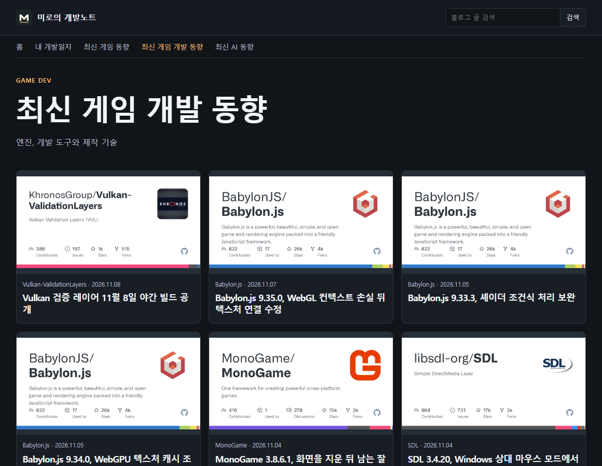
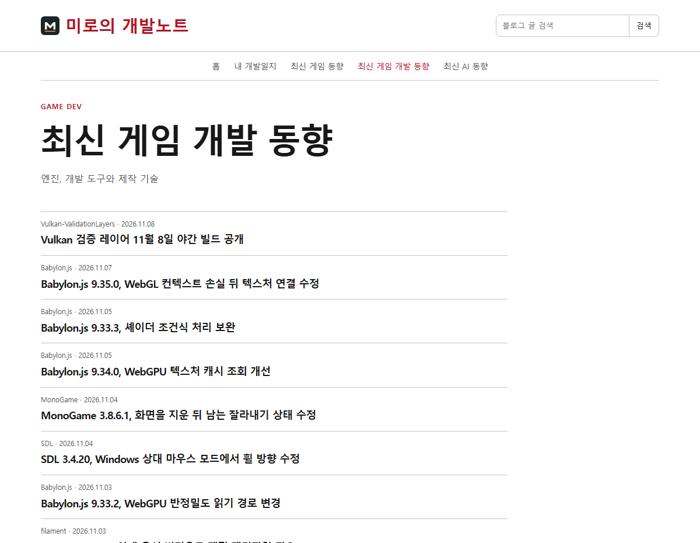
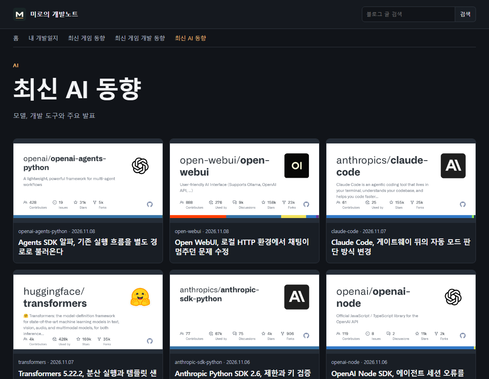
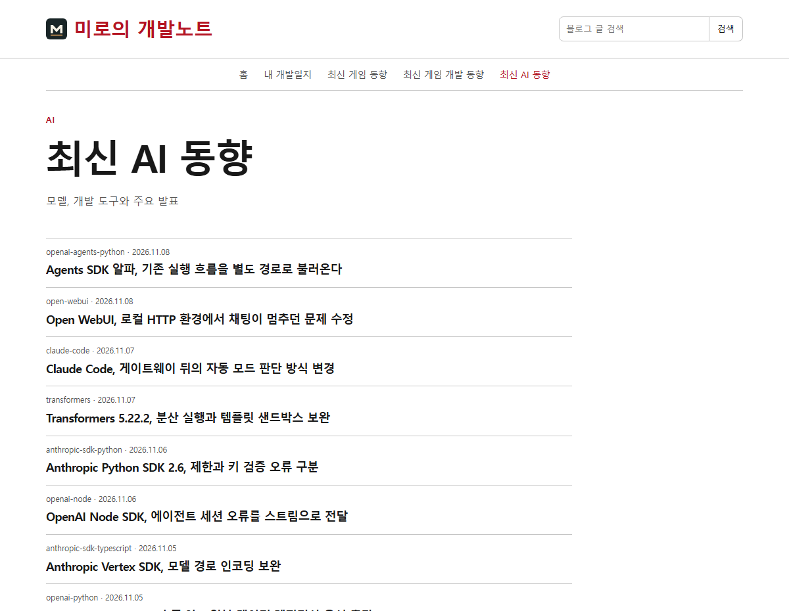
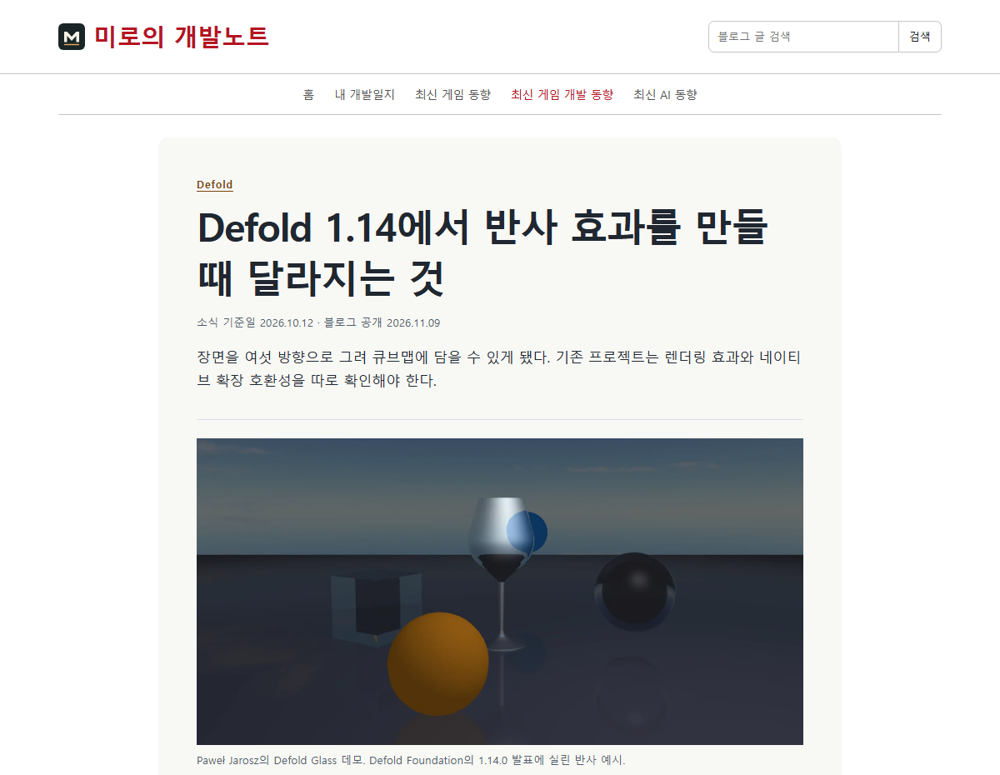
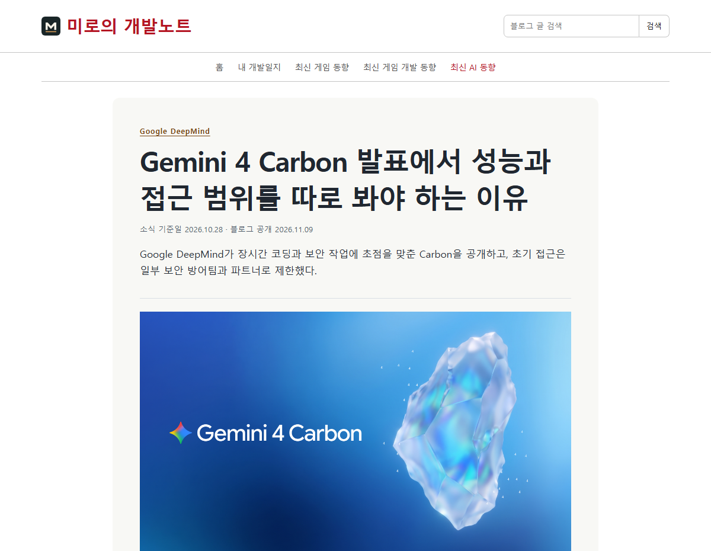

## 작업 결과

[개발 블로그](https://miro-7rc.pages.dev/)의 새 디자인이 운영에 반영됐습니다.

## 변경 내용

### 적용 내용

왼쪽 최신 개발일지, 중앙 대표 글, 오른쪽 주요 동향, 하단 최신 뉴스 목록을 구성했습니다. Defold와 Gemini Carbon은 공식 발표 자료로 별도 작성했습니다.

## 검증

새 주소의 실제 Chrome에서 홈 데스크톱 3열과 모바일 1열, 새 글 두 편의 이미지와 출처, GrowingCity 검색을 확인했습니다. 빌드 HTML 755개와 게시물 702편의 내부 링크 오류는 0건입니다. 두 동향 게시판에서 저장소 공유 이미지가 표시되지 않는 것을 확인했습니다.

## 남은 사항

10월 10일~11월 8일 30일간 게시판마다 60편이 목표입니다. 새로 각 한 편을 발행해 게임 개발 동향은 14편, AI 동향은 9편입니다. 각각 46편, 51편이 부족하며 기존 글 21편의 공유 카드 표시는 제거했으며, 기사에 직접 관련된 이미지 확보는 남아 있습니다. 전역 지침 변경은 없습니다.

대화 기록 요약. 사용자가 Game Developer를 직접 지정하고 주소를 미로로 바꾸며 게임 개발과 AI 동향 원고의 품질과 일별 수량을 바로잡아 달라고 요청했습니다. AI는 원본 첫 화면을 Chrome으로 확인하고 레이아웃을 반영했으며 Cloudflare가 배정한 주소를 적용했습니다.

## 작업 시간

- 제안 시간: 디자인과 배포 검증 약 5~8분.
- 실제로 완료된 시간: 2026-11-09 18:15:16 KST 시작, 운영 검증 2026-11-09T18:25:16.7782589+09:00 완료, 601초.
- XERJ: 미사용 — 연결 도구가 없어 rg와 격리 Chrome으로 검증했습니다.
