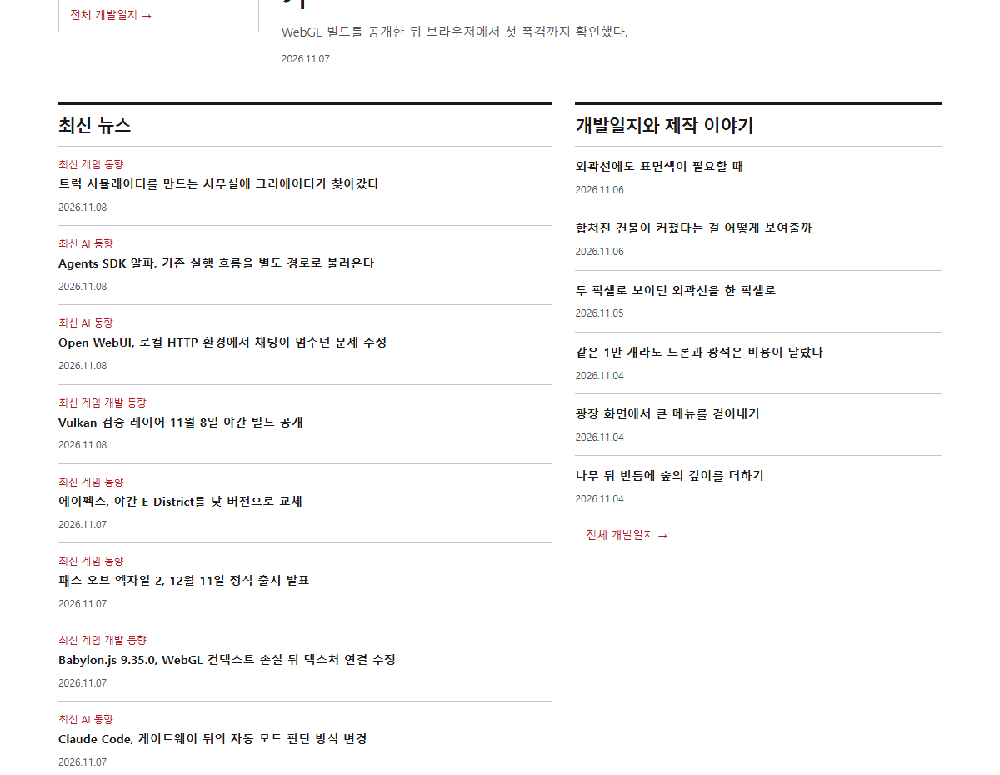
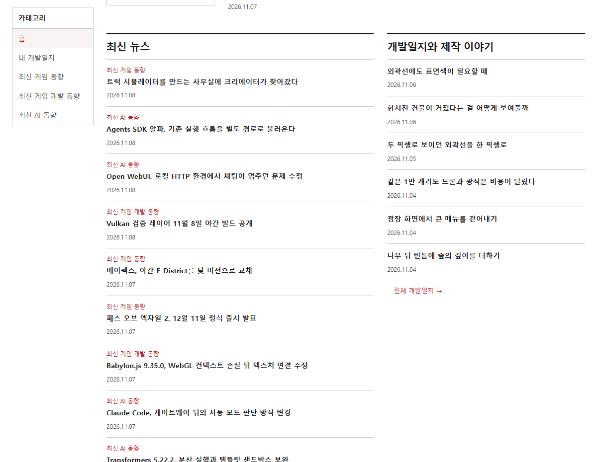
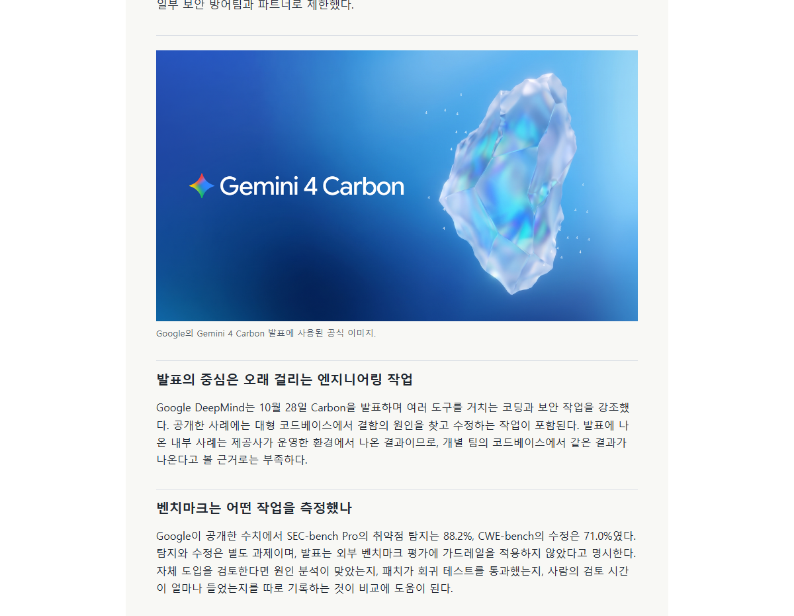
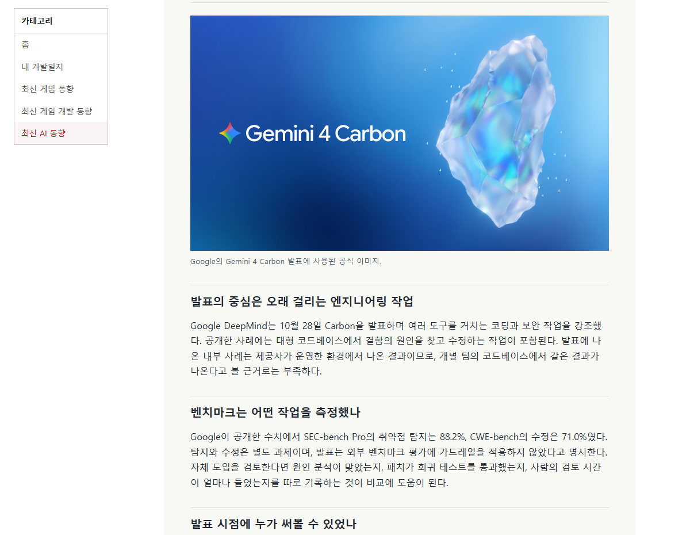
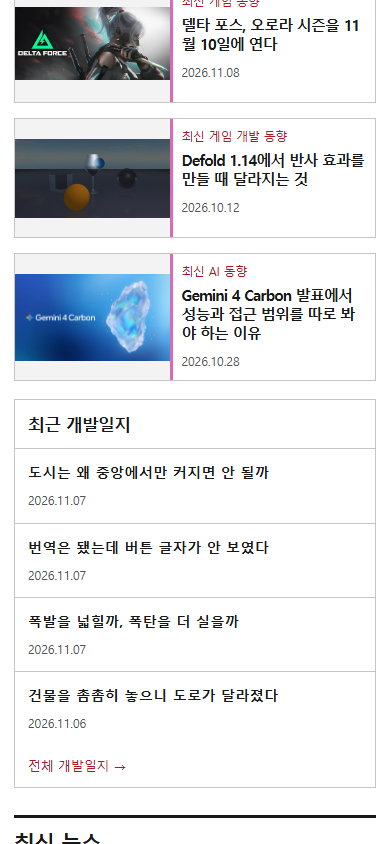
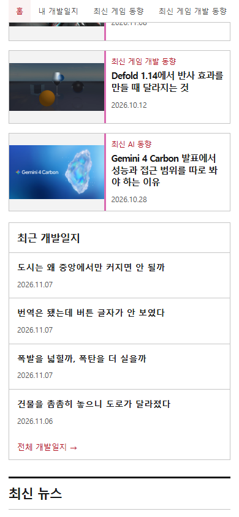

## 작업 결과

[미로 블로그](https://miro-game.pages.dev/)의 카테고리 메뉴를 스크롤하는 동안 계속 사용할 수 있게 바꿨습니다.

## 변경 내용

### 적용 내용

넓은 화면에서는 메뉴를 본문 왼쪽에 배치합니다. 모바일에서는 가로로 넘길 수 있는 상단 메뉴를 고정합니다.

## 검증

실제 운영 Chrome에서 홈과 글 상세를 스크롤한 뒤 메뉴가 본문 왼쪽에 유지되는 것을 확인했습니다. 모바일 390px에서는 메뉴가 화면 상단에 고정되고 페이지 가로 넘침이 없었습니다.

## 남은 사항

전역 지침 변경은 없습니다.

대화 요약. 사용자는 “카테고리 메뉴는 항상 화면에 따라왔으면 좋겠는데 좌측에”라고 요청했습니다. 모바일에서는 본문 너비를 확보하도록 상단으로 배치했습니다.

## 작업 시간

- 제안 시간: 배포와 확인 약 3~5분.
- 실제로 완료된 시간: 2026-11-09 19:12:04 KST 시작, 운영 검증 2026-11-09T19:14:47.0243209+09:00 완료, 163초.
- XERJ: 미사용 — rg로 공통 카테고리 메뉴와 스타일 위치를 확인했습니다.
