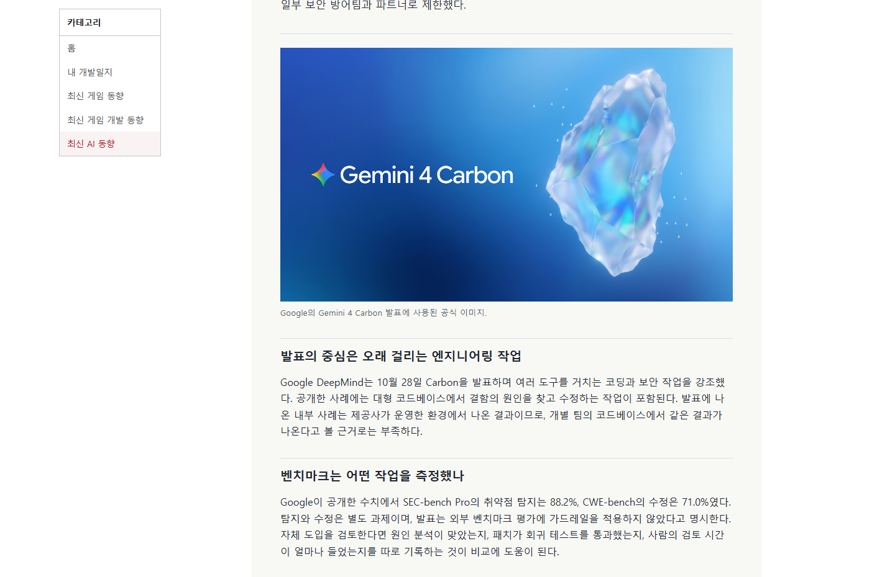
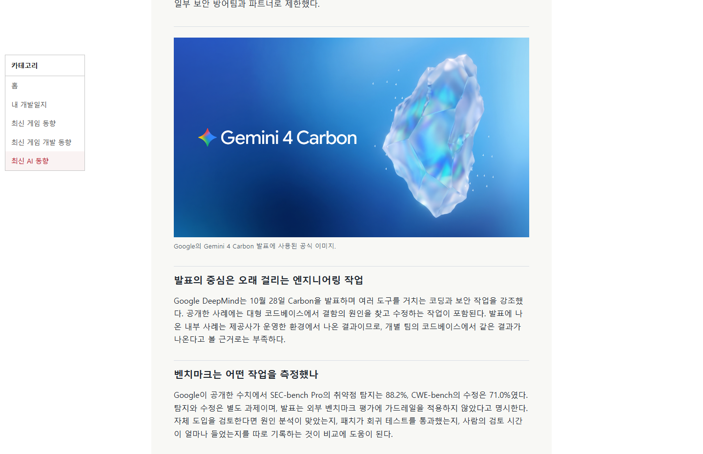
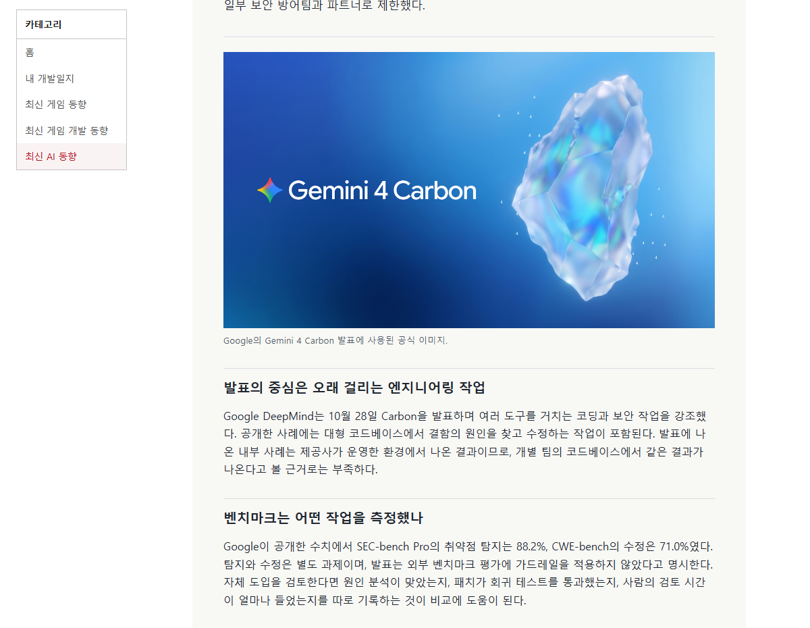
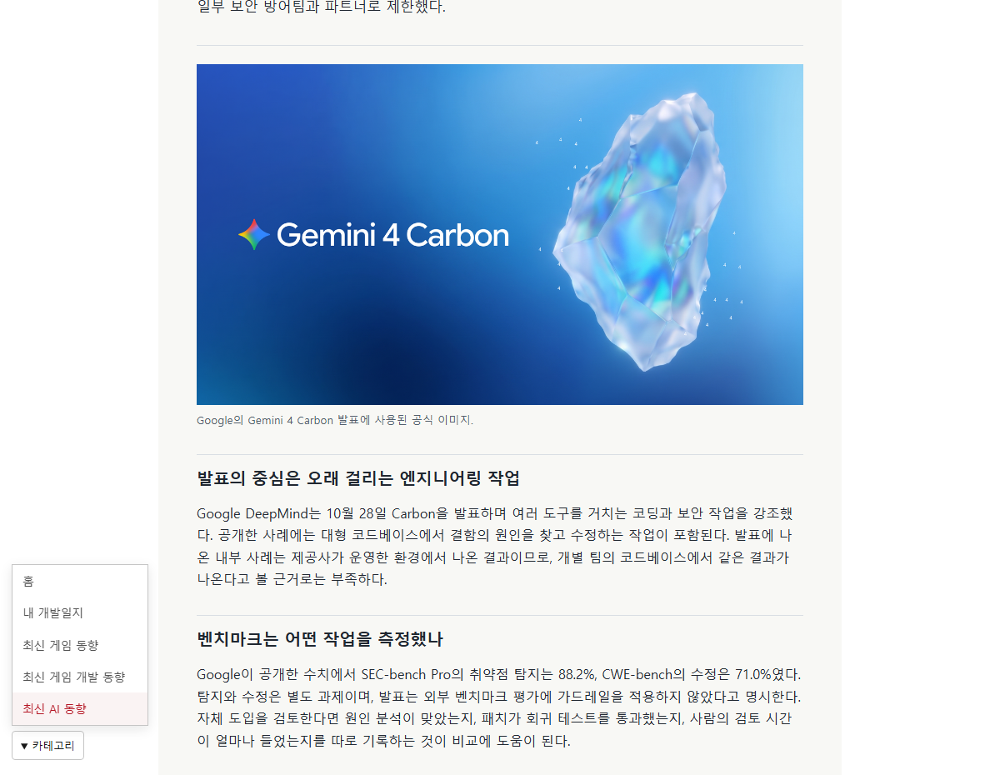

## 작업 결과

[미로 블로그](https://miro-game.pages.dev/)의 본문 폭과 가운데 정렬을 복원했습니다.

## 변경 내용

### 적용 내용

넓은 화면은 왼쪽 여백에 전체 메뉴를 표시합니다. 일반 데스크톱에서는 왼쪽 버튼으로 메뉴를 엽니다.

## 검증

운영 Chrome의 1440px와 1200px에서 본문 왼쪽 좌표와 너비를 메뉴 도입 전 화면과 비교했습니다. 두 화면 모두 같았으며 1200px에서 메뉴를 열어도 본문 좌표가 유지됐습니다. 모바일 390px의 상단 고정도 확인했습니다.

## 남은 사항

전역 지침 변경은 없습니다.

대화 요약. 사용자는 “메뉴가 생긴만큼 밀렸는데 별로임”라고 요청했습니다. AI는 메뉴 도입 전의 본문 위치와 폭을 복원하고 화면 너비에 따라 전체 메뉴나 버튼을 배치했습니다.

## 작업 시간

- 제안 시간: 배포와 확인 약 3~5분.
- 실제로 완료된 시간: 2026-11-09 19:17:51 KST 시작, 운영 검증 2026-11-09T19:20:32.2642706+09:00 완료, 161초.
- XERJ: 미사용 — rg로 공통 카테고리 메뉴와 스타일 위치를 확인했습니다.
