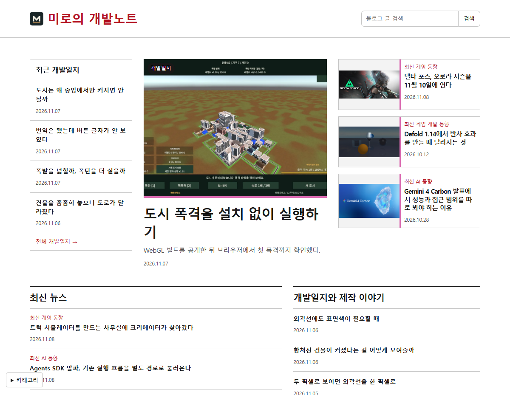
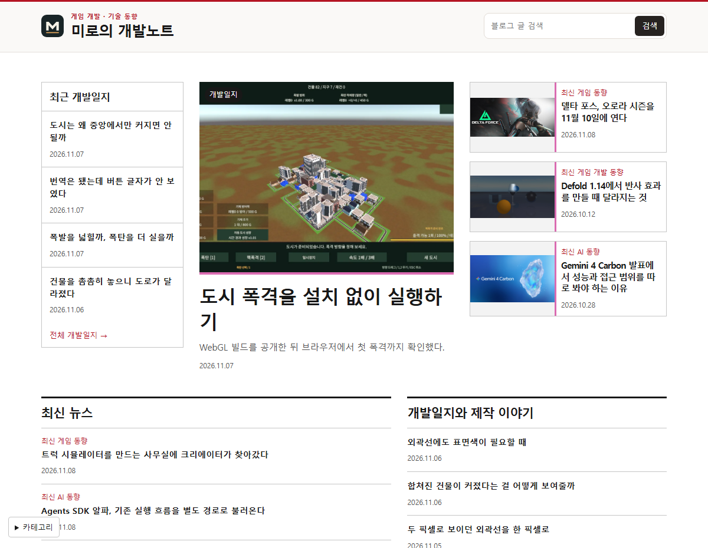
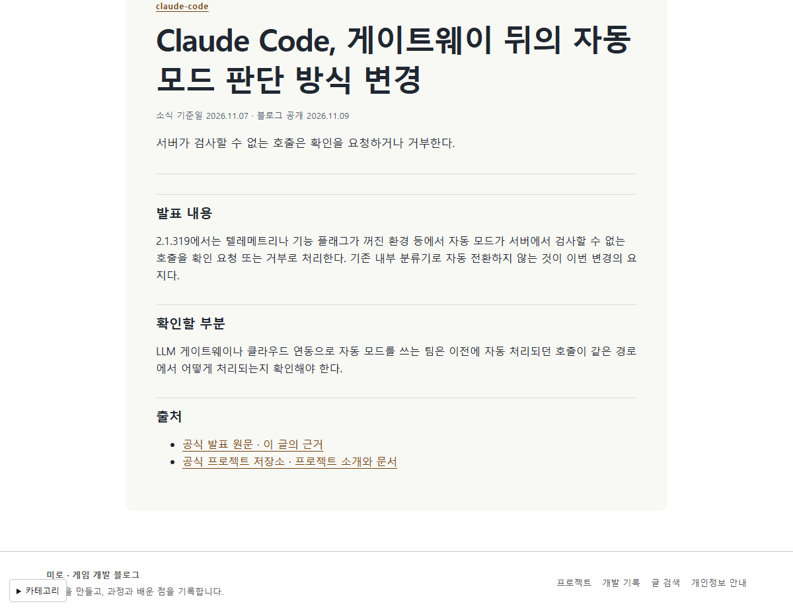
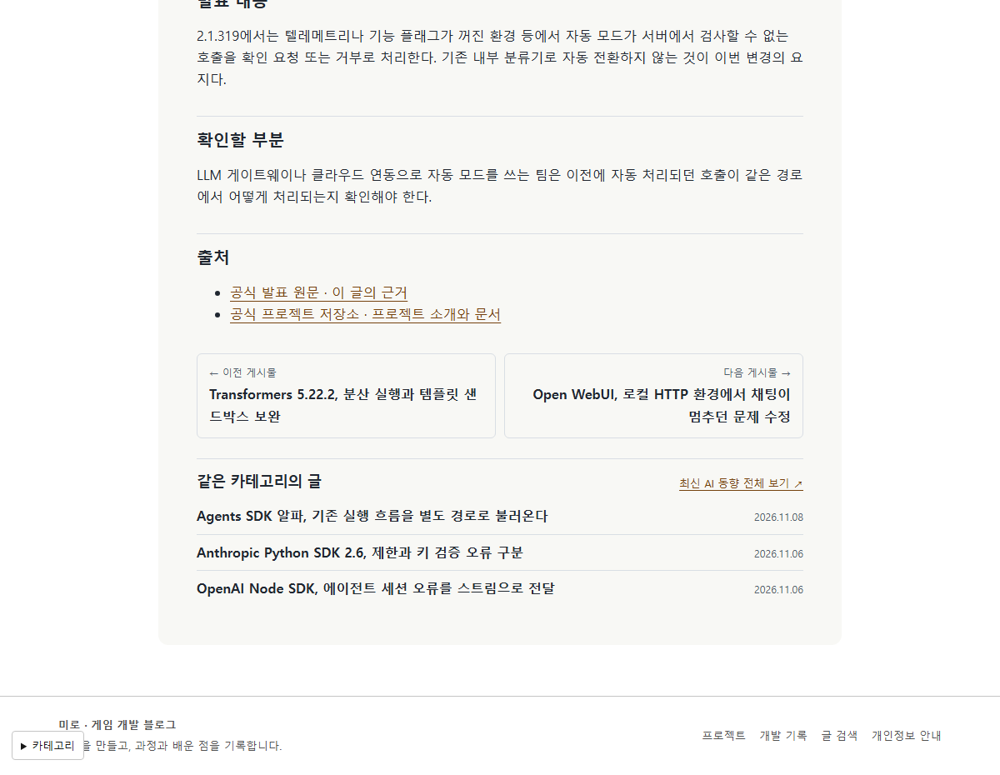
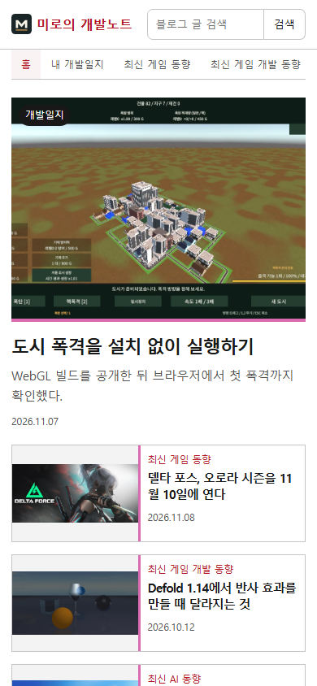
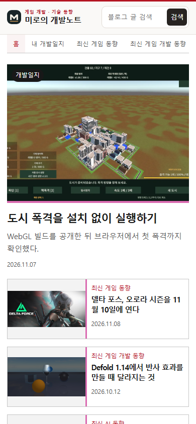

## 작업 결과

[미로 블로그](https://miro-game.pages.dev/)의 상단과 글 하단을 개선했습니다.

## 변경 내용

### 적용 내용

상단의 브랜드와 검색을 한 줄로 배치했습니다. 이전 글은 같은 카테고리의 더 오래된 글, 다음 글은 더 최근 글로 연결합니다. 같은 카테고리의 추천 글은 최대 세 편입니다.

## 검증

운영 Chrome의 실제 글에서 이전·다음과 같은 카테고리의 추천 글 3개가 표시되고 모두 정상 응답하는 것을 확인했습니다. 이전 글을 눌러 이동했으며 모바일 390px에서 가로 넘침이 없었습니다.

## 남은 사항

전역 지침 변경은 없습니다.

대화 요약. 사용자는 글 상세에 같은 카테고리 글과 이전·다음 이동을 추가하고 사이트 상단 디자인을 세련되게 해 달라고 요청했습니다.

## 작업 시간

- 제안 시간: 배포와 확인 약 3~5분.
- 실제로 완료된 시간: 2026-11-09 19:23:50 KST 시작, 운영 검증 2026-11-09T19:26:42.3971372+09:00 완료, 172초.
- XERJ: 미사용 — rg로 상단과 게시글 템플릿을 찾았습니다.
