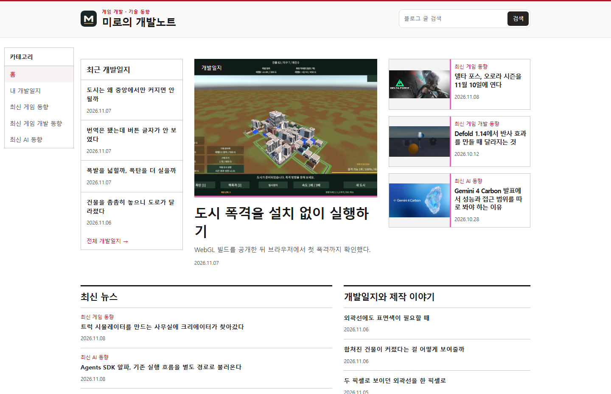
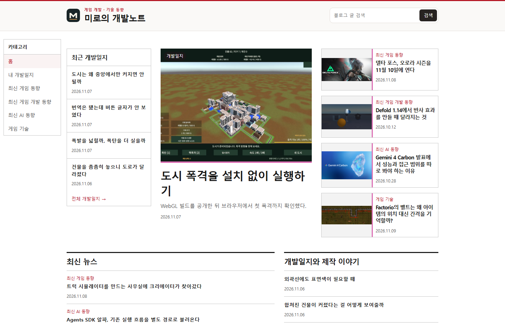
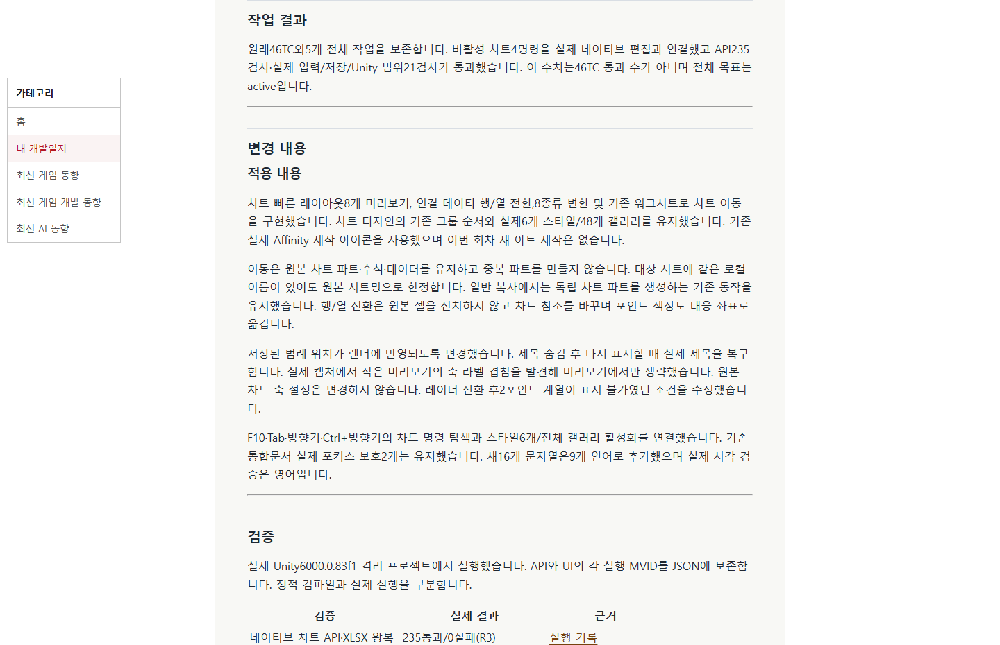
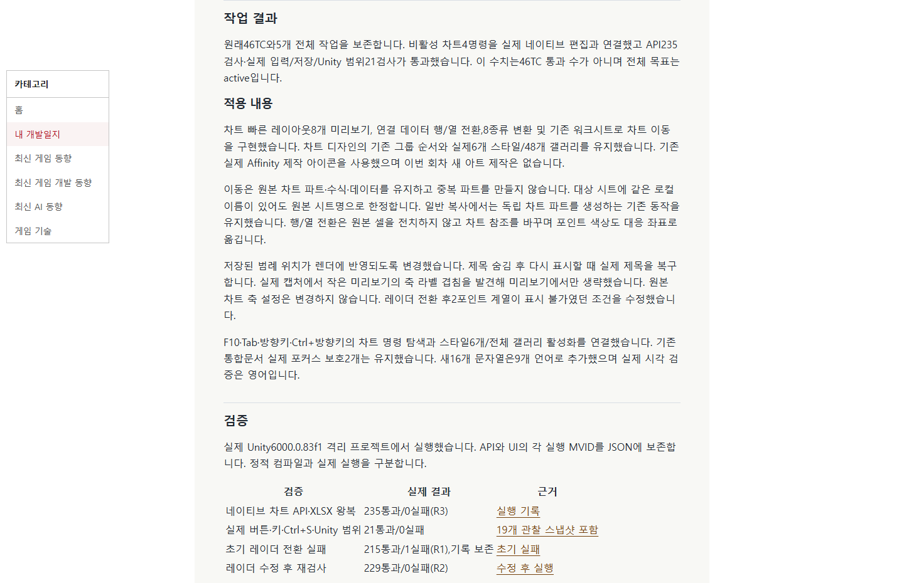
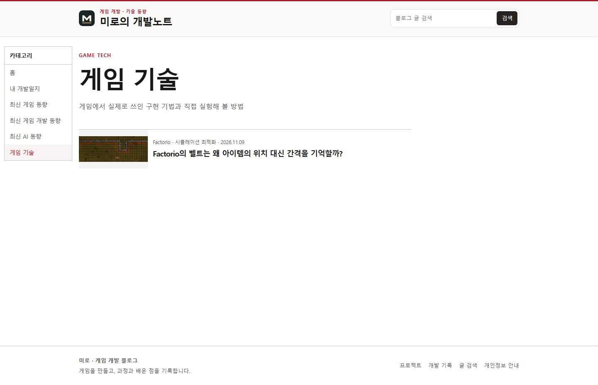
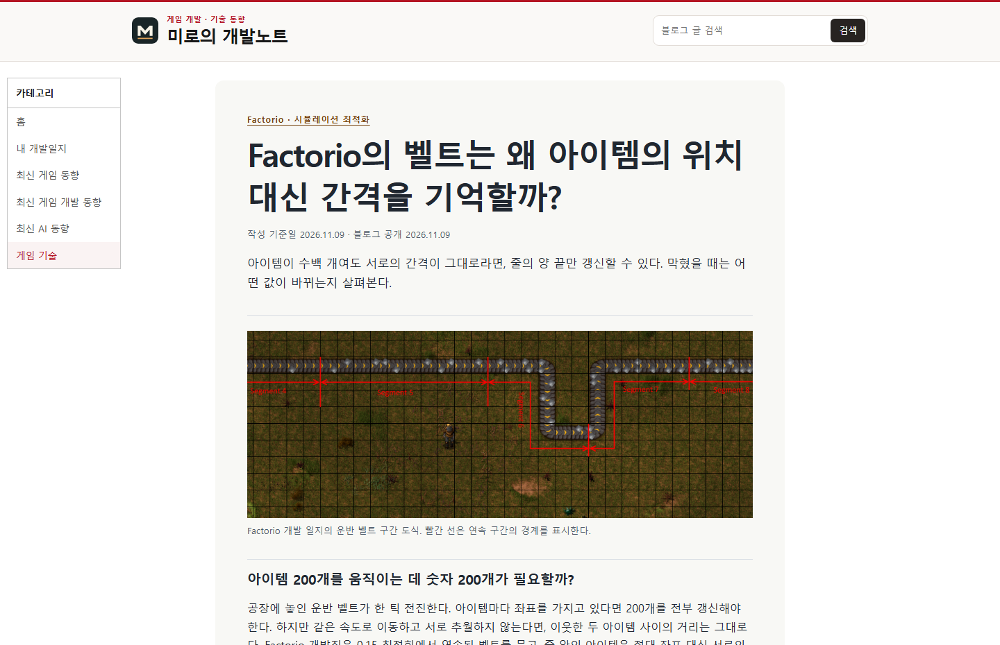

## 작업 결과

[게임 기술](https://miro-game.pages.dev/game-tech/) 카테고리를 추가했습니다.

## 변경 내용

### 적용 내용

Factorio 벨트의 간격 저장 방식을 공식 이미지와 함께 소개했습니다. 모든 게시판의 예약 발행을 하루 한 편으로 바꾸고, 새 원고에는 관련 썸네일과 1,500자 이내 본문을 요구합니다.

## 검증

운영 사이트에서 카테고리, Factorio 첫 글의 원본 이미지와 출처, 기존 장문 게시글의 단축 본문을 확인했습니다. 1,500자를 넘은 원고 143개를 줄였으며 모든 게시물은 빌드에서 글자 수를 검사합니다. 예약 설정은 오전 10시 한국시간 하루 한 번입니다.

## 남은 사항

예약 발행은 설정을 변경했으며 첫 예약 실행은 예정 상태입니다. 예전 글의 누락 썸네일 보강은 이번 원고 길이 변경 범위와 별개로 남아 있습니다. 전역 지침 변경은 없습니다.

대화 요약. 사용자는 GamePrompt와 같은 게임 기술 게시판, 게시판별 하루 한 편과 썸네일을 요청했습니다. 이후 기존 글을 포함해 본문을 1,500자 이내로 갱신해 달라고 요청했습니다.

## 작업 시간

- 제안 시간: 카테고리와 예약 발행 구성 약 5~8분. 기존 글 길이 수정 요청을 작업 중 추가했습니다.
- 실제로 완료된 시간: 2026-11-09 19:32:30 KST 시작, 운영 검증 2026-11-09T19:39:15.1166665+09:00 완료, 405초.
- XERJ: 미사용 — rg로 블로그 생성과 출처 검사 위치를 확인했습니다.
