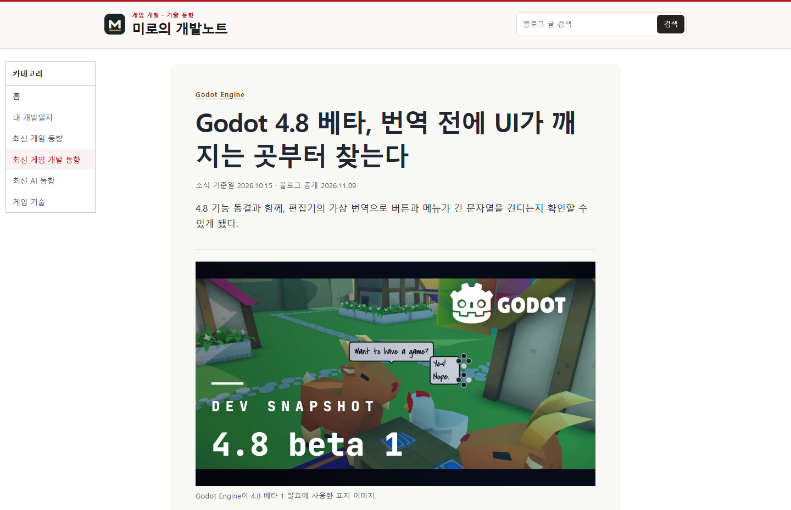
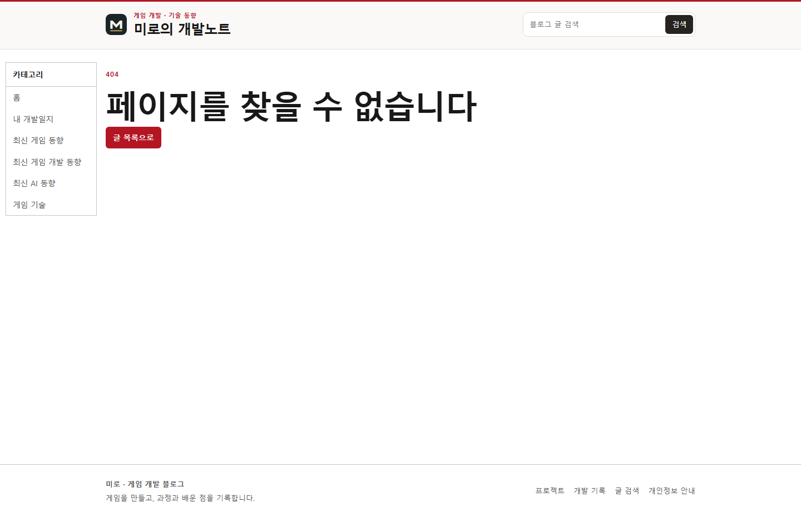
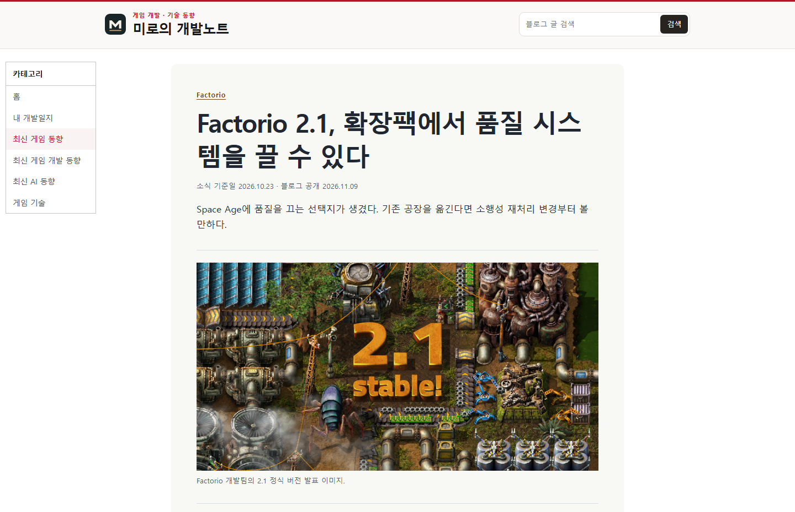
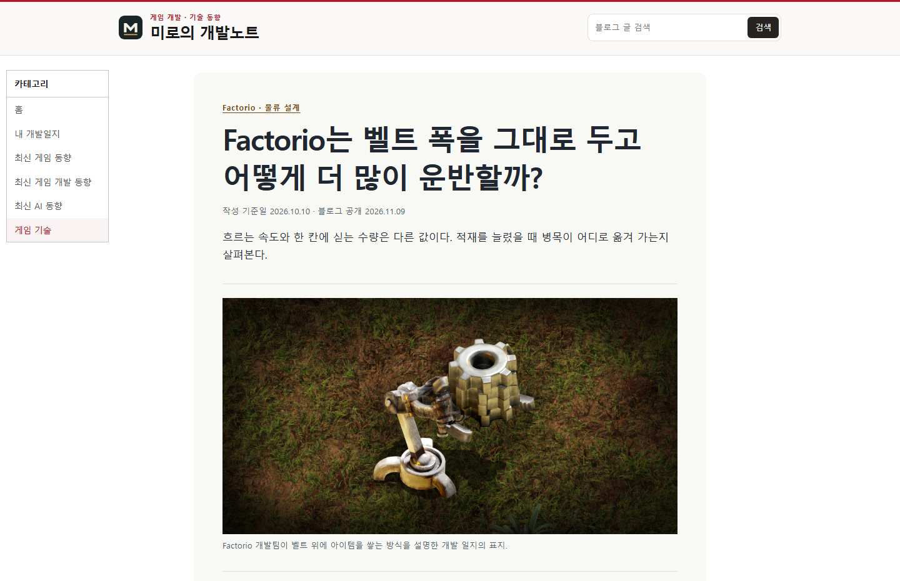

## 작업 결과

본문 길이는 주제에 따라 조절합니다. 빌드에서 길이 검사와 경고를 제거했습니다. 공식 자료를 바탕으로 쓴 글 3편은 운영에서 본문과 이미지까지 확인했습니다.

## 변경 내용

### 적용 내용

- 작성 안내와 기존 예약 발행 지침을 1,500자 내외로 수정했습니다.
- [게임 동향](https://miro-game.pages.dev/posts/news-factorio-21-stable/), [게임 개발 동향](https://miro-game.pages.dev/posts/news-godot-48-beta1/), [게임 기술](https://miro-game.pages.dev/posts/tech-factorio-stacked-belts/)에 한 편씩 추가했습니다.

### 대화 기록

- 사용자(시각 미기록) — 한 달 동안 각 게시판에 하루 한 편과 관련 썸네일을 요청하고 1,500자 초과 시 중단되는 이유를 질문했습니다.
- AI(시각 미기록) — 기존 빌드 중단을 경고로 바꾸고, 배포를 확인한 3편과 미완료 범위를 보고했습니다. 중앙 아카이브 보고서 게시와 공개 확인을 누락했습니다.
- 사용자(시각 미기록) — “1500자 내외로 넓게 작성하라는거고”라고 기준을 정정하고, 보고서 누락과 지연 원인 확인을 요청했습니다.

## 검증

이전 회차에서 1,501자 원고가 페이지로 생성되는 것을 확인했습니다. 이번 회차에는 길이 검사 자체를 제거한 소스의 빌드가 성공했고, 예약 발행 지침 수정이 저장됐습니다. 앞선 운영 배포에서 세 글에 이미지 캡션이 존재하고 썸네일은 각각 HTTP 200으로 응답했습니다.

## 남은 사항

10월 10일~11월 8일 중 글이 있는 날짜는 게임 기술 1일, 게임 동향 5일, 게임 개발 동향 11일, AI 동향 5일, 편집한 개발일지 9일입니다. 월간 빈 날짜와 기존 글의 누락 썸네일 보강은 미완료입니다. 빌드 조건 변경은 화면 디자인 변경이 없습니다. 전역 지침을 변경하지 않았습니다.

## 작업 시간

- 제안 시간: 이전 빌드 수정과 운영 확인 2~4분. 이번 지침 정정과 보고서 공개 5~8분 예상.
- 실제로 완료된 시간: 이전 글 3편 운영 확인은 2026-11-09 19:48:30 KST에 완료했습니다. 이번 회차는 19:57:14 KST에 실행 기록을 시작했고, 2026-11-09 19:59:12 KST에 보고서를 생성했습니다. 공개 확인 시각은 최종 답변에 기록합니다.
- XERJ: 미사용 — rg로 글자 수 규칙과 예약 발행 설정을 확인했습니다.
