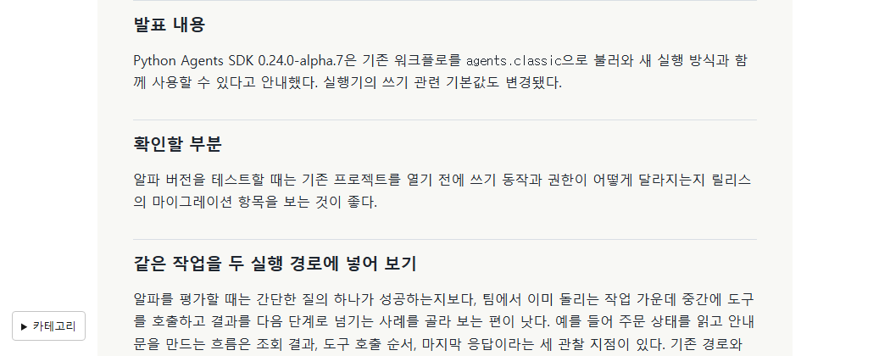

## 작업 결과

편집 원고 65편을 존댓말로 정리했습니다. 펭귄 모델 글은 황제펭귄의 외형과 얼음에서 물로 들어가는 움직임 사이의 선택을 중심으로 다시 썼습니다.

## 변경 내용

### 적용 내용

개발일지 30편에서 원본 보고서의 검증 문장과 수치를 글의 주제에 맞게 덜어내고, 글마다 실제 작업의 선택을 설명하는 문단을 썼습니다. 동향 글 33편과 게임 기술 2편의 종결 어미와 반복되는 절차 설명도 정리했습니다.

### 대화 기록

- 사용자(시각 미기록) — 펭귄 모델 글에 바이트와 용량을 나열할 이유가 없으며 외형과 아쉬운 점을 중심으로 적어 달라고 했습니다.
- 사용자(시각 미기록) — “모두 펭귄 말고 모두”라고 범위를 명시하고 “~했습니다. ~에요.”처럼 존댓말로 쓰라고 요청했습니다.
- AI(시각 미기록) — 다섯 게시판 65편을 편집하고 운영 확인을 진행했습니다.

## 검증

블로그 빌드와 운영 배포 후 기존 주소 65곳의 본문을 이전 배포와 대조했습니다. 이번 편집의 실측 범위는 497~1741자입니다. [65편 검증 자료](../assets/editorial-voice-20261109/lengths.json) · [65편 전후 화면 전체](../assets/editorial-voice-20261109/comparison.html).

## 남은 사항

다섯 게시판의 편집 원고가 대상입니다. 별도로 연결된 원본 프로젝트 보고서는 편집 범위 밖입니다. 전역 지침은 변경하지 않았습니다.

## 작업 시간

- 제안 시간: 첫 예상 5~8분. 이후 기존 편집 원고 전체와 존댓말 조건을 반영했습니다.
- 실제로 완료된 시간: 2026-11-09 20:51:03 KST에 확인을 시작했고 운영 근거 수집 시각은 2026-11-09 20:58:07 +09:00ST입니다. 보고서 공개 확인 시각은 최종 응답에 기록합니다.
- XERJ: 미사용 — rg로 보고서 문단과 비존댓말 종결을 확인하고 Chrome에서 운영 본문을 대조했습니다.
