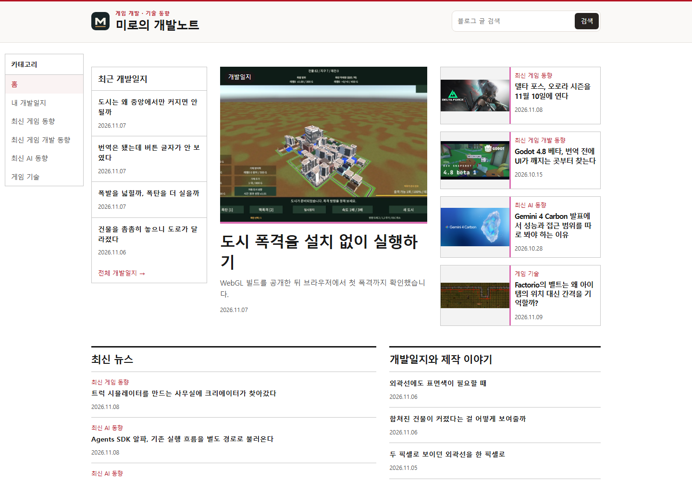
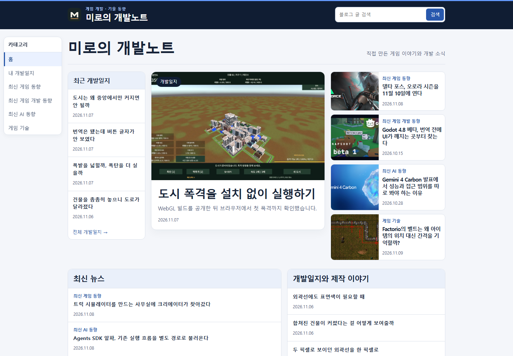
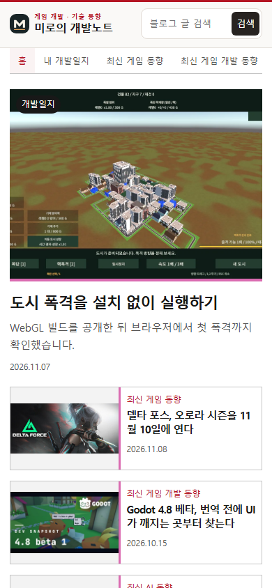
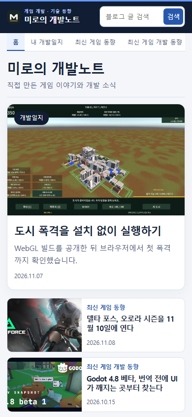
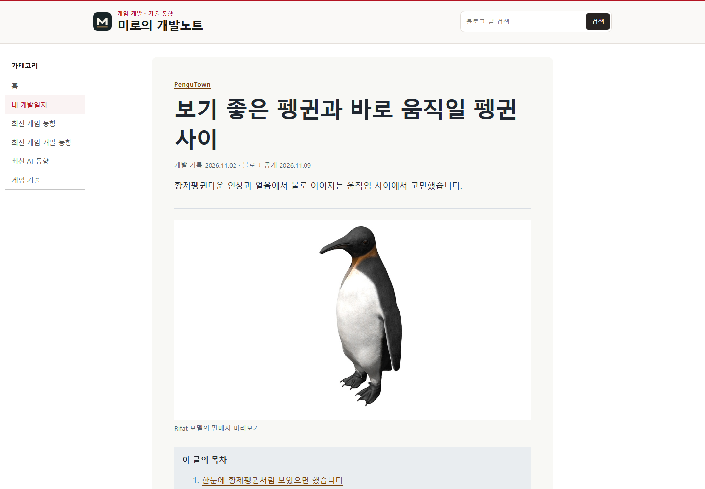
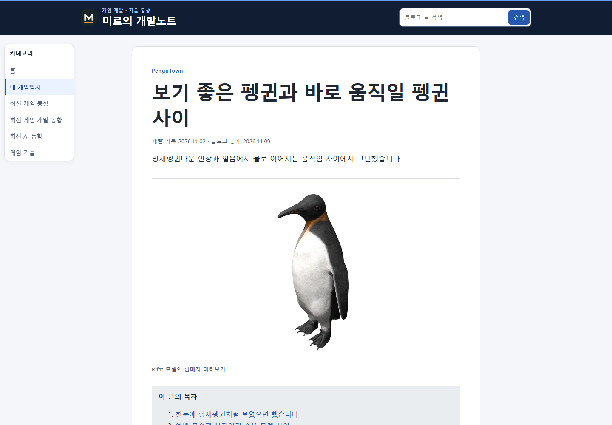
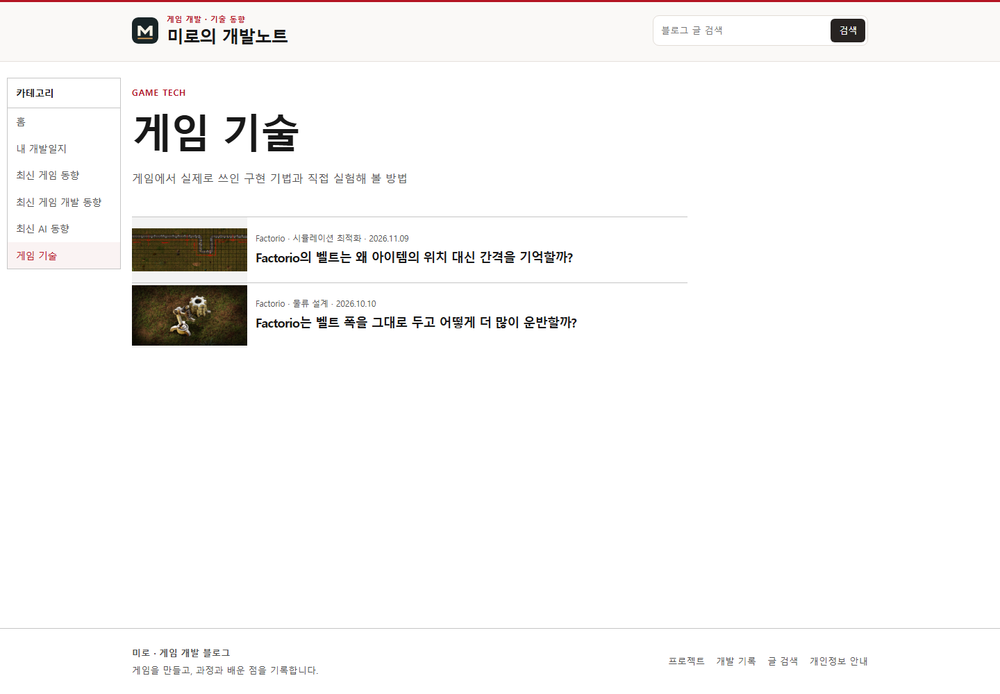
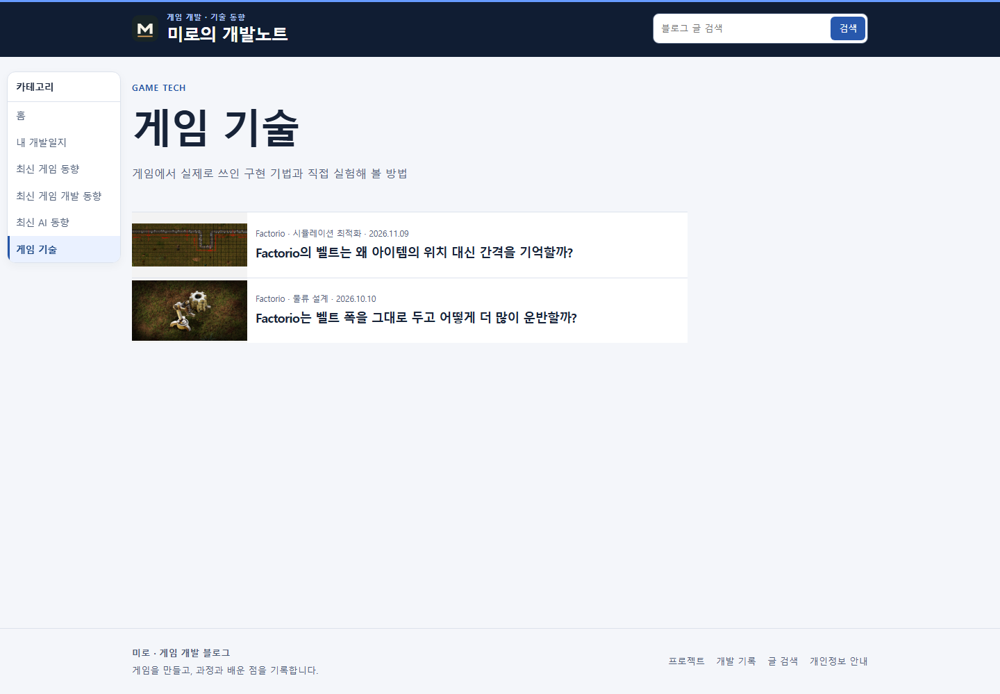

## 작업 결과

운영 홈이 짙은 상단 바와 흰 카드로 구분되고, 모바일과 중간 너비에서는 가로 카테고리를 바로 사용할 수 있습니다.

## 변경 내용

### 적용 내용

상단과 카드 색상, 홈의 대표 글 크기, 소식 카드와 목록의 간격을 조정했습니다. 넓은 화면은 왼쪽 카테고리, 좁은 화면은 상단 가로 메뉴를 사용합니다. 글 본문과 카테고리 목록에도 공통 색을 적용했습니다.

### 대화 기록

- 사용자(시각 미기록) — 「블로그 디자인 왜 보고 안 하고 왜 안 바꿈?」이라고 요청했습니다.
- AI(시각 미기록) — 운영의 기존 디자인을 확인하고 상단·홈·카테고리·본문을 바꿔 배포하겠다고 답했습니다.

## 검증

블로그 소스 커밋 9c4f91c, 빌드와 Cloudflare Pages 운영 응답을 확인했습니다. 같은 화면 크기로 네 가지 화면을 변경 전후 대조했습니다.

## 남은 사항

전역 지침은 변경하지 않았습니다. 전후 스크린샷은 글자 판독을 위해 브라우저가 저장한 원본을 첨부했습니다.

## 작업 시간

- 제안 시간: 첫 확인 약 1~2분. 디자인 구현과 화면 확인 약 5~8분.
- 실제로 완료된 시간: 2026-11-09 21:15 KST에 확인을 시작했고 2026-11-09 21:21:10 KST 운영 화면을 확인했습니다. 보고서 공개 확인은 최종 답변에 기록합니다.
- XERJ: 미사용 — rg와 운영 응답, 실제 Chrome 캡처를 대조했습니다.
