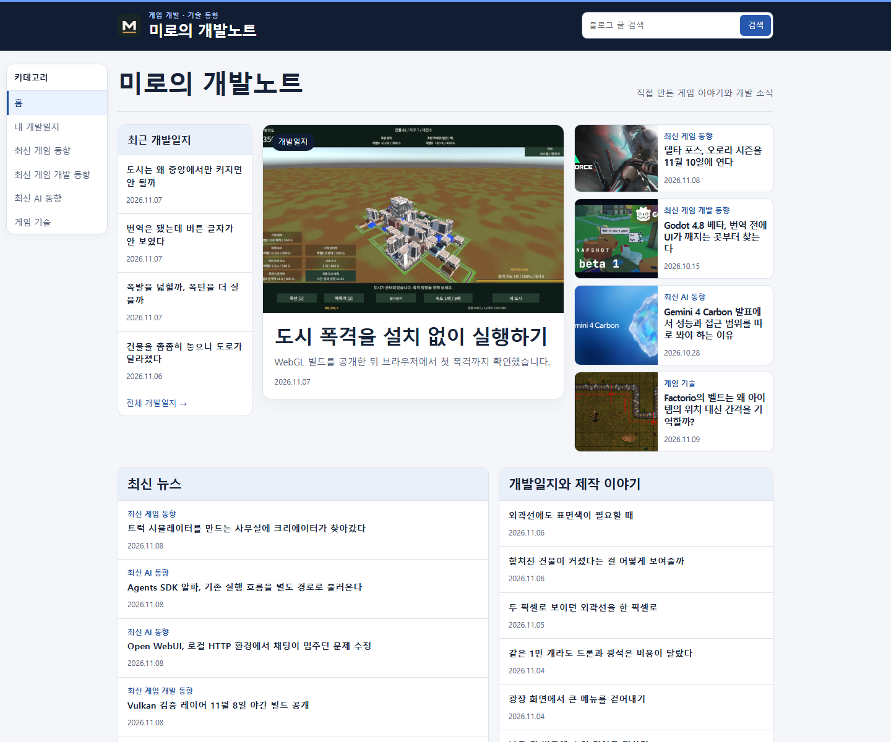
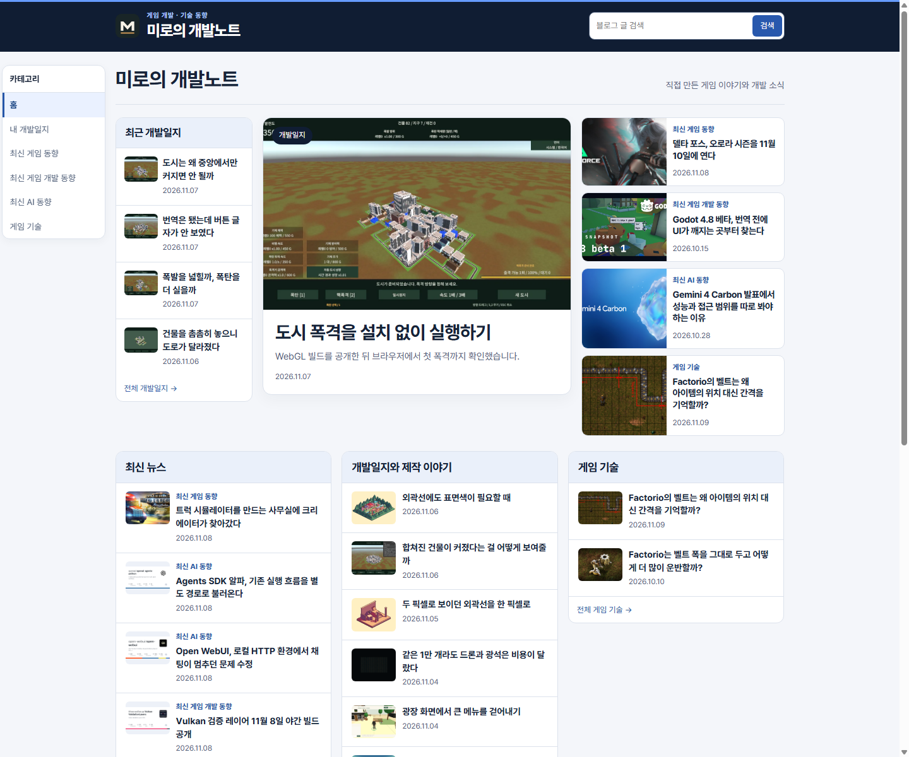
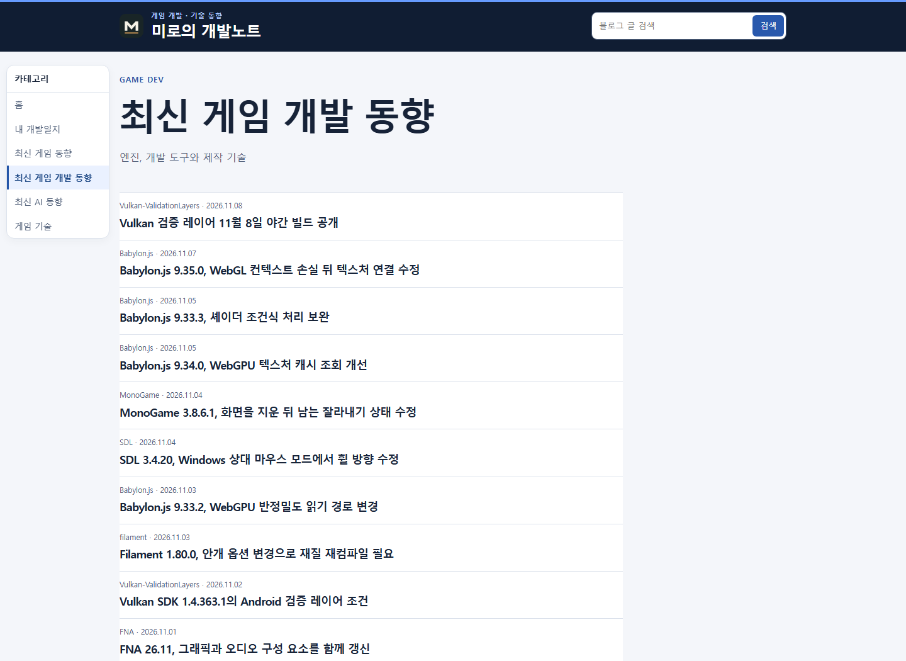
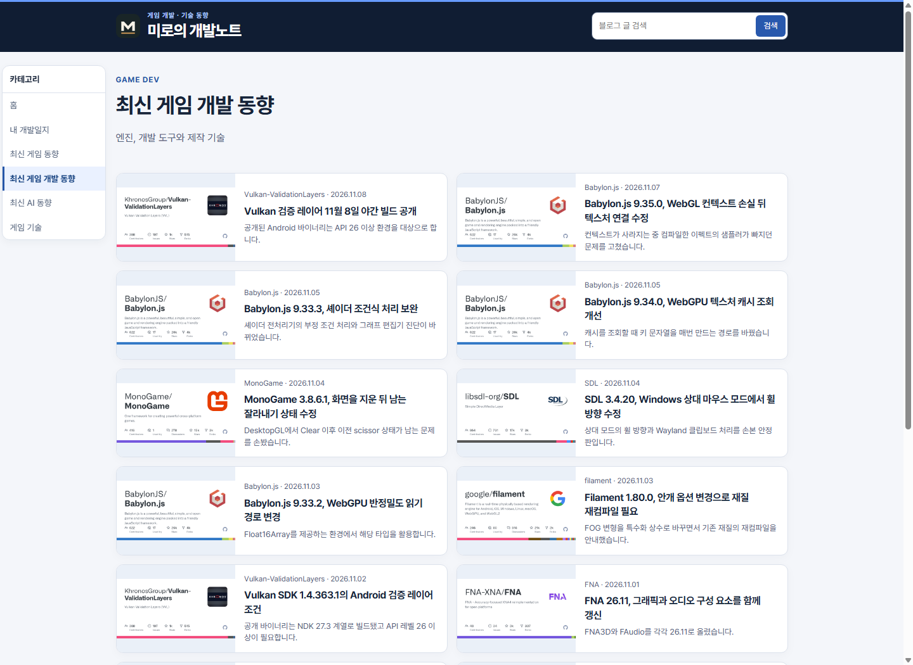
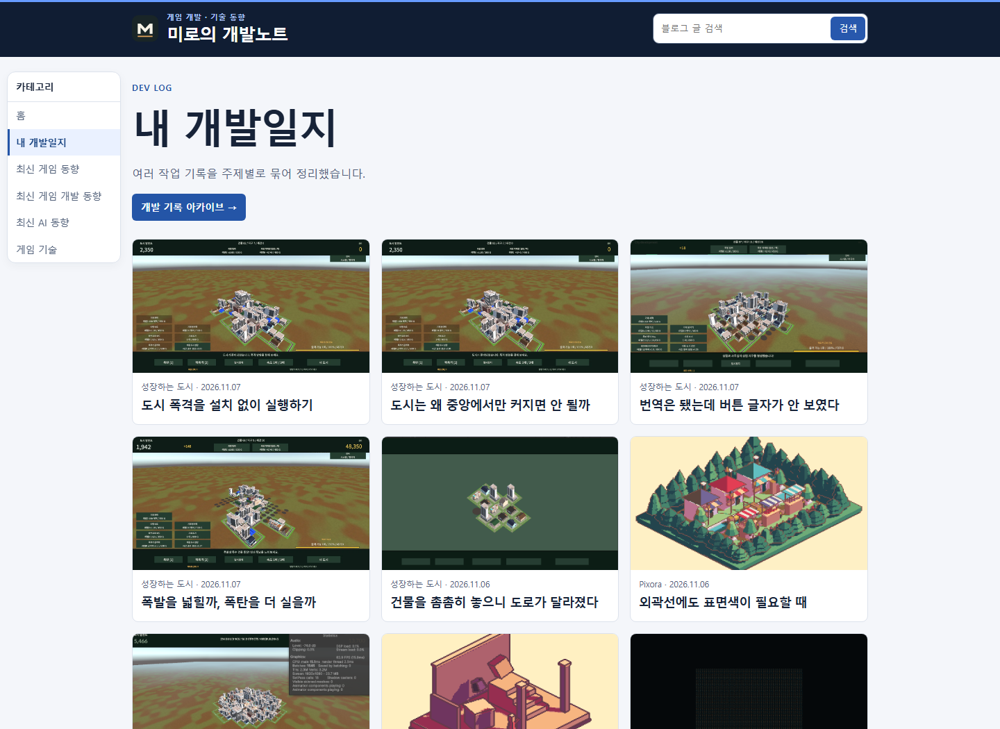
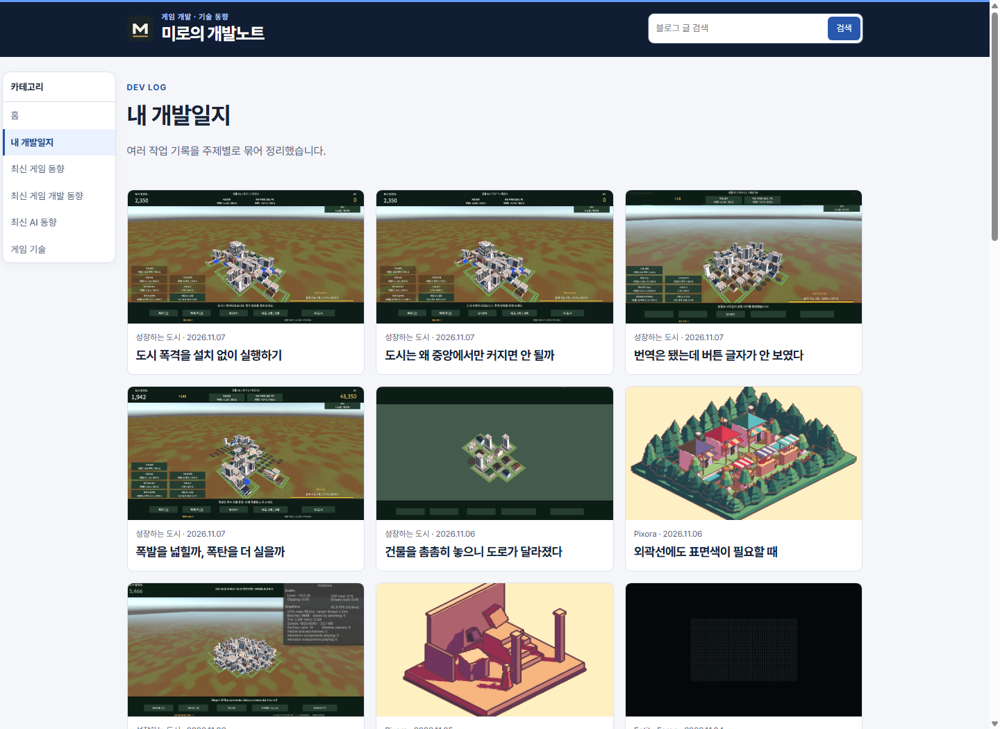

## 작업 결과

운영 사이트에 제목 글꼴과 크기, 홈 썸네일, 카테고리 목록 개편을 반영했습니다.

## 변경 내용

### 적용 내용

Pretendard Variable을 적용하고 데스크톱 카테고리 제목 최대 34px, 기사 제목 최대 36px, 목록 제목 16px로 정리했습니다. 홈에 게임 기술 섹션을 추가하고 내 개발일지에서 아카이브 진입 버튼을 제거했습니다.

### 대화 기록

- 사용자(시각 미기록): 「사이트의 제목들 담당하는 부분들이 폰트가 너무 큰 듯」이라며 글꼴과 크기 조사를 요청했습니다.
- 사용자(시각 미기록): 홈과 목록 썸네일, 게임 기술 섹션, 개발일지에서 아카이브 진입 제거를 요청했습니다.
- AI(시각 미기록): 제목을 줄이고 목록 변경을 묶어 운영에 반영하겠다고 답했습니다.

## 검증

운영 홈, 최신 게임 개발 동향, 내 개발일지의 HTML과 CSS를 직접 확인했습니다. 760페이지의 내부 링크 및 이미지 참조 검사 결과 누락 0건이었습니다.

## 남은 사항

한 달치 기사 보강과 기존 대표 이미지의 기사별 교체는 이번 화면 배포에서 완료하지 않았습니다. 전역 지침 변경 없음.

## 작업 시간

- 제안 시간: 화면 수정과 운영 확인 4~6분
- 실제로 완료된 시간: 2026-11-09 21:37:40 KST 착수, 21:43:26 KST 운영 확인.
- XERJ: 미사용 — 빌드, 운영 HTTP 응답 및 Chrome 캡처
