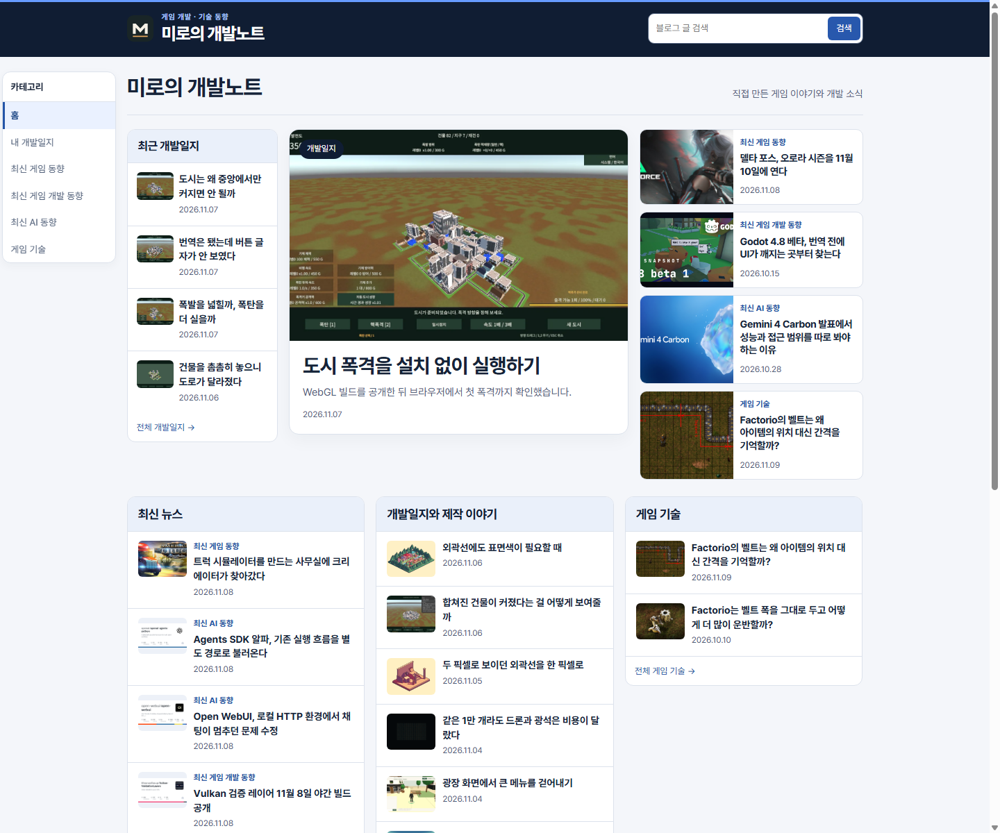
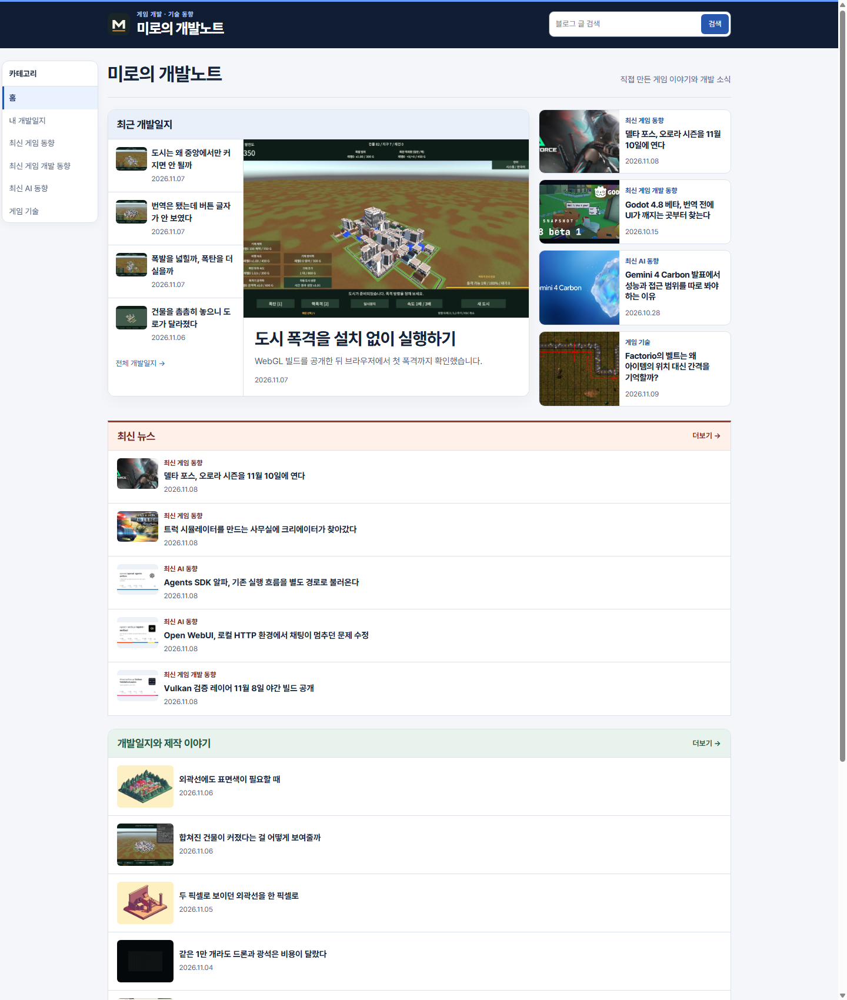
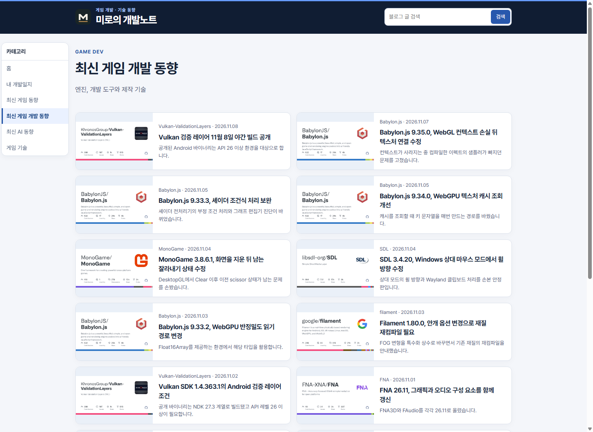
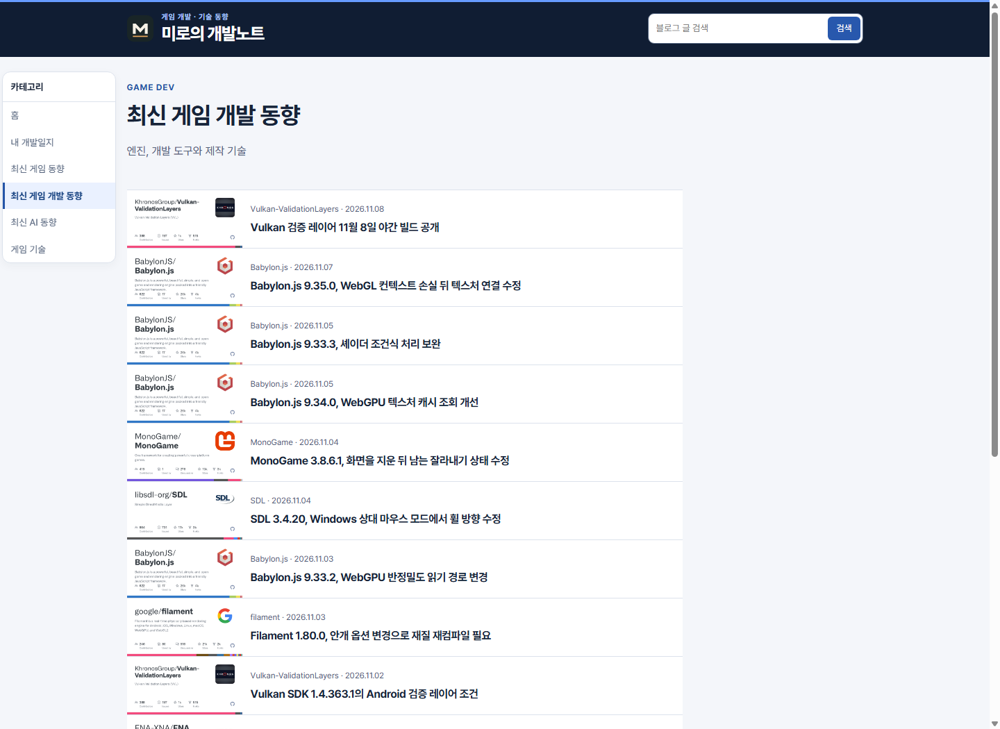

## 작업 결과

운영 홈과 게시판에 변경을 적용했습니다.

## 변경 내용

### 적용 내용

대표 개발일지와 최근 목록을 하나로 묶었습니다. 하단은 뉴스, 제작 이야기, 게임 기술 순서로 세로 배치하고 각 5개와 더보기를 표시합니다. 섹션 색과 썸네일 비율을 달리했습니다. 카테고리 목록은 왼쪽 썸네일, 오른쪽 제목과 날짜로 한 행을 구성합니다.

### 대화 기록

- 사용자(시각 미기록): 표시한 개발일지 영역을 합치고, 아래 섹션은 세로 배치와 최신 5개 및 더보기를 요청했습니다.
- 사용자(시각 미기록): 섹션 색과 디자인을 구분하고 게시판은 「한 줄로 게시판 느낌 아까 그대로」라고 정정했습니다.
- AI(시각 미기록): 홈의 섹션만 시각적으로 구분하고 게시판을 한 줄로 복원하겠다고 답했습니다.

## 검증

운영 홈에서 최신 뉴스 5개, 제작 이야기 5개, 게임 기술 2개와 더보기 목적지를 확인했습니다. 761페이지의 링크와 이미지 참조 검사 결과 누락 0건이었습니다.

## 남은 사항

월간 기사 보강은 미완료입니다. 게임 기술 글은 현재 2개입니다. 프로젝트 내에 화면별 요구를 적용했으며 전역 지침 변경은 없습니다.

## 작업 시간

- 제안 시간: 2~3분 (수정과 운영 확인)
- 실제로 완료된 시간: 2026-11-09 21:45:05 KST 착수, 21:47:47 KST 운영 확인 (2분 42초).
- XERJ: 미사용 — 빌드, 운영 HTTP 응답과 Chrome 캡처
