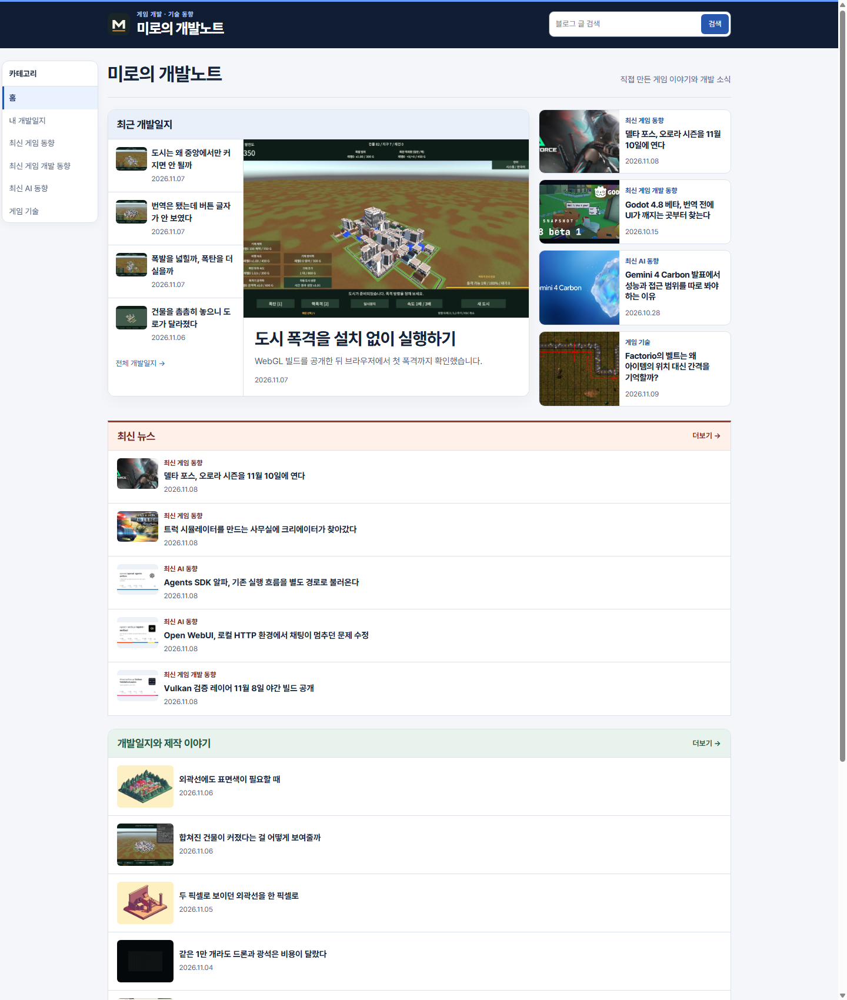
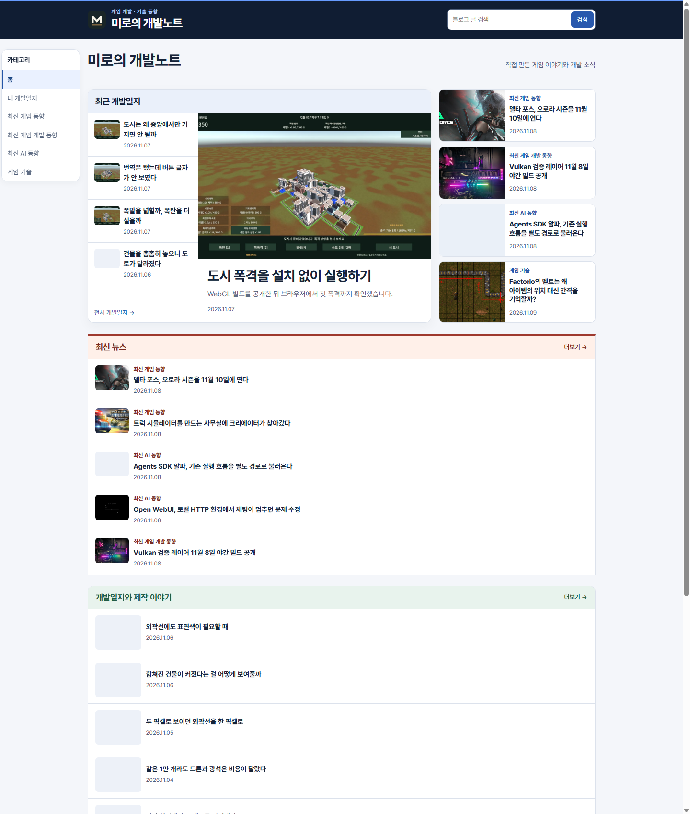
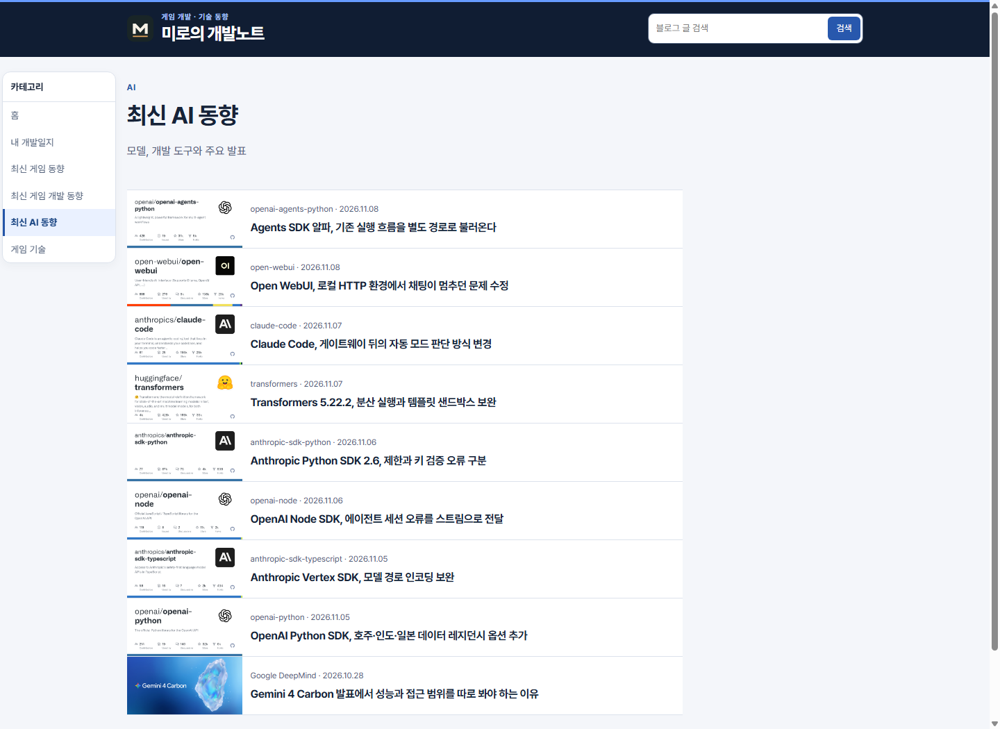
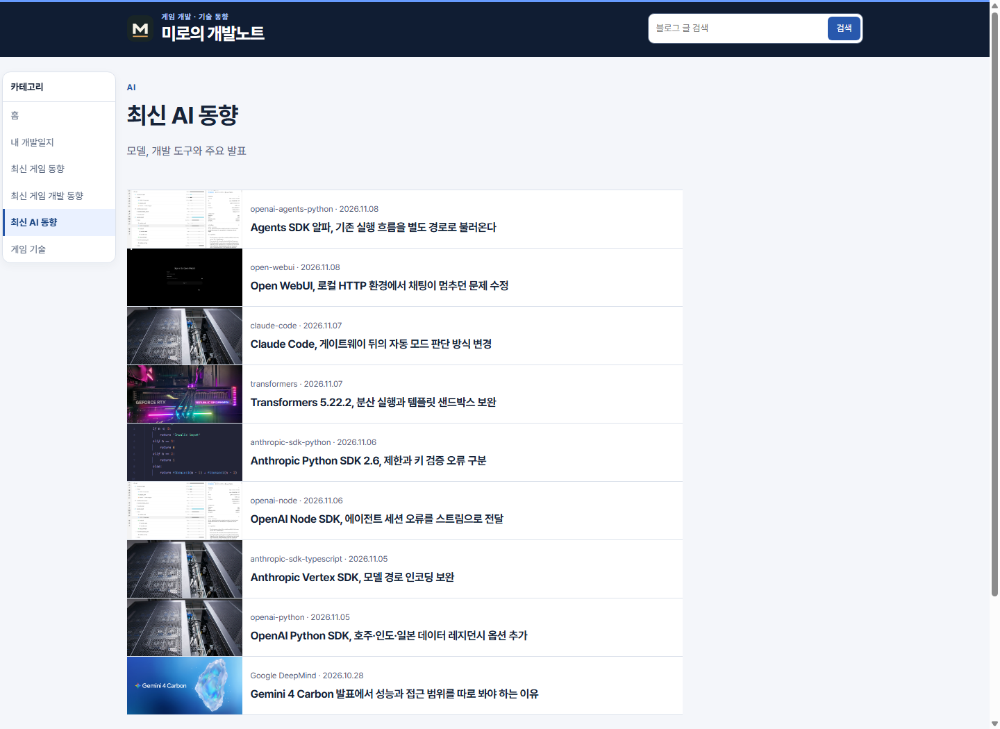
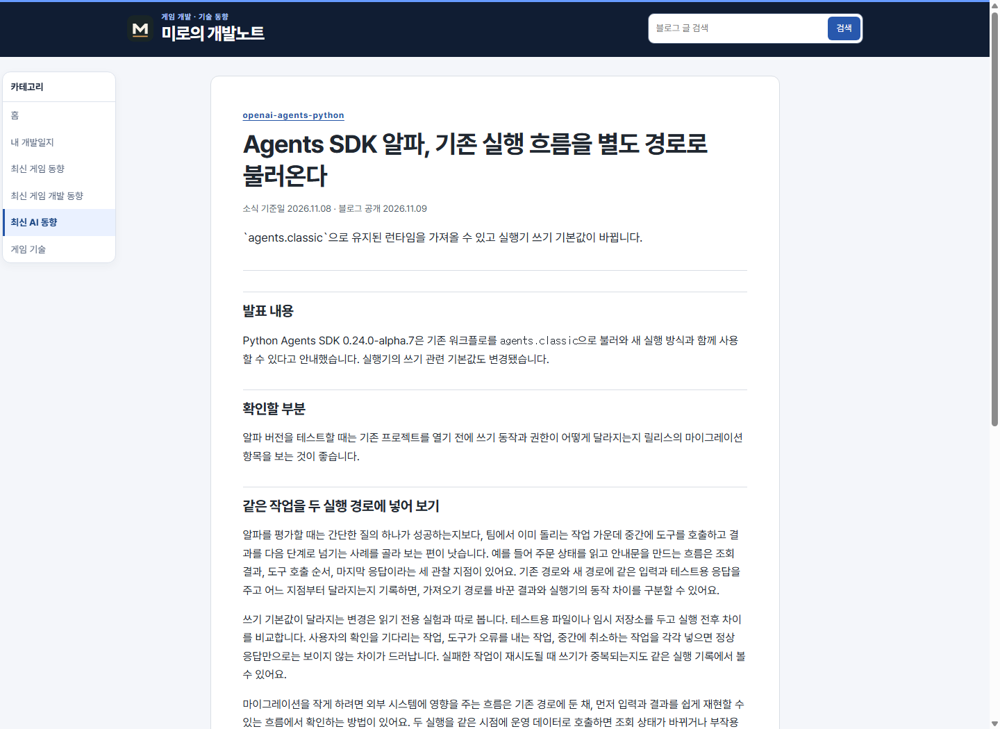
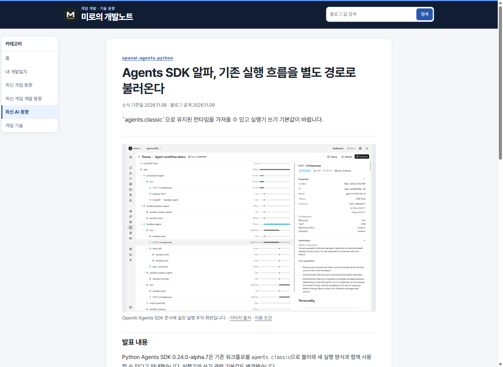
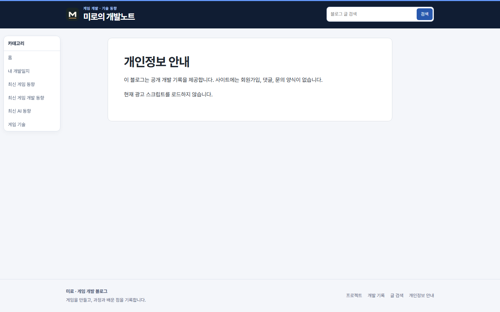
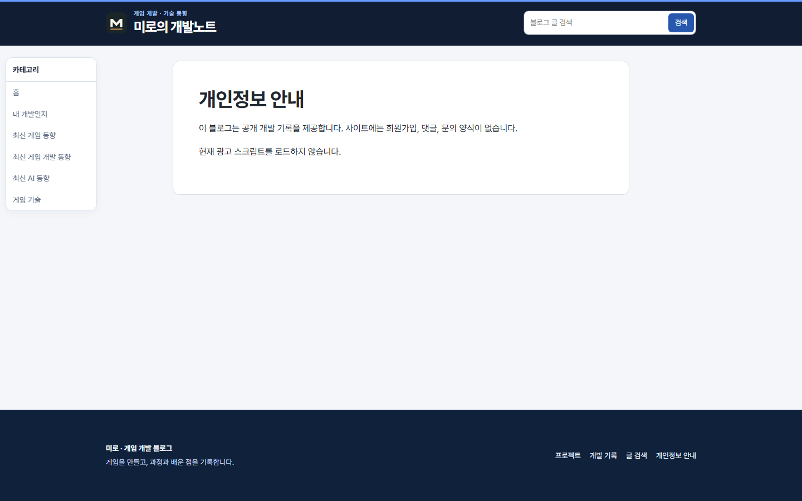

## 작업 결과

운영에 반영했습니다. 대상 원고 21편의 목록과 본문에 이미지가 표시됩니다.

## 변경 내용

### 적용 내용

공유 카드 16개를 제거하고, 원문 데모와 재사용 가능한 참고 사진 11개로 원고 21편을 갱신했습니다. 빌드에서 OG 경로를 거부하고 글 본문에도 대표 이미지와 출처를 표시합니다. 홈의 두 열 하단을 맞추고 푸터에 어두운 남색, 밝은 글씨와 34~58px의 상하 여백을 적용했습니다.

### 대화 기록

- 사용자(시각 미기록): 「OG 절대로 가져오지마」라고 정정하고 본문에도 썸네일을 요청했습니다.
- 사용자(시각 미기록): 홈 상단 양쪽 높이와 푸터 배경·글씨·여백을 요청했습니다.
- AI(시각 미기록): OG 카드 재표시를 실수로 인정하고 원문 이미지와 출처가 확인된 참고 자료를 쓰겠다고 답했습니다.

## 검증

운영에서 대상 21편에 대표 이미지와 출처 링크가 있으며, 사용한 11개 이미지 파일 모두 HTTP 정상 응답을 확인했습니다. AI와 게임 개발 게시판에는 기존 GitHub 공유 카드 경로가 남아 있지 않습니다. 761페이지에서 내부 참조 누락은 0건입니다.

## 남은 사항

공식 화면이 없는 일부 글은 별도 캡션으로 구분한 참고 사진을 사용합니다. 월간 기사 보강은 미완료입니다. OG 금지는 프로젝트 작성 기준에 반영했으며 전역 지침은 변경하지 않았습니다.

## 작업 시간

- 제안 시간: OG 경로와 대상 확인 3~5분
- 실제로 완료된 시간: 2026-11-09 21:50:26 KST 시작, 21:55:37 KST 운영 확인 (5분 11초).
- XERJ: 미사용 — 빌드, 운영 HTTP 응답과 Chrome 캡처
