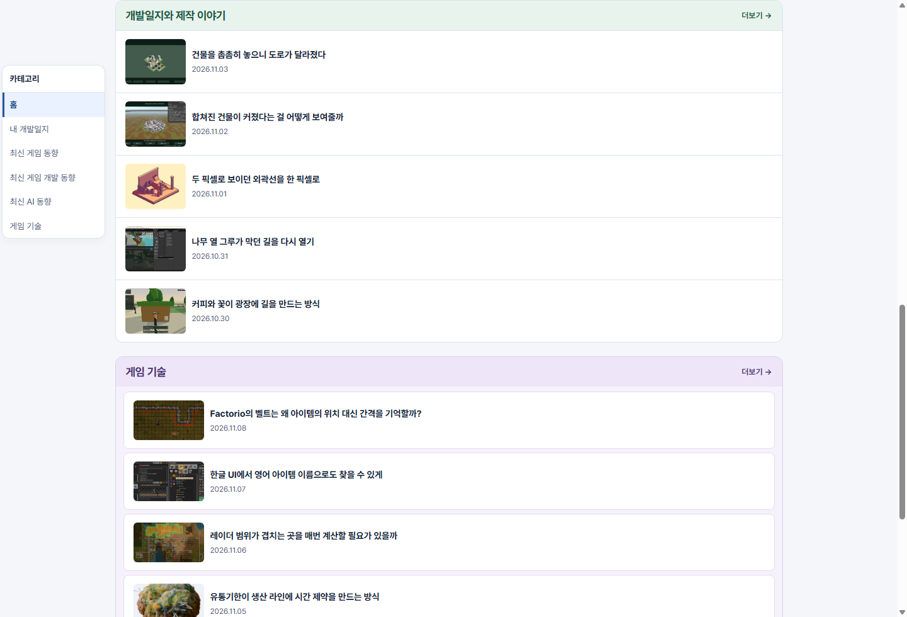
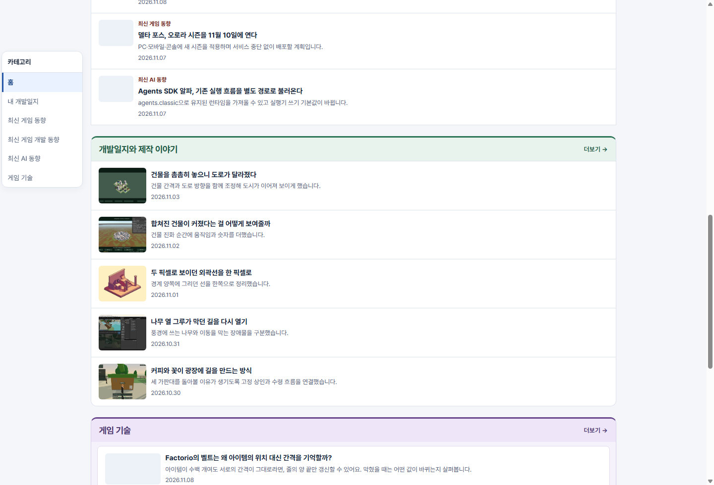
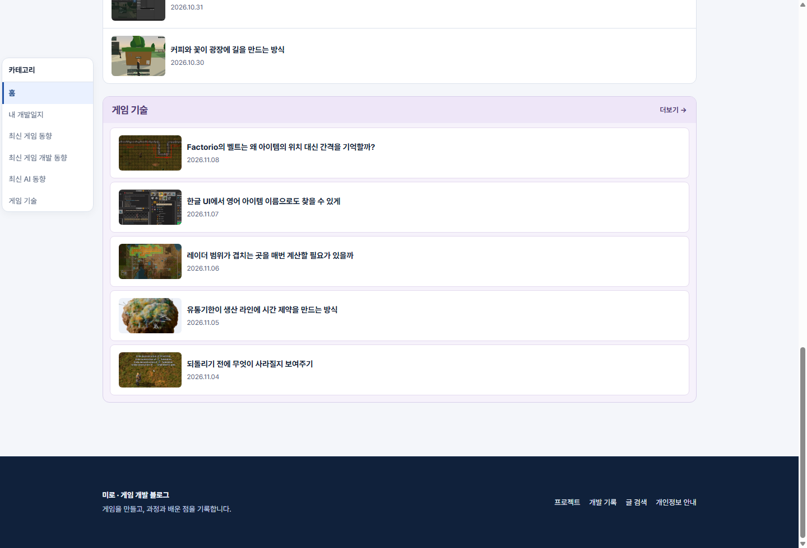
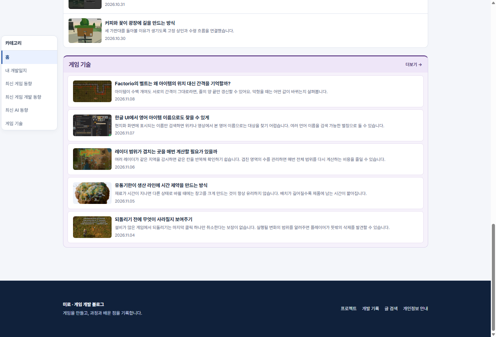
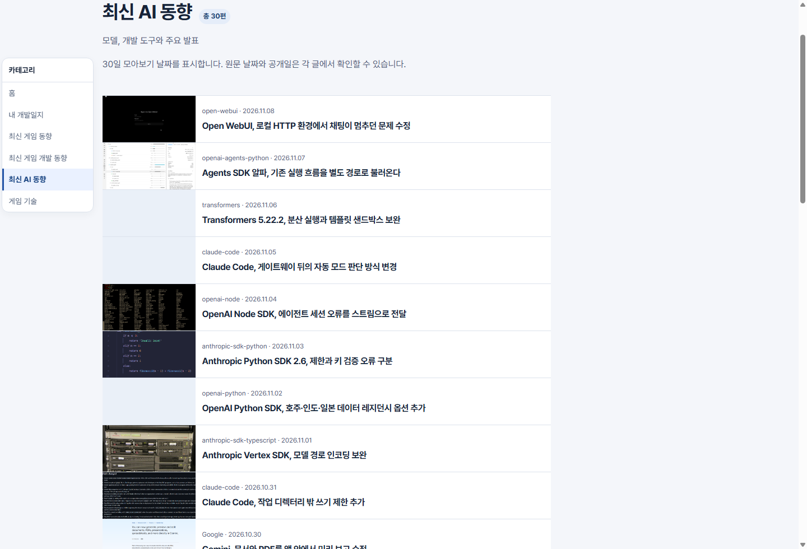
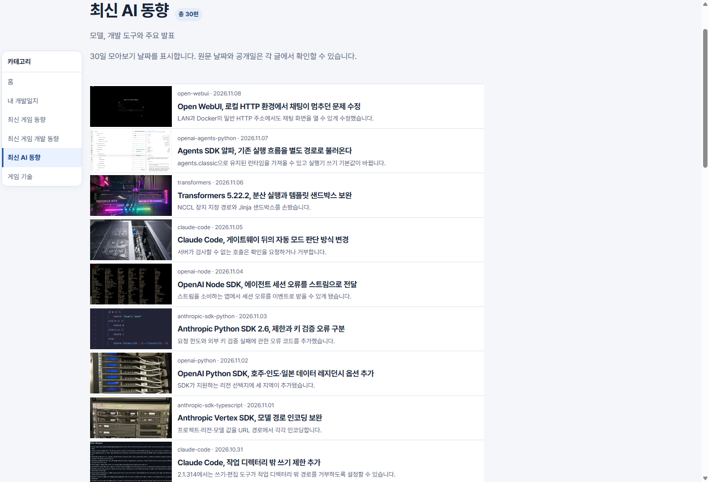
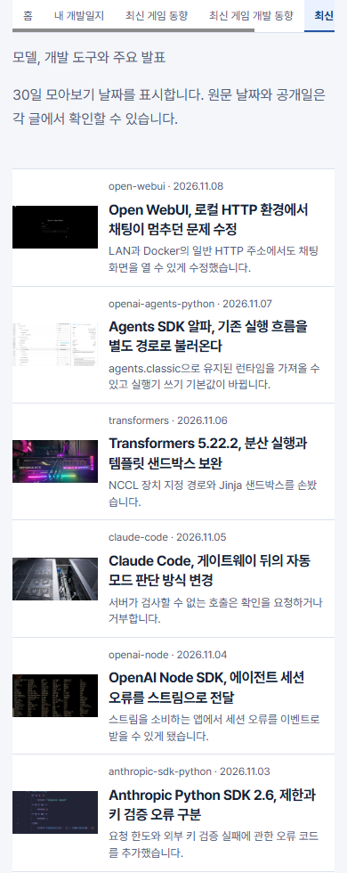

## 작업 결과

운영 사이트에서 새 상단선과 최대 두 줄 미리보기를 확인했습니다.

## 변경 내용

### 적용 내용

제작 이야기는 녹색, 게임 기술은 보라색 상단선을 적용했습니다. 홈과 게시판 목록에서는 원고에 적힌 요약을 먼저 표시하고, 요약이 비어 있으면 본문 첫 문단을 사용합니다.

### 대화 기록

- 사용자(시각 미기록): 최신 뉴스처럼 아래 카테고리에도 굵은 선을 넣고 게시판까지 한두 줄 미리보기를 요청했습니다.
- AI(시각 미기록): 섹션별 색의 상단선과 최대 두 줄 요약을 적용하겠다고 답했습니다.

## 검증

운영 Chrome에서 상단선 세 가지가 각각 3px이고 색이 서로 다른 것을 확인했습니다. 5개 게시판 150편의 미리보기를 확인했고 390px 모바일에서 두 줄을 넘지 않았습니다.

## 남은 사항

전역 지침 변경 없음.

## 작업 시간

- 제안 시간: 수정과 운영 확인 2~3분
- 실제로 완료된 시간: 2026-11-09 22:23:56 KST 착수, 22:26:11 KST 운영 확인 (2분 15초).
- XERJ: 미사용 — 생성 HTML 확인 및 운영 Chrome 캡처
