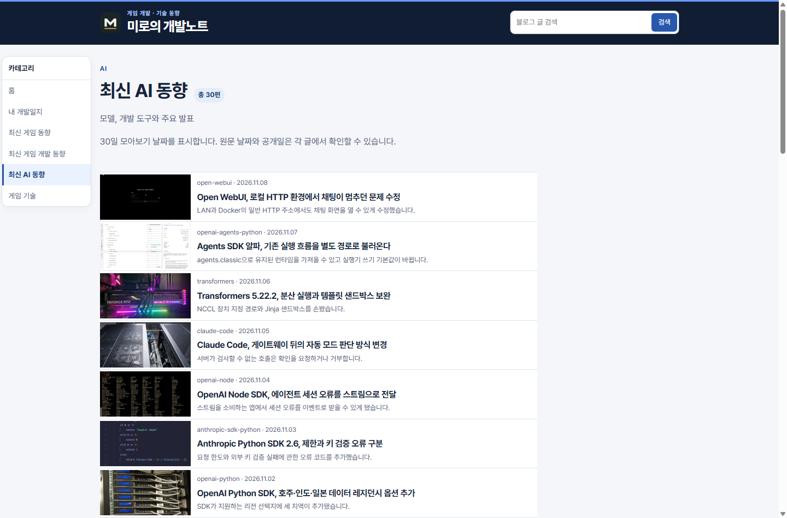
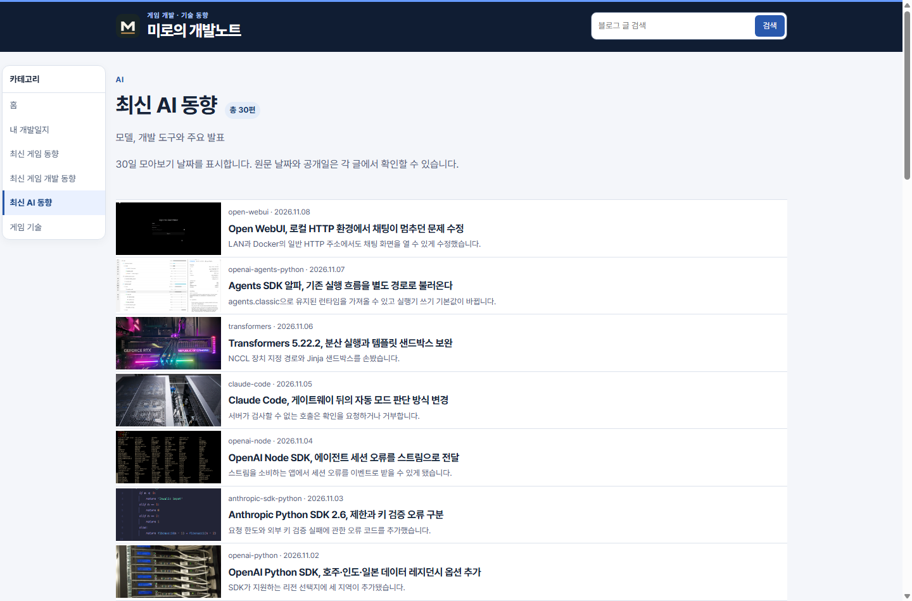

## 작업 결과

홈과 게시판 목록이 같은 공통 래퍼의 가로 폭을 사용합니다.

## 변경 내용

### 적용 내용

목록에 남아 있던 두 폭 제한을 제거했습니다.

### 대화 기록

- 사용자(시각 미기록): 홈과 게시판의 가로 길이를 동일한 래퍼로 맞추도록 요청했습니다.
- AI(시각 미기록): 별도 폭 제한을 제거하고 운영 화면 좌우 좌표를 비교하겠다고 답했습니다.

## 검증

운영 Chrome에서 1440px, 1024px, 390px 뷰포트의 홈과 게시판 6곳의 좌우 좌표를 비교했습니다. 동일 뷰포트의 홈과 모든 목록은 폭이 일치했습니다. 1440px에서 AI 게시판은 800px에서 홈과 같은 1060px가 됐습니다.

## 남은 사항

전역 지침 변경 없음.

## 작업 시간

- 제안 시간: 수정과 운영 확인 2~3분
- 실제로 완료된 시간: 2026-11-09 22:27:35 KST 착수, 22:30:02 KST 운영 확인 (2분 27초).
- XERJ: 미사용 — 운영 Chrome에서 실제 가로 좌표 측정
