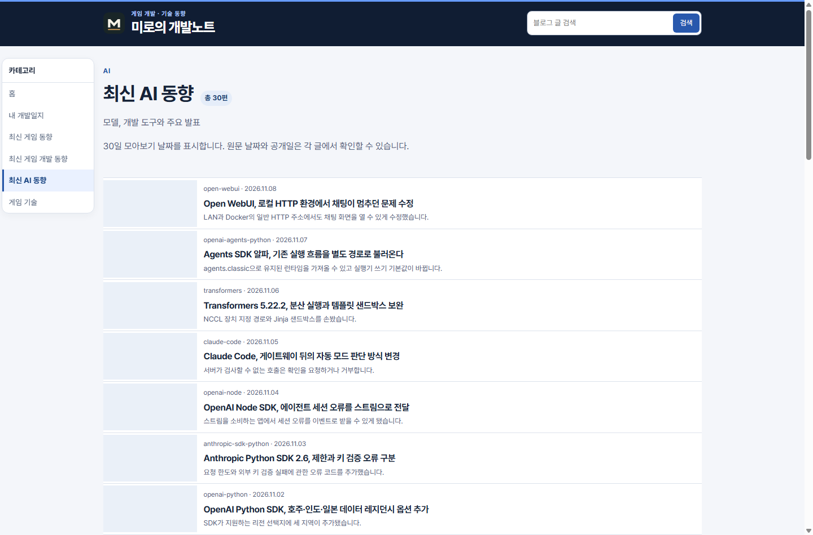
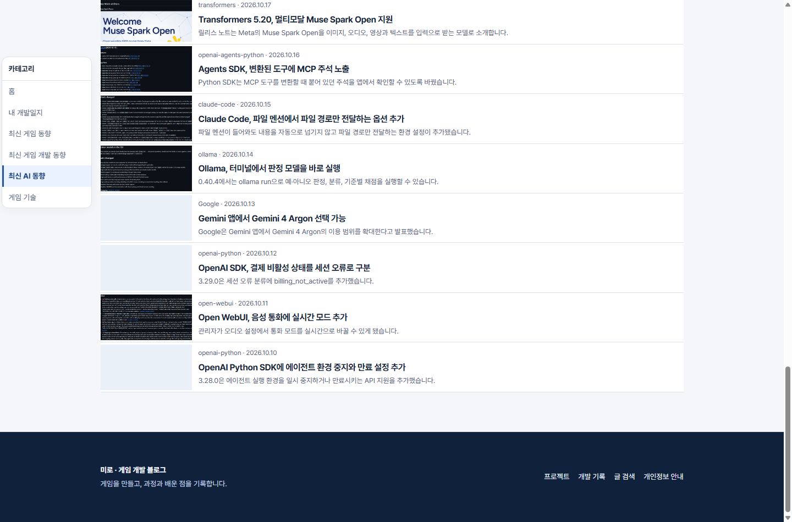
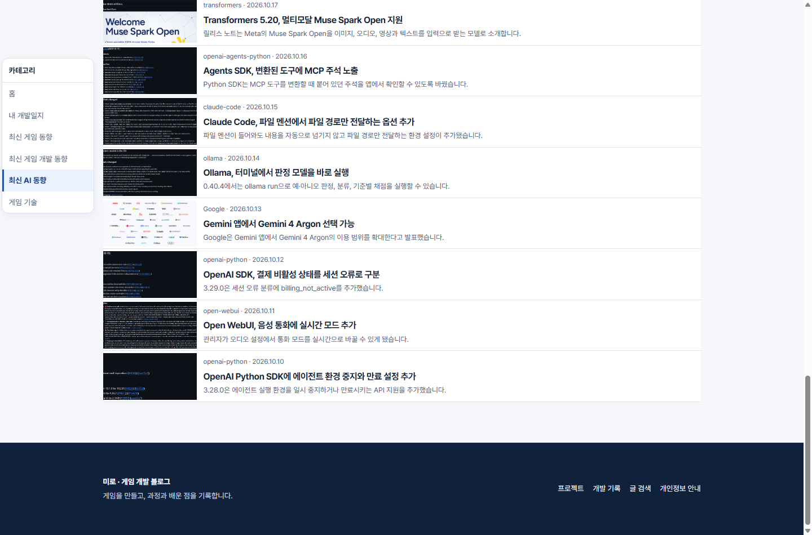
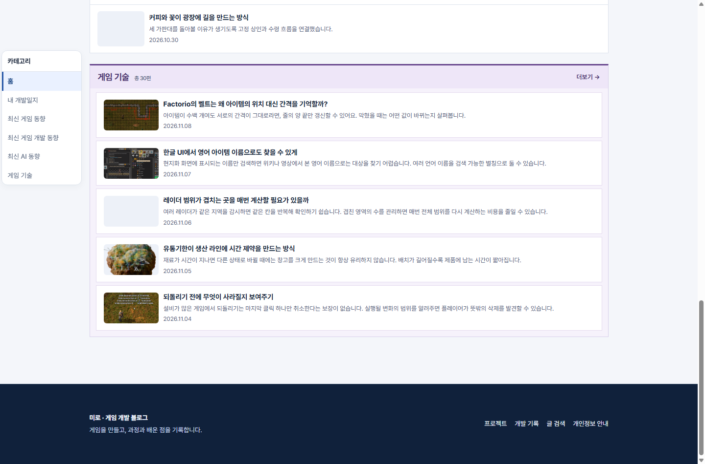

## 작업 결과

운영에서 스크롤 전후 카드 DOM과 이미지 요청을 확인했습니다.

## 변경 내용

### 적용 내용

IntersectionObserver로 화면 진입 시 원고 카드 HTML을 실제 DOM에 넣습니다. 화면 밖에서는 스켈레톤 박스를 표시하고 이미지가 로딩 중일 때 썸네일 자리에 애니메이션을 표시합니다. 자바스크립트가 꺼진 브라우저에서는 글 제목 링크를 제공합니다.

### 대화 기록

- 사용자(시각 미기록): 홈과 게시판에서 화면 밖 글은 영역만 잡고, 스크롤 진입 후 글과 썸네일을 렌더링하며 로딩 애니메이션을 넣도록 요청했습니다.

## 검증

운영 Chrome에서 AI 게시판 첫 화면은 30편 중 7편만 DOM에 들어갔습니다. 홈과 모바일 게시판도 화면 밖 검증 대상에 링크·이미지 요소와 이미지 요청이 없었고 스크롤 후 생성 및 다운로드됐습니다. 로딩 화면 캡처는 검증용으로 이미지 응답을 잠시 지연시켜 촬영했습니다.

## 남은 사항

글 카드 HTML은 초기 문서의 비활성 템플릿에 들어 있습니다. 전역 지침 변경 없음.

## 작업 시간

- 제안 시간: 구현과 확인 3~5분
- 실제로 완료된 시간: 2026-11-09 22:35:21 KST 착수, 22:39:05 KST 운영 확인 (3분 44초).
- XERJ: 미사용 — Chrome DOM과 네트워크 요청 및 운영 캡처
