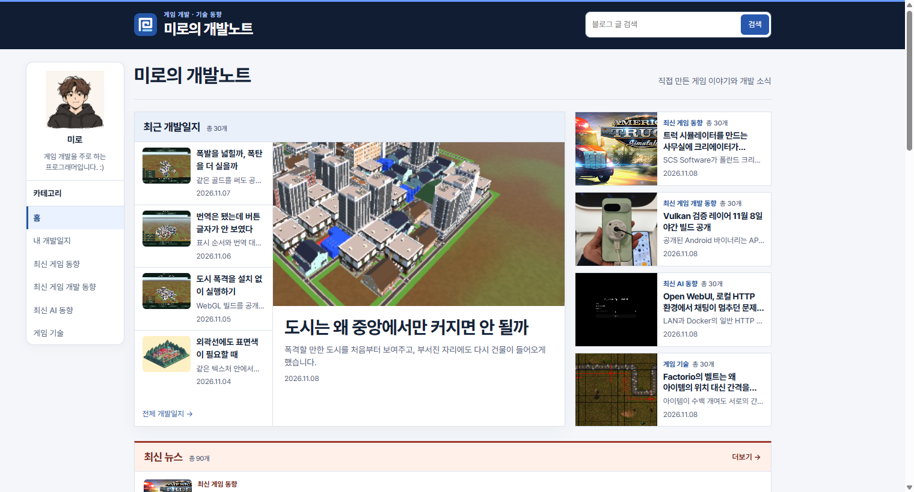
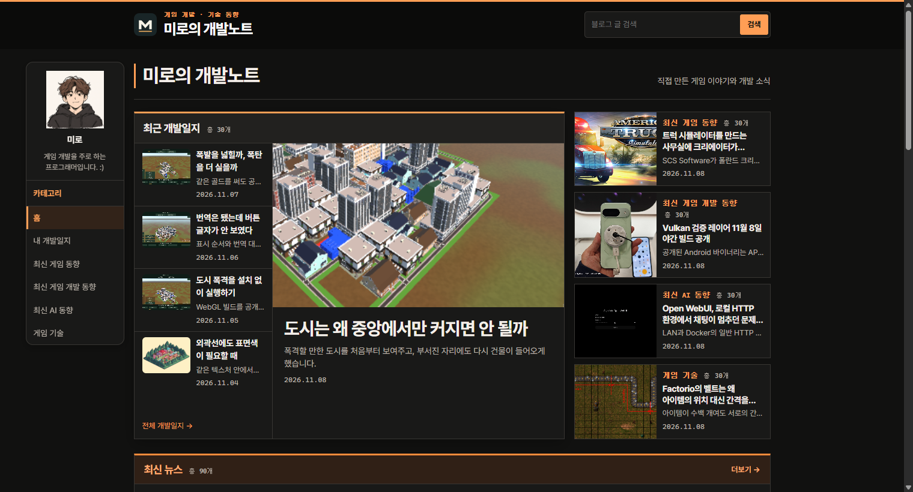
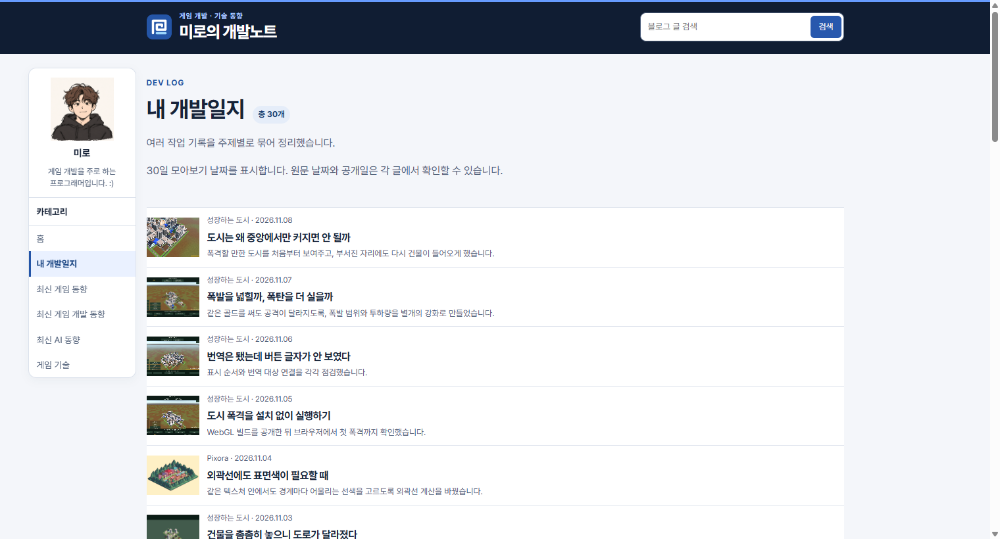
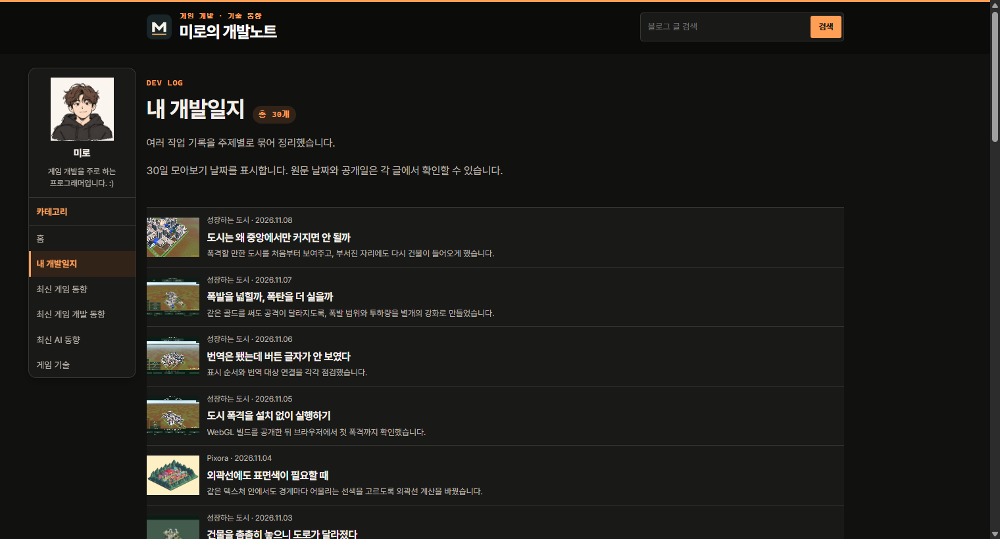
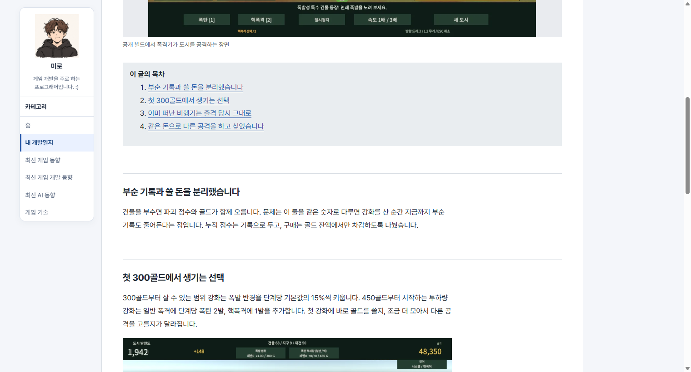
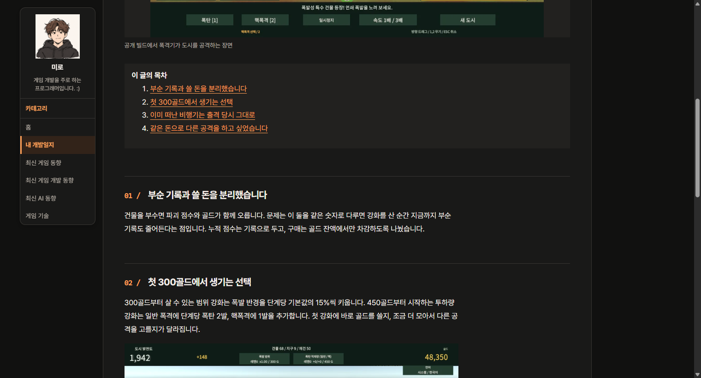
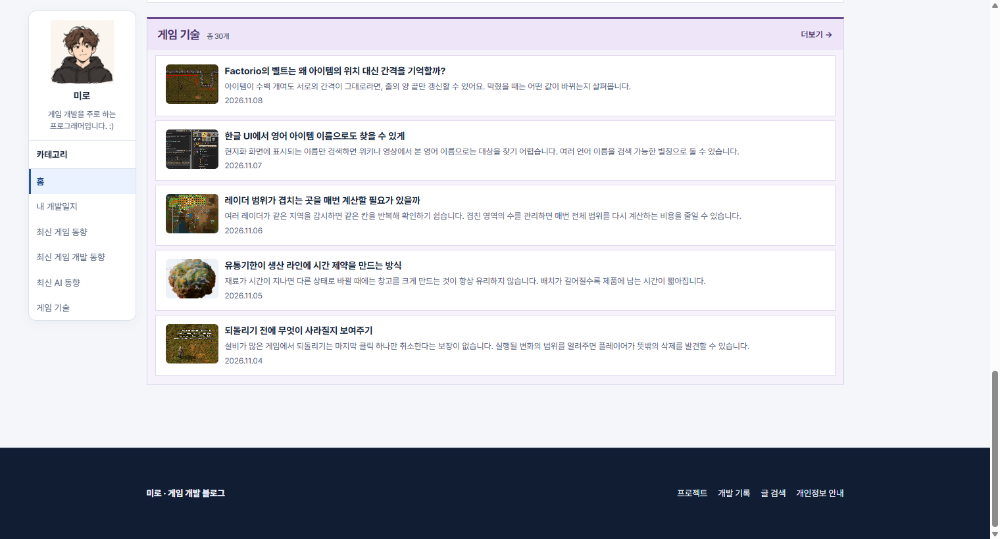
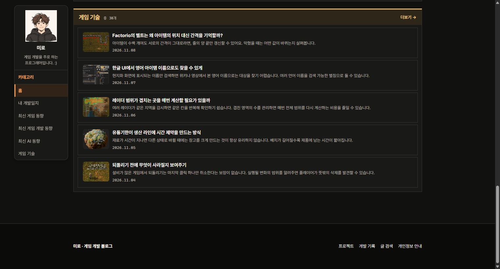
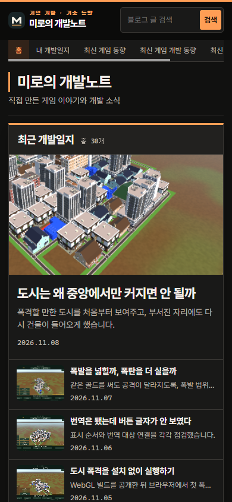

## 작업 결과

Cloudflare 운영 배포 https://e5e1bef4.miro-game.pages.dev 에서 화면을 확인했습니다. 기본 주소에서 아직 이전 HTML이 내려오고 있어 기본 주소 적용은 미확인입니다.

## 변경 내용

### 적용 내용

홈 섹션은 톤이 다른 주황 계열, 네비게이션과 검색은 주황 선택 상태, 본문은 밝은 텍스트와 챕터 번호를 적용했습니다. 기존 로고를 상단과 탭에 같은 자산으로 적용했습니다. 대화 요약: 사용자가 “주황색과 검정색을 사용한 개발자 느낌”을 요청했고, 기존 레이아웃을 유지하고 가독성을 확인하겠다고 답했습니다. 발언 시각 미기록.

## 검증

같은 데스크톱 Chrome 화면에서 홈·게시판·글 상세·푸터의 전후를 비교했습니다. 모바일 390px에서도 문서 폭 390px로 확인했습니다. 대표 본문과 패널의 명도 대비는 15.39:1, 보조 글씨는 8.68:1, 주황 링크는 8.61:1입니다.

## 남은 사항

기본 주소에서 아직 이전 HTML이 내려오고 있어 기본 주소 적용은 미확인입니다. 전역 지침은 변경하지 않았습니다. 블로그 전용 지침은 기존 공통 디자인 기준을 유지합니다.

## 작업 시간

- 제안 시간: 3~5분
- 실제로 완료된 시간: 3분 47초, 2026-11-10 00:48:52 KST 배포 주소 화면 확인
- XERJ: 미사용 — 사용하지 않았습니다.
