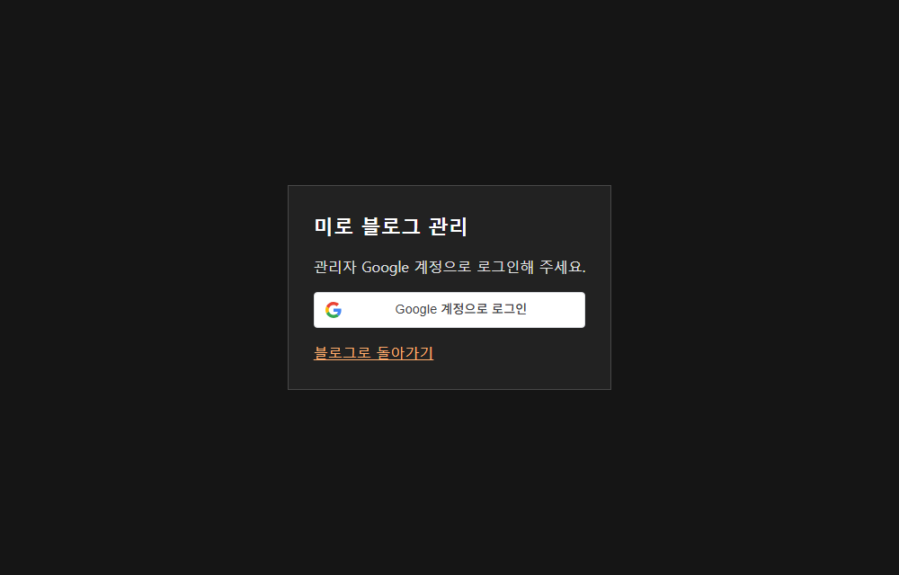

## 작업 결과

배포된 관리 페이지에 Google 로그인 버튼이 표시됩니다. 푸터의 작은 톱니바퀴를 공통 템플릿에 추가했습니다.

## 변경 내용

### 적용 내용

포트폴리오와 같은 Google Identity Services 버튼을 사용하고 지정한 관리자 계정만 허용했습니다. 관리자 API에 서명된 세션을 요구합니다.

### 대화 기록
- 사용자: 포트폴리오처럼 Google 로그인과 숨은 관리 버튼을 요청했습니다.
- Codex: 푸터 톱니바퀴를 구현하고 Google OAuth 원본 등록을 안내했습니다.

교훈 검토: 관리 UI 참조의 로그인과 진입점을 모두 대조했습니다. 별도 지침 변경은 없습니다.

## 검증

로컬 빌드의 172개 페이지에서 관리 링크를 확인했습니다. 운영 관리 화면의 Google 버튼을 실제 브라우저에서 확인했습니다. 비로그인 관리 API 401과 공개 광고 배치 API 200을 확인했습니다.

## 남은 사항

블로그 운영 브랜치 푸시는 자동 승인 검토에서 명시적 승인 대기입니다. Google 승인 원본 등록과 허용 계정 로그인 성공은 미확인입니다. 푸터의 운영 전후 화면은 미확인입니다.

## 작업 시간

- 제안 시간: 초기 코드·설정 확인 1~2분
- 실제로 완료된 시간: 15:28 KST 착수. 최종 Worker 배포 및 HTTP 응답 확인 15:33:18 KST. 전체 작업 진행 중.
- XERJ: 미사용 — 코드 검색 근거가 제공되지 않았습니다.
