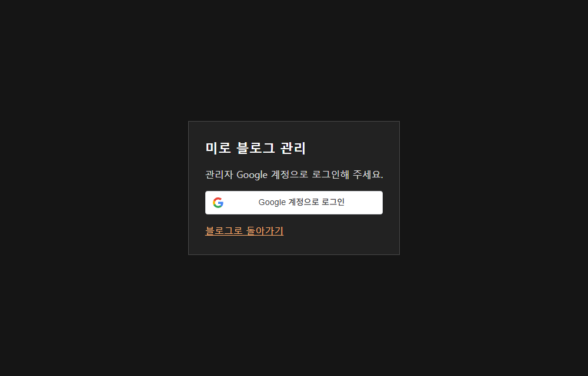

## 작업 결과

블로그 푸터의 개인정보 안내 옆 관리 링크를 운영에 반영했습니다.

## 변경 내용

### 적용 내용

승인된 관리 변경 7개 파일을 원격 최신 커밋 위에 적용하고 main에 푸시했습니다.

### 대화 기록
- 사용자: OAuth 설정 작업 후 푸시를 승인했습니다.
- Codex: 운영 링크와 Google 로그인 도착 페이지를 확인했습니다.

교훈 검토: 지침 변경 없음.

## 검증

커밋 a514f42. 공개 블로그 HTML의 관리 링크와 스타일시트의 관리 링크 스타일, 도착 페이지의 Google 로그인 스크립트를 확인했습니다.

## 남은 사항

실제 계정 로그인과 푸터 전후 캡처는 미확인입니다. 백그라운드 브라우저에서 푸터가 로드되지 않았습니다.

## 작업 시간

- 제안 시간: 푸시 10~30초, Pages 확인 1~3분
- 실제로 완료된 시간: 15:43:47 KST 착수, 15:44:41 푸시, 15:47:02 운영 확인. 총 3분 15초.
- XERJ: 미사용 — 코드 검색 근거가 제공되지 않았습니다.
