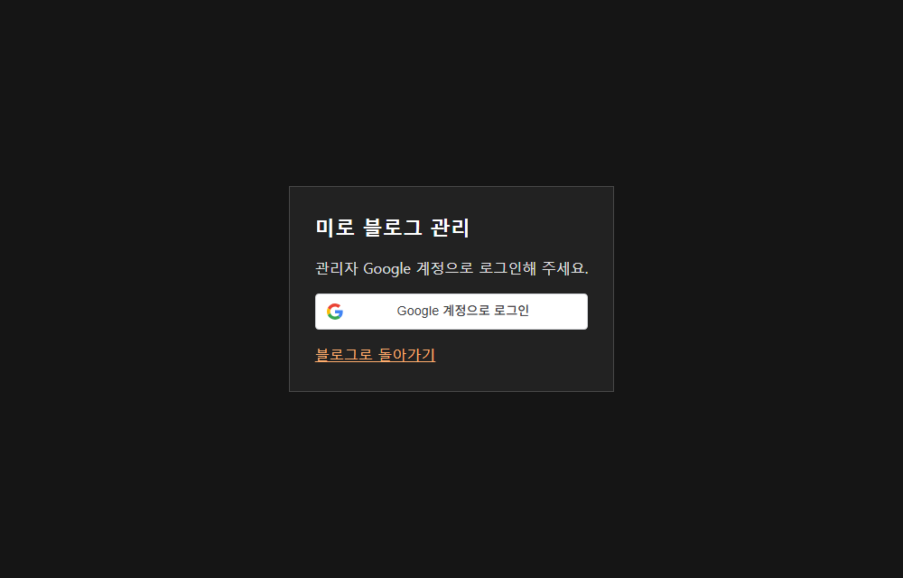
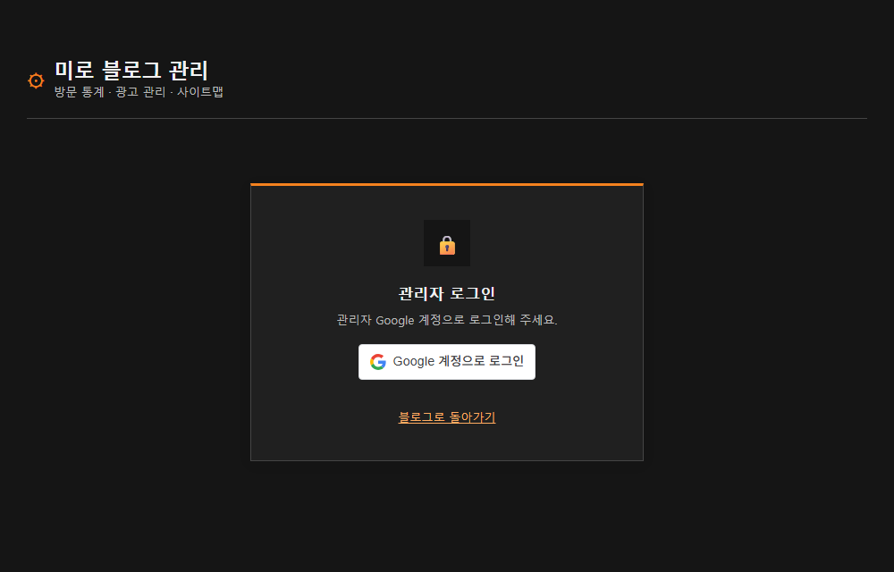

## 작업 결과

공통 헤더와 로그인 카드, 방문 통계 요약 카드, 기간별 차트, 광고·사이트맵 메뉴를 적용했습니다.

## 변경 내용

### 적용 내용

포트폴리오 관리 화면의 구성과 회색·주황 스타일을 블로그 관리 화면에 적용했습니다. 방문 통계는 블로그에서 이미 집계한 일별 데이터로 구성했습니다.

### 대화 기록
- 사용자: 포트폴리오 사이트처럼 전체 화면 구성을 요청했습니다.
- Codex: 로그인과 대시보드를 공통 스타일로 개편했습니다.

교훈 검토: 기존 참조와 화면 구성을 대조했으며 지침 변경은 없습니다.

## 검증

Worker 버전 fc61c060-b54e-426e-a209-1e00864d7af1. 공개 로그인 페이지와 공통 CSS, 기존 블로그 OAuth 클라이언트 적용 및 비로그인 API 응답 401을 확인했습니다.

## 남은 사항

로그인 후 운영 대시보드의 실제 화면과 탭 전환은 관리자 세션이 없어 미확인입니다. 프로젝트 소스는 로컬 변경 상태입니다.

## 작업 시간

- 제안 시간: 구현과 화면 확인 2~4분
- 실제로 완료된 시간: 15:54:45 KST 착수, 15:57:08 KST 배포 확인, 15:57:27 KST 로그인 화면 캡처. 약 2분 42초.
- XERJ: 미사용 — 코드 검색 근거가 제공되지 않았습니다.
