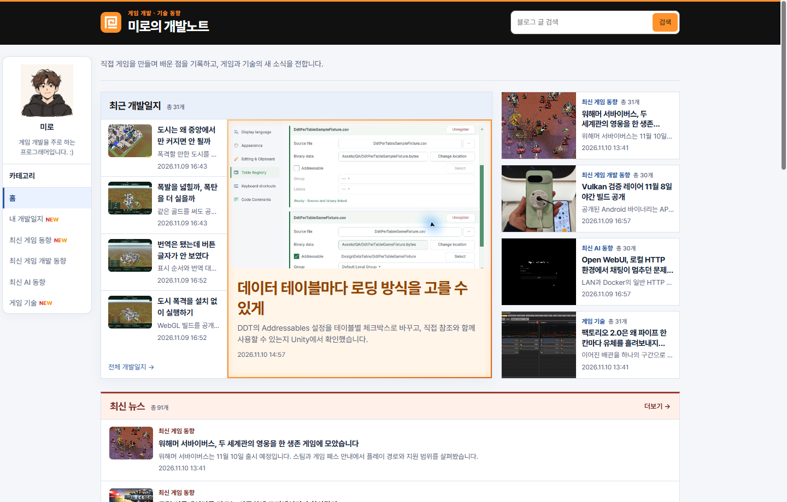
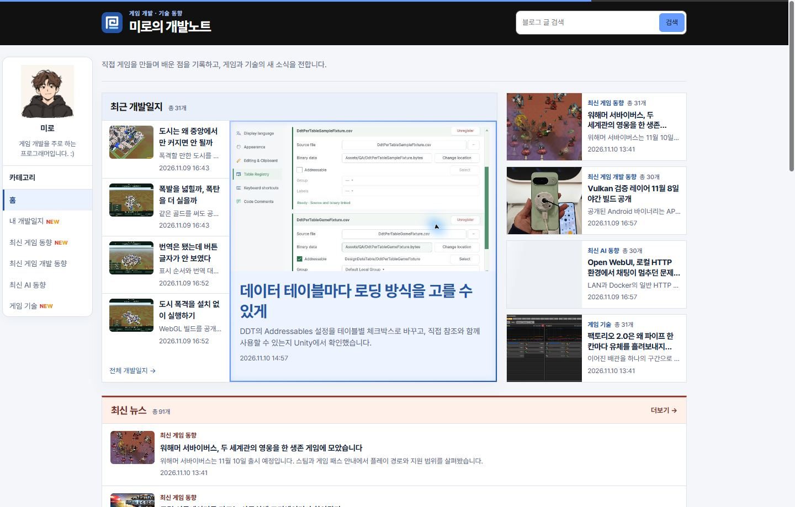
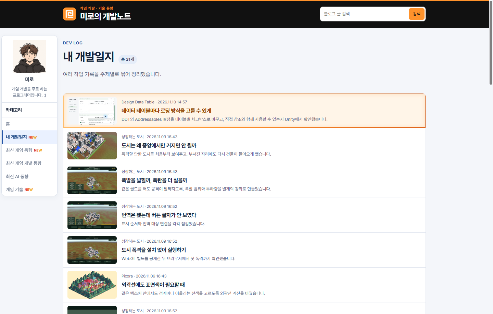
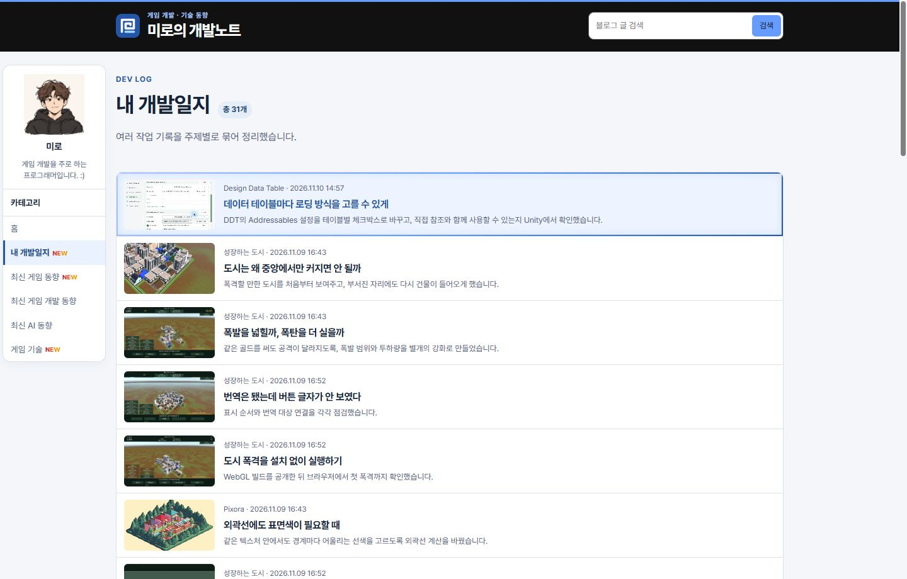

## 작업 결과

공개 홈과 게시판에서 하늘색 테마와 새 로고 참조를 확인했습니다.

## 변경 내용

### 적용 내용

공용 하늘색 기준은 기존 #669bff입니다. 로딩 게이지와 탑바 선은 같은 색을 쓰며, 카드 외곽선과 그림자는 공용 색상에서 파생됩니다. 기존 벡터 로고를 탑바와 파비콘에 다시 연결했습니다.

### 대화 기록

- 사용자 요청 요약 — 이전 하늘색으로 복원하고 관련 요소도 같은 테마로 조정해 달라고 요청했습니다. 핵심 원문은 ‘그냥 이전처럼 하늘색으로 해줘 그에 맞게 다른 것들도 바꿔주고’입니다.
- AI 결정 — 기존 하늘색 값과 벡터 아이콘을 재사용하고, 공용 색상으로 주요 요소를 연결했습니다.

## 검증

커밋 bcae834를 푸시했습니다. 빌드에서 153개 게시물을 생성했습니다. 공개 Chrome에서 대표 글과 게시판 행에 실제 호버하여 탑바와 버튼이 #669bff이고 외곽선이 같은 계열의 그라데이션인지 확인했습니다. 탑바 로고의 렌더링과 파비콘 링크를 확인했습니다.

## 남은 사항

브라우저 탭 자체의 표시는 미확인입니다. 공용 테마 검증 범위를 프로젝트 지침에 추가했으며 전역 지침 변경은 없습니다.

## 작업 시간

- 제안 시간: 코드 수정 약 1분, 공개 확인까지 약 2~3분
- 실제로 완료된 시간: 블로그 공개 확인까지 약 1분 57초. 2026-11-10 16:13:04 KST
- XERJ: 미사용 — 코드 검색 근거가 제공되지 않았습니다.
