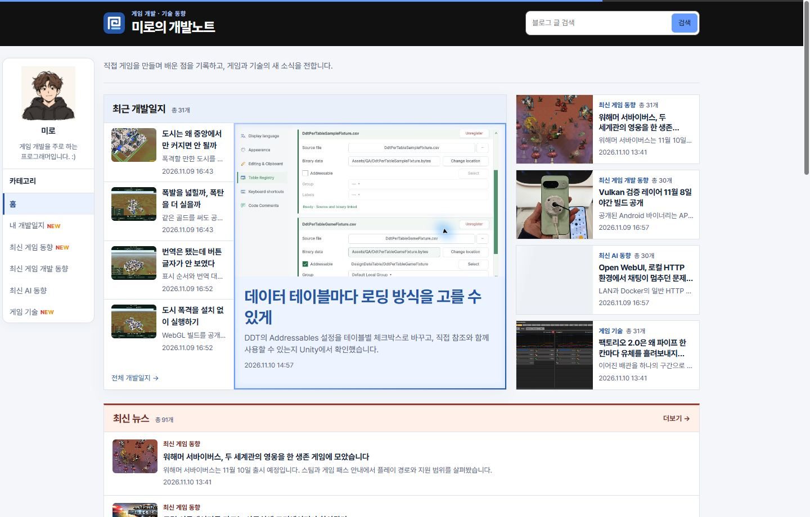
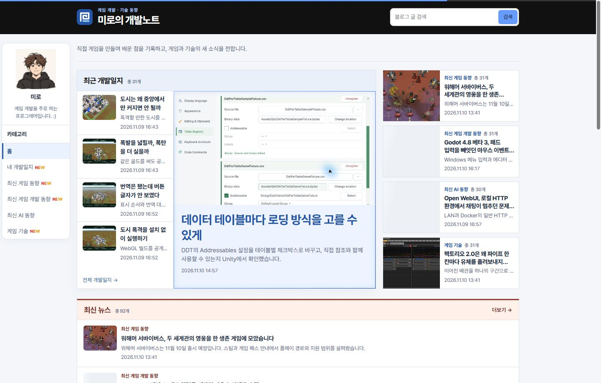
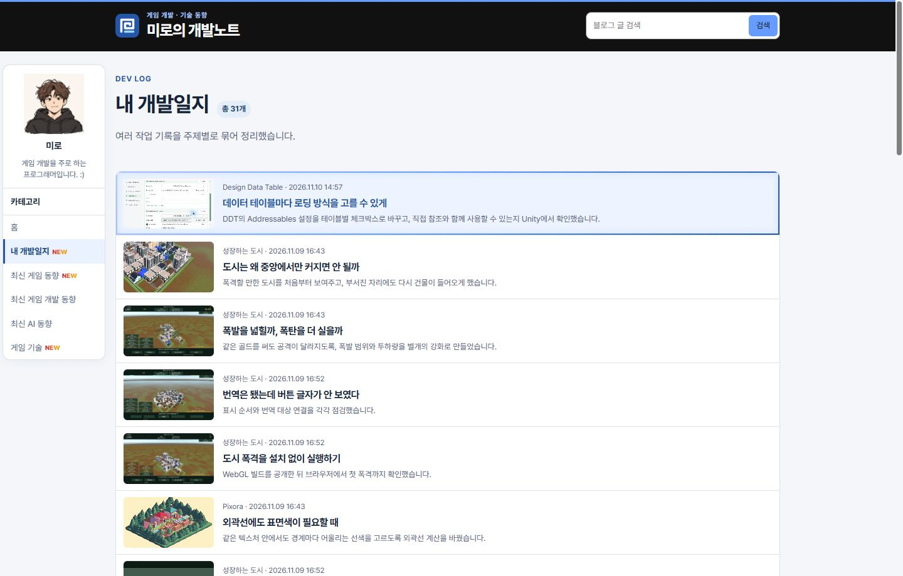

## 작업 결과

공개 홈과 게시판에서 강조선 네 변의 1px 적용을 확인했습니다.

## 변경 내용

### 적용 내용

공용 카드 호버 규칙의 외곽선 두께를 1px로 조정했습니다.

### 대화 기록

- 사용자 요청 요약 — 하늘색 카드 강조선을 더 얇게 해 달라고 요청했습니다.
- AI 결정 — 기존 2px을 1px로 조정했습니다.

## 검증

블로그 커밋 4559671을 푸시하고 공개 Chrome에서 실제 호버 시 네 변 모두 1px인 것을 확인했습니다.

## 남은 사항

전역·프로젝트 지침에 추가할 새 교훈은 없었습니다.

## 작업 시간

- 제안 시간: 수정과 로컬 확인 약 30초
- 실제로 완료된 시간: 블로그 공개 확인까지 약 1분 5초. 2026-11-10 16:20:27 KST
- XERJ: 미사용 — 코드 검색 근거가 제공되지 않았습니다.
