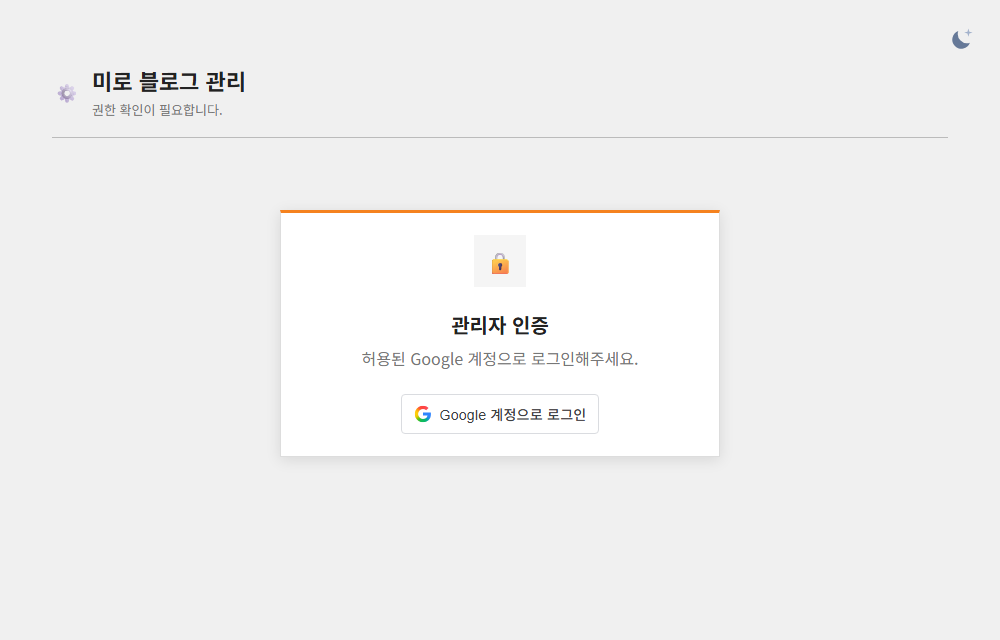
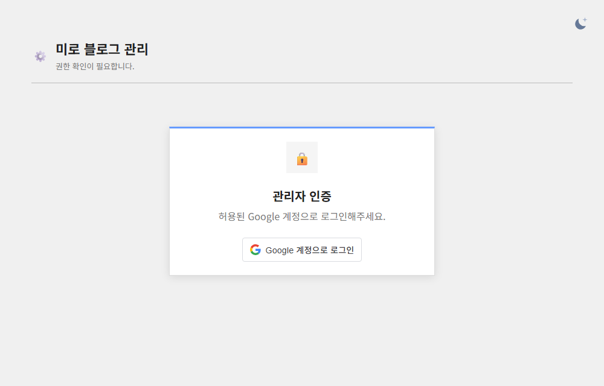

## 작업 결과

관리 로그인, 대시보드 차트와 버튼, 운영 도구의 강조색을 블로그의 하늘색 팔레트로 바꿨습니다. 탭 아이콘은 공개 블로그와 같은 SVG를 참조합니다.

## 변경 내용

### 적용 내용

운영 블로그에서 확인한 하늘색 값과 파비콘 경로를 사용했습니다.

### 대화 기록
- 사용자: 관리 화면 테마를 블로그와 맞추고 파비콘도 갱신하도록 요청했습니다.
- Codex: 운영 팔레트와 실제 SVG를 관리 화면에 반영했습니다.

교훈 검토: 운영 팔레트와 아이콘을 기준으로 대조했습니다. 지침 변경은 없습니다.

## 검증

Worker 버전 ae912138-e7ed-4b27-8052-49f34376e239. 공개 관리 HTML에서 하늘색과 파비콘 링크를 확인했고 파비콘 URL은 200 image/svg+xml을 반환했습니다.

## 남은 사항

로그인 후 운영 화면과 실제 브라우저 탭의 파비콘 표시를 직접 확인하지 못했습니다. 관리 Worker는 배포됐고 소스 변경은 로컬에 있습니다.

## 작업 시간

- 제안 시간: 1~2분
- 실제로 완료된 시간: 16:22:18 KST 확인 시작, 16:22:58 KST 운영 응답 확인. 약 40초.
- XERJ: 미사용 — 코드 검색 근거가 제공되지 않았습니다.
