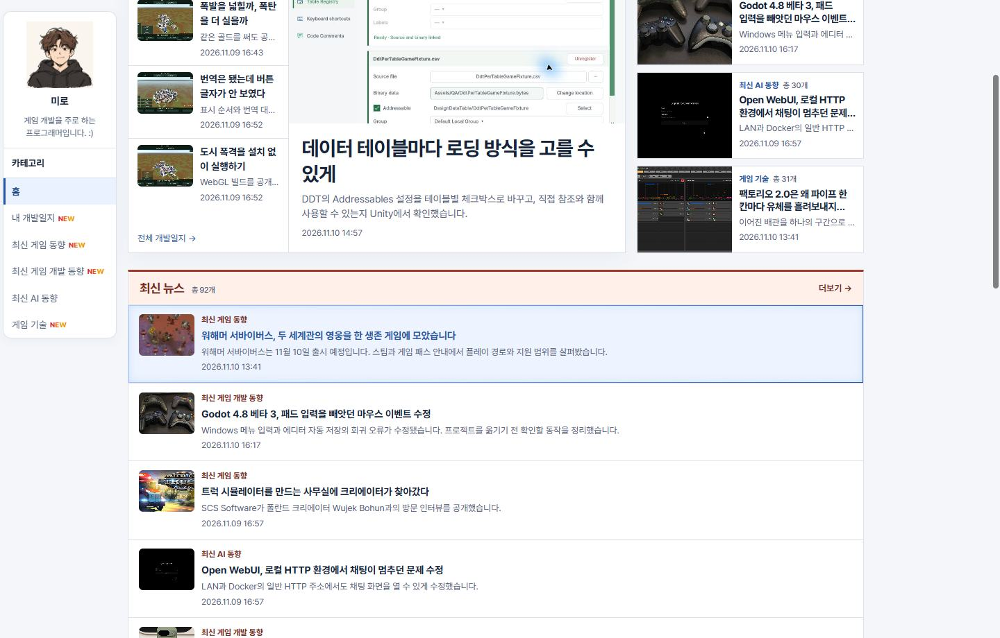
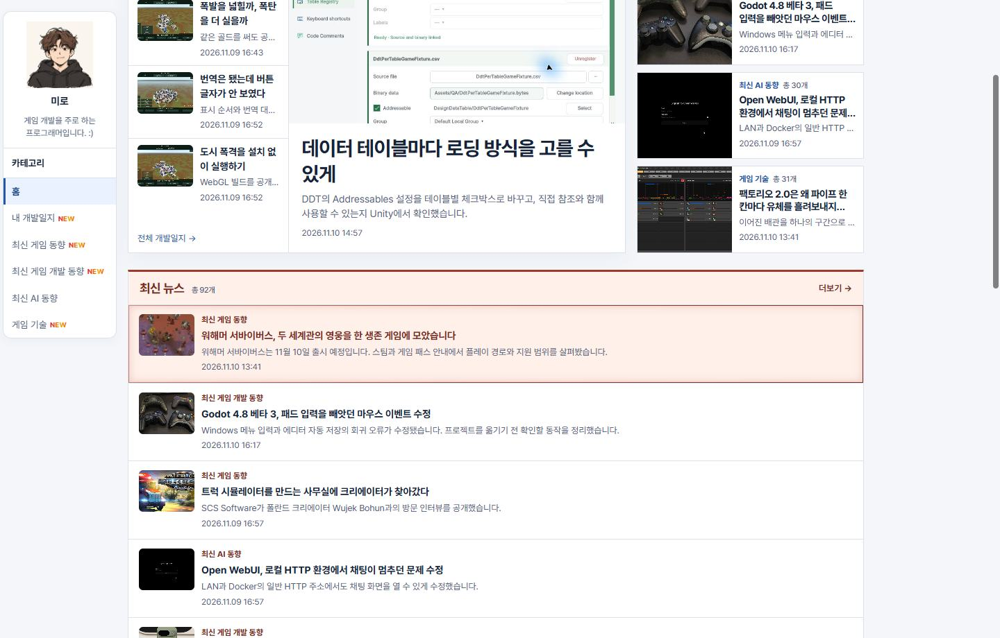
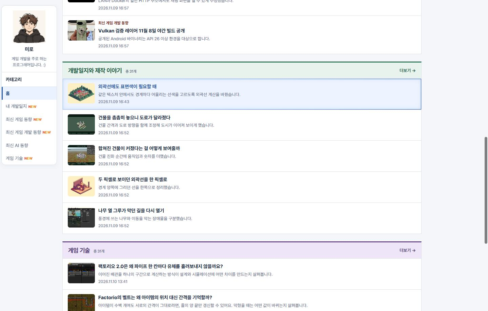
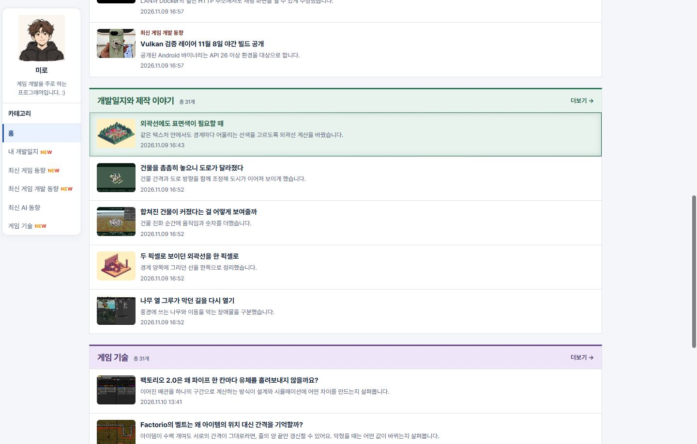
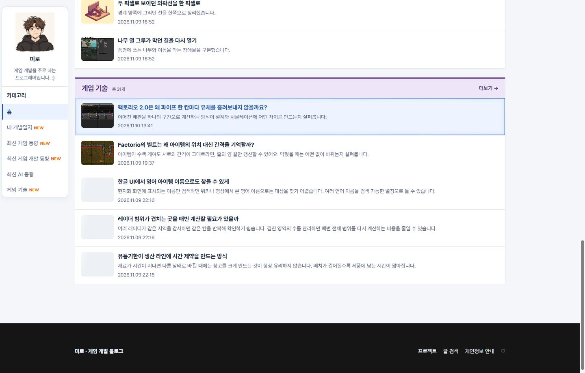
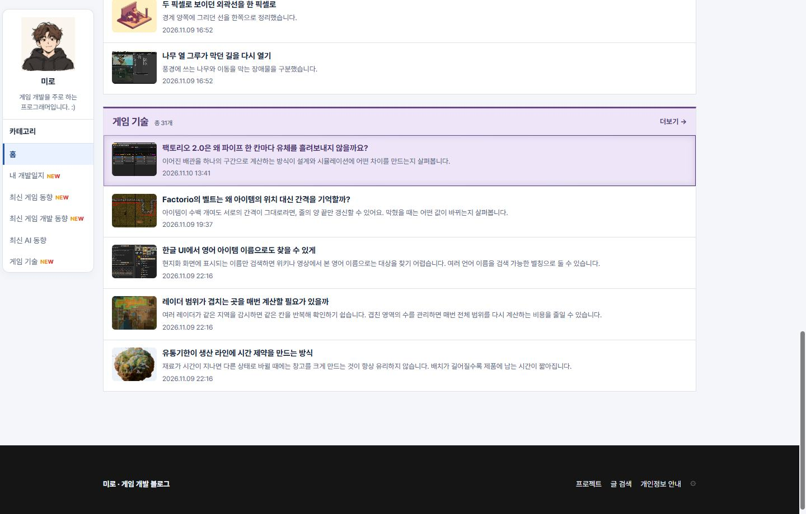

## 작업 결과

세 섹션의 제목과 카드 호버에 같은 색이 적용됩니다.

## 변경 내용

### 적용 내용

제목과 카드 강조가 같은 섹션 색상 값을 공유합니다.

### 대화 기록

- 사용자 요청 — ‘그 색에 맞게 강조 색상 적용해줘’
- AI 결정 — 기존에 별도 색이 있는 홈 섹션 세 곳에 해당 색을 적용했습니다.

## 검증

블로그 커밋 960c80c를 푸시했습니다. 공개 Chrome에서 세 섹션의 제목과 호버 배경색이 같고 외곽선이 1px임을 확인했습니다.

## 남은 사항

전역·프로젝트 지침 변경은 없습니다.

## 작업 시간

- 제안 시간: 수정과 로컬 확인 약 1분
- 실제로 완료된 시간: 블로그 공개 확인까지 약 4분 29초. 2026-11-10 16:28:18 KST
- XERJ: 미사용 — 코드 검색 근거가 제공되지 않았습니다.
