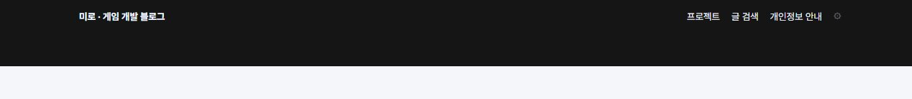
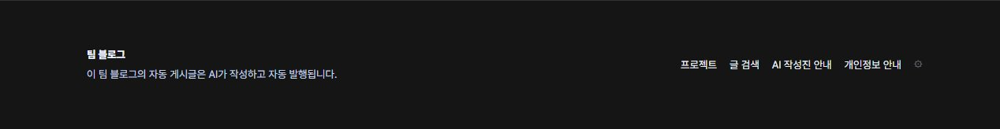
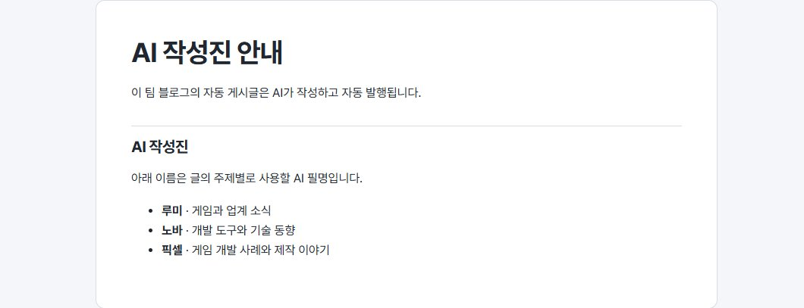

## 작업 결과

공개 블로그에서 팀 블로그 표기와 AI 작성진 안내 링크를 확인했습니다. 안내에는 주제별 AI 필명 루미·노바·픽셀을 소개합니다.

## 변경 내용

### 적용 내용

공용 푸터의 기존 문구를 ‘팀 블로그’로 교체하고 자동 게시글은 AI가 작성하고 자동 발행된다는 문구를 추가했습니다. 하단의 AI 작성진 안내에서 필명과 담당 주제를 확인할 수 있습니다.

### 대화 기록

- 사용자(개별 발언 시각 미기록) — ‘이 곳을 팀 블로그라고 적어줘’라고 요청하고, AI를 통해 발행된다는 안내와 AI 이름 목록 링크를 푸터에 추가해 달라고 했습니다.
- AI — 사람 이름처럼 읽히는 루미·노바·픽셀을 AI 필명으로 정하고 각각 게임 소식, 개발 기술, 제작 사례를 맡는 구성으로 구현했습니다.

## 검증

공개 사이트의 홈에서 변경 전후 푸터를 비교하고, 변경 후 안내 링크를 실제로 열어 안내 본문과 필명 세 개를 확인했습니다. 블로그 변경 커밋은 7838c3c12ca7977843268677aa005954e3ce1bb5입니다.

교훈 검토 결과, 새로 일반화할 규칙이 없어 전역·프로젝트 지침 변경 없음.

## 남은 사항

자동 게시 파이프라인과 게시글별 작성자 표기 연결은 별도 작업입니다.

## 작업 시간

- 제안 시간: 2~4분
- 실제로 완료된 시간: 블로그 반영 및 공개 브라우저 확인 약 3분 15초. 2026-11-10 16:29:11 KST 확인. 이후 중앙 보고서 공개 확인을 별도로 진행했습니다.
- XERJ: 미사용 — 빌드와 공개 웹페이지 확인에 사용하지 않았습니다.
