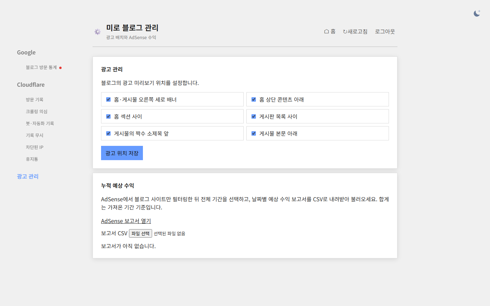

## 작업 결과

왼쪽 광고 관리 탭에서 광고 배치와 AdSense CSV를 사용할 수 있습니다. 예전 도구 주소는 광고 관리 탭으로 연결됩니다.

## 변경 내용

### 적용 내용

관리자 사이트맵 탭과 본문을 제거했습니다. 공개 sitemap.xml은 유지했습니다.

### 대화 기록
- 사용자: 왼쪽 패널에 광고 관리 탭을 만들고 사이트맵을 삭제하도록 요청했습니다.
- Codex: 광고 관리 탭 통합 및 운영 배포 결과를 확인했습니다.

교훈 검토: 지침 변경 없음.

## 검증

Worker 버전 1893dc78-1929-465c-baad-2d4d99586ddd. 운영 HTML에서 광고 탭과 폼·CSV, 사이트맵 UI 제거를 확인했습니다. 예전 경로는 303, 비로그인 광고 API는 401입니다. 로컬 Worker의 실제 브라우저에서 광고 탭이 열리고 저장된 체크 상태를 불러오는 것을 확인했습니다.

## 남은 사항

운영 로그인 세션을 사용할 수 없어 변경 전과 변경 후의 운영 관리자 캡처를 확보하지 못했습니다. 운영에서 광고 저장값은 변경하지 않았습니다. 소스는 로컬 변경 상태입니다.

## 작업 시간

- 제안 시간: 1~2분
- 실제로 완료된 시간: 16:33:46 KST 시작, 16:35:12 KST 배포 응답 확인, 16:35:48 KST 브라우저 캡처. 약 2분 2초.
- XERJ: 미사용 — 코드 검색 근거가 제공되지 않았습니다.
