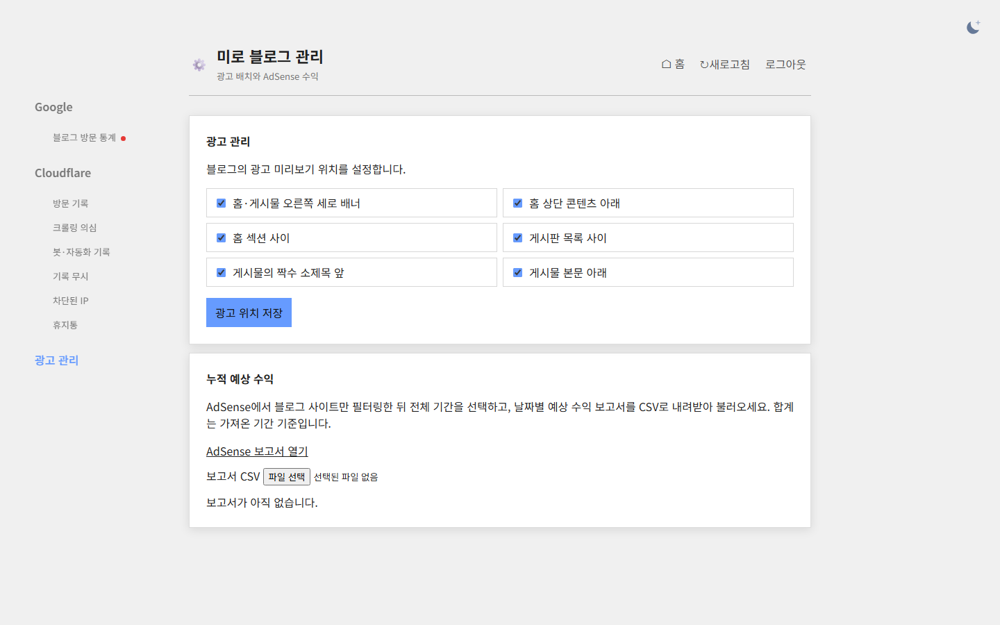
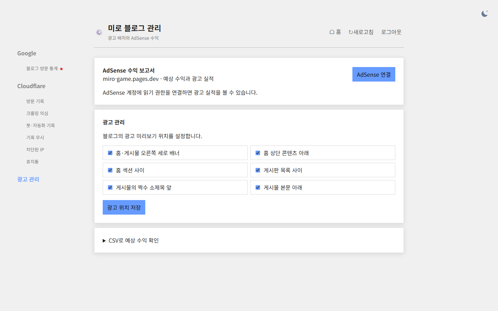

## 작업 결과

광고 관리 탭에서 기간별 예상 수익, 페이지뷰, 노출, 클릭, RPM, CTR과 게재율을 조회할 수 있도록 연결했습니다.

## 변경 내용

### 적용 내용

사용자 승인 후 브라우저가 Google 공식 API로 읽기 전용 보고서를 조회합니다. CSV는 보조 경로로 보존했습니다.

### 대화 기록
- 사용자: 광고 관리에서 예상 수익과 광고 실적을 조회하도록 요청했습니다.
- Codex: 수익 보고서를 운영에 배포하고 최초 승인 절차를 안내했습니다.

교훈 검토: 공식 API의 날짜·도메인 필터와 읽기 범위를 사용했습니다. 지침 변경 없음.

## 검증

Worker 버전 2b11e735-a80b-4c2a-9274-9c8591776100. 공개 HTML의 보고서 UI, 도메인 필터와 OAuth 읽기 범위를 확인했습니다. 아래는 실제 로컬 Worker 브라우저 전후 화면입니다.

## 남은 사항

실제 AdSense 계정의 권한 승인이 필요하며 운영 수익 데이터 조회와 운영 로그인 후 화면은 미확인입니다. 관리자 소스는 로컬 변경 상태입니다.

## 작업 시간

- 제안 시간: 3~5분
- 실제로 완료된 시간: 16:41:50 KST 확인 시작, 16:43:54 KST 운영 응답 확인, 16:44:09 KST 로컬 화면 캡처. 약 2분 19초.
- XERJ: 미사용 — 코드 검색 근거가 제공되지 않았습니다.
