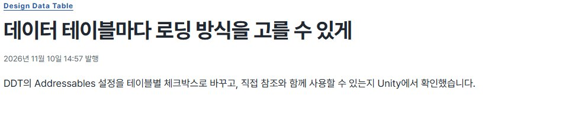
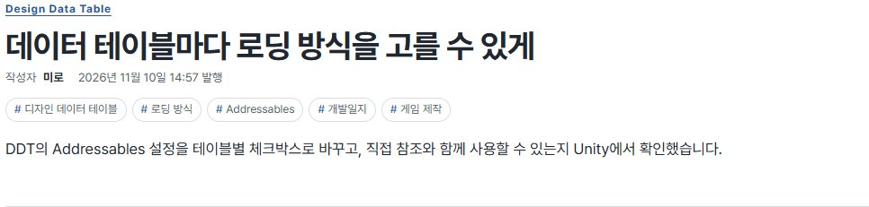
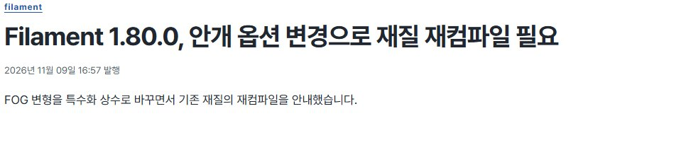
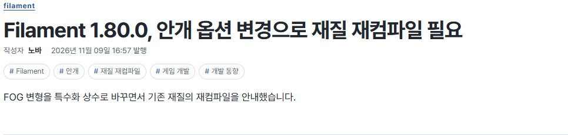
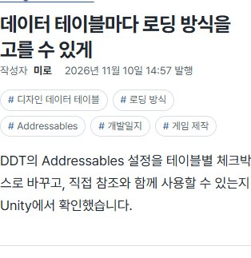
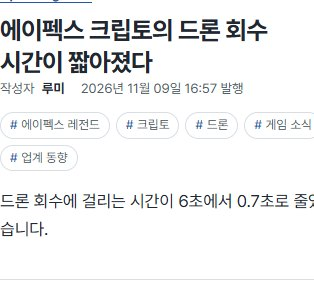

## 작업 결과

공개 블로그의 게시글 제목 아래에서 작성자, 발행일, 태그 다섯 개를 확인했습니다.

## 변경 내용

### 적용 내용

개발일지는 미로, 게임 동향은 루미, 게임 개발·AI 동향은 노바, 게임 기술은 픽셀로 표시합니다. 작성자 줄에는 ‘작성자’와 이름만 표시합니다. 태그는 글마다 핵심 소재 세 개와 분류 태그 두 개를 기본으로 골랐습니다. 새 원고에서 태그 다섯 개를 지정할 수 있고, 지정하지 않으면 제목과 분류로 기본값을 생성합니다.

### 대화 기록

- 사용자(개별 발언 시각 미기록) — ‘내 개발일지만 내 닉네임을 쓰고’ 나머지 글에는 작성진 이름을 넣고, 글마다 태그 5개와 작성자를 표시하되 ‘거기서는 AI라고 표현하지마’라고 요청했습니다.
- AI — 기존 필명 세 개를 게시판에 대응시켰고, 제목 아래에서 작성자·발행일·태그를 함께 읽을 수 있게 배치했습니다.

## 검증

최신 공개 브랜치의 원고 154개에 중복 없는 태그 다섯 개를 확인했습니다. 로컬에서 생성된 글 상세 153개에 각 게시판에 해당하는 작성자와 태그 다섯 개가 생성됐습니다. 공개 사이트에서 필명 네 종류의 변경 전후 화면과 두 글의 390px 표시를 확인했습니다. 적용 커밋은 d6cf4c0입니다.

교훈 검토 결과, 작성자·태그 운영 기준을 github-blog 프로젝트 전용 지침에 추가했습니다. 전역 지침은 변경하지 않았습니다.

## 남은 사항

없음

## 작업 시간

- 제안 시간: 5~8분
- 실제로 완료된 시간: 블로그 구현과 공개 화면 확인 약 4분 24초. 2026-11-10 16:45:46 KST 확인. 이후 중앙 보고서 배포를 별도로 확인했습니다.
- XERJ: 미사용 — 사용하지 않았습니다.
