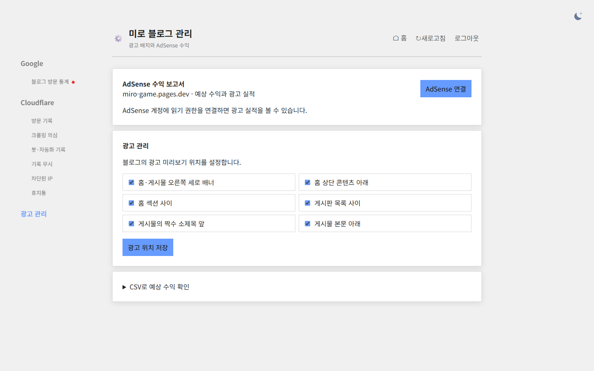
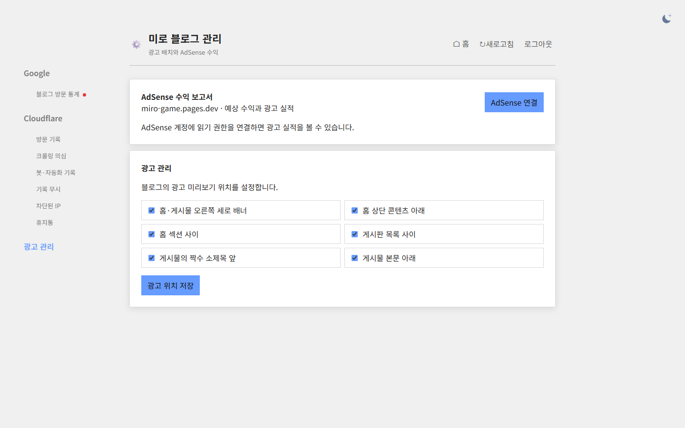

## 작업 결과

광고 관리 탭에서 AdSense 직접 조회와 광고 배치 설정을 사용합니다.

## 변경 내용

### 적용 내용

수익 CSV 가져오기 UI, 파일 읽기 및 계산 코드를 제거했습니다.

### 대화 기록
- 사용자: CSV 예상 수익 확인 기능 삭제를 요청했습니다.
- Codex: 광고 관리 UI와 처리 코드를 삭제하고 운영에 배포했습니다.

교훈 검토: 지침 변경 없음.

## 검증

Worker 버전 4a75e0e0-45ab-45a0-8bfb-f8fe01fc60e9. 공개 HTML에서 CSV 메뉴와 처리 코드가 사라지고 AdSense 보고서가 남아 있음을 확인했습니다. 같은 크기의 로컬 Worker 실제 브라우저 화면을 비교했습니다.

## 남은 사항

운영 계정의 AdSense 실제 조회는 이번 변경의 검증 범위에 포함하지 않았습니다. 관리자 소스는 로컬 변경 상태입니다.

## 작업 시간

- 제안 시간: 30초~1분
- 실제로 완료된 시간: 17:04:26 KST 시작, 17:04:55 KST 운영 확인, 17:05:12 KST 로컬 화면 캡처. 약 46초.
- XERJ: 미사용 — 코드 검색 근거가 제공되지 않았습니다.
