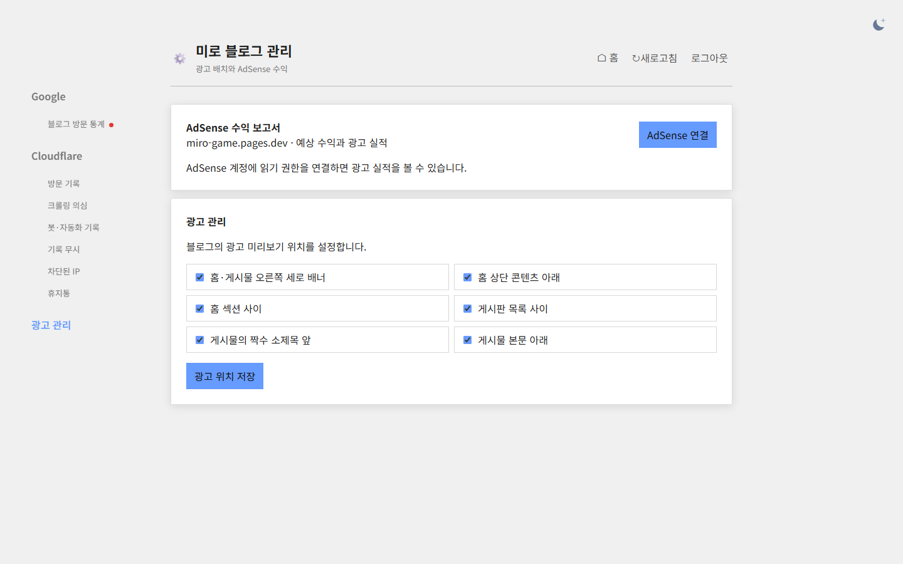
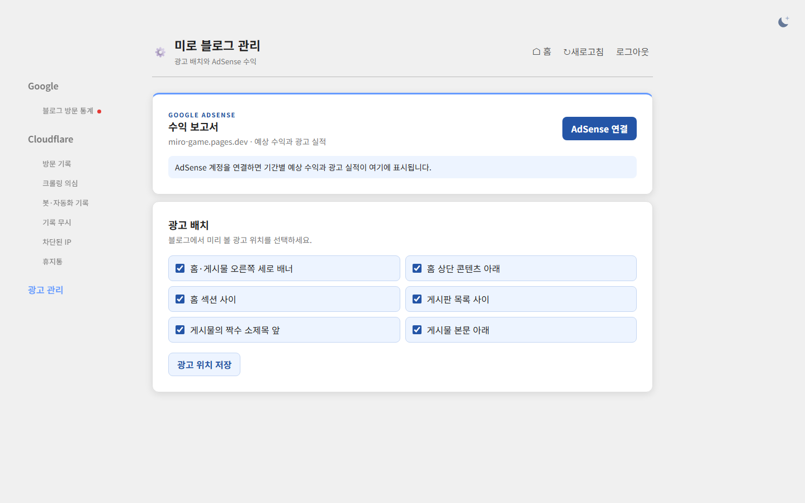

## 작업 결과

AdSense 연결과 광고 위치 저장의 버튼 스타일을 구분하고, 선택 항목과 수익 안내를 하늘색 패널로 정리했습니다.

## 변경 내용

### 적용 내용

버튼 대비·여백·키보드 초점과 광고 위치 선택 표시를 다듬고 연결 후 통계 카드·일별 표의 스타일을 정의했습니다.

### 대화 기록
- 사용자: 광고 관리 버튼과 보고서 화면 디자인 개선을 요청했고 AdSense는 미연결이라고 알렸습니다.
- Codex: 미연결 화면을 브라우저로 비교하고 운영에 반영했습니다.

교훈 검토: 지침 변경 없음.

## 검증

Worker 버전 d52f5cb8-d35d-4b8b-bbc5-9a73309e0ee2. 동일한 크기의 로컬 Worker에서 미연결 화면을 비교했습니다. 운영 HTML과 CSS에 변경을 확인했습니다.

## 남은 사항

실제 AdSense 연결 후 수익 카드와 일별 표는 미확인입니다. 관리자 소스는 로컬 변경 상태입니다.

## 작업 시간

- 제안 시간: 2~3분
- 실제로 완료된 시간: 17:11:56 KST 시작, 17:12:50 KST 로컬 화면 캡처, 17:13:28 KST 운영 반영 확인. 약 1분 32초.
- XERJ: 미사용 — 코드 검색 근거가 제공되지 않았습니다.
